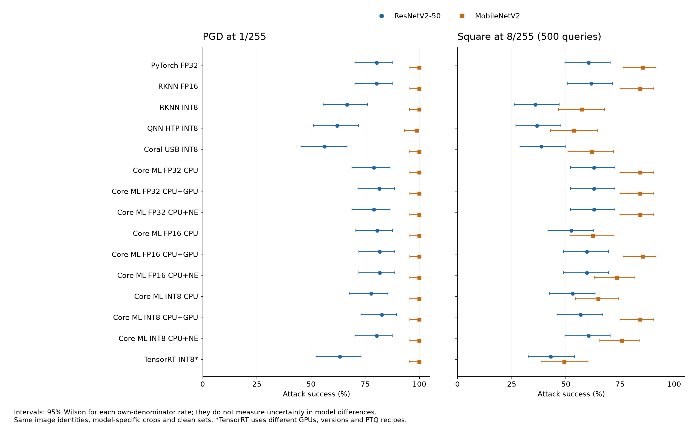
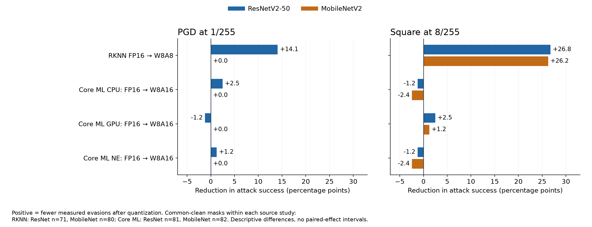
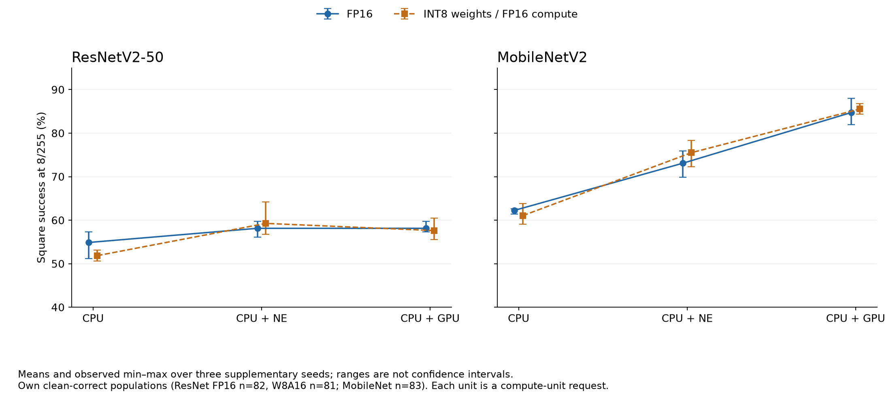

# Runtime and quantization effects depend on the model and the attack

**ResNetV2-50 versus MobileNetV2 — retained results through 10 November 2026
(Hong Kong time).** This report compares the two archived model families,
building on the new [ResNetV2-50 cross-runtime report](resnetv2_50/RESNETV2_50_CROSS_RUNTIME_REPORT.md)
and [MobileNetV2 cross-runtime report](mobilenetv2/MOBILENETV2_REPORT.md).
“ResNet” here means the timm pre-activation ResNetV2-50 checkpoint, not the
historical TorchVision ResNet-50 experiments.

## Executive summary

- **The second model changes the small-budget quantization conclusion.** On
  RKNN study-level common-clean cohorts, FP16 → INT8 reduces ResNet PGD 1/255
  evasion from 55/71 to 45/71 (**14.08 points**), but MobileNet stays 80/80 in
  both precisions (**0 points**). The retained quantized MobileNet does not
  inherit ResNet's observed small-budget PGD resistance.
- **Some effects reproduce across models.** The same RKNN comparison reduces
  Square 8/255 success by **26.76 points for ResNet and 26.25 for MobileNet**.
  Activation-quantized artifacts impede this finite-query attack on both
  models, while the PGD effect depends on the model.
- **Runtime effects also interact with the model.** For Core ML FP16 on each
  model's common-clean cohort, GPU versus CPU increases Square 8/255 success
  by **6/81 (7.41 points) for ResNet** and **19/82 (23.17 points) for MobileNet**.
  Three extra seeds retain a much wider CPU-to-GPU spread for MobileNet.
- **Weight-only INT8 is not a substitute for activation quantization.** Core
  ML FP16 → W8A16 has small, mixed-direction changes on both models. Neither
  architecture choice nor a lower bit-width label supplies a general defense.
  At 8/255, the retained PGD/BPDA campaigns evade almost every eligible image.

## What this two-model comparison controls

The primary evidence includes **19 ResNet and 20 MobileNet configurations**,
with **15 deployment labels paired across model families** (TensorRT INT8 is
only an approximate platform match). A reporting reconciliation checked 842
conditions against 39 original-summary hashes. It also compared the ordered
image SHA-256s, indices and labels: both models use the **same 100 source
images**. These are two separately trained checkpoints and architectures, not
two random replicates of one treatment.

| Comparison dimension | Held consistent or recorded difference | Interpretation |
| --- | --- | --- |
| Image identity / labels | Same 100 source JPEG hashes and original 1,000-class labels | Removes a change in source image sample |
| Crop tensors | ResNet: resize 232 bilinear; MobileNet: resize 256 bicubic/antialias; both crop 224 | Model identity is confounded with preprocessing in between-model differences |
| Threat and nominal budget | Untargeted pixel L∞; 1, 2, 4, 8/255; FGSM, PGD 20×2, PGD+ 100×5 at 1/255; Square 500 queries | Common attack settings, but gradients and optimization trajectories differ |
| Clean eligibility | Each deployment's own clean-correct images; study-level intersections only where retained | No global matched 39-arm cohort; own-denominator comparisons are descriptive |
| Native runtime scores | Actual target runtime/board; recorded replicas supply approximate gradients where needed | Missing native gradients are not treated as resistance |
| Quantization | Calibration data/counts, formats, activation precision and operator recipes vary | Runtime/precision associations do not identify a pure hardware or bit-width effect |
| Core ML requests | Same recorded OS/runtime family and CPU/GPU/NE requests for both models | Stronger fixed-platform comparison, but per-model graphs and planned operations differ |
| TensorRT | ResNet: TRT 10.9 / Ada; MobileNet: TRT 11.3 / Blackwell | Paired INT8 row is not a controlled same-hardware runtime contrast |

The two original sample ledgers and their hashes are retained in
[the source index](cross_runtime/source_index.json). There is no new
cross-model transfer experiment: separately optimized candidates are compared
here, not one model's candidates scored on the other model.

## The model gap is largest for low-budget gradient attacks

The table uses each deployment's **own clean-correct denominator**. Positive
delta means MobileNet has more successful evasion. It is a descriptive rate
difference, not a paired per-image causal effect. The TensorRT pair differs in
GPU, runtime version and quantization recipe.

| Deployment | ResNet PGD 1 | MobileNet PGD 1 | MobileNet − ResNet (pp) | ResNet Square 8 | MobileNet Square 8 |
| --- | ---: | ---: | ---: | ---: | ---: |
| PyTorch FP32 | 65/81 (80.2%) | 83/83 (100.0%) | +19.8 | 49/81 (60.5%) | 71/83 (85.5%) |
| RKNN FP16 | 65/81 (80.2%) | 83/83 (100.0%) | +19.8 | 50/81 (61.7%) | 70/83 (84.3%) |
| RKNN INT8 | 52/78 (66.7%) | 80/80 (100.0%) | +33.3 | 28/78 (35.9%) | 46/80 (57.5%) |
| QNN HTP INT8 | 49/79 (62.0%) | 77/78 (98.7%) | +36.7 | 29/79 (36.7%) | 42/78 (53.8%) |
| Coral USB INT8 | 45/80 (56.2%) | 79/79 (100.0%) | +43.8 | 31/80 (38.8%) | 49/79 (62.0%) |
| Core ML FP32 CPU | 64/81 (79.0%) | 83/83 (100.0%) | +21.0 | 51/81 (63.0%) | 70/83 (84.3%) |
| Core ML FP32 CPU+GPU | 66/81 (81.5%) | 83/83 (100.0%) | +18.5 | 51/81 (63.0%) | 70/83 (84.3%) |
| Core ML FP32 CPU+NE | 64/81 (79.0%) | 83/83 (100.0%) | +21.0 | 51/81 (63.0%) | 70/83 (84.3%) |
| Core ML FP16 CPU | 66/82 (80.5%) | 83/83 (100.0%) | +19.5 | 43/82 (52.4%) | 52/83 (62.7%) |
| Core ML FP16 CPU+GPU | 67/82 (81.7%) | 83/83 (100.0%) | +18.3 | 49/82 (59.8%) | 71/83 (85.5%) |
| Core ML FP16 CPU+NE | 67/82 (81.7%) | 83/83 (100.0%) | +18.3 | 49/82 (59.8%) | 61/83 (73.5%) |
| Core ML INT8 CPU | 63/81 (77.8%) | 83/83 (100.0%) | +22.2 | 43/81 (53.1%) | 54/83 (65.1%) |
| Core ML INT8 CPU+GPU | 67/81 (82.7%) | 83/83 (100.0%) | +17.3 | 46/81 (56.8%) | 70/83 (84.3%) |
| Core ML INT8 CPU+NE | 65/81 (80.2%) | 83/83 (100.0%) | +19.8 | 49/81 (60.5%) | 63/83 (75.9%) |
| TensorRT INT8 (different recipe/hardware) | 50/79 (63.3%) | 79/79 (100.0%) | +36.7 | 34/79 (43.0%) | 39/79 (49.4%) |

The chart shows per-cell **95% Wilson intervals**, not confidence intervals
for the model gap. MobileNet is easier to evade under the recorded PGD 1/255
campaign in every paired label, but this cannot be attributed to architecture
alone. For PyTorch the gap is **100.0% − 80.2% = 19.8 points**; for Coral it is
**100.0% − 56.2% = 43.8 points**. At 8/255 these large PGD differences mostly
collapse: MobileNet reaches 100% on every deployment, ResNet float reaches
100%, and a few ResNet quantized configurations retain one or two survivors.

Square 8/255 success is also higher for MobileNet in every paired row here, but the
size of the gap varies: Core ML FP16 CPU is 62.7% versus ResNet's 52.4%, while
Core ML FP16 GPU is 85.5% versus 59.8%. Device ordering and the size of the
model gap therefore cannot be reduced to one constant model offset.
The complete FGSM, PGD, Square, random and transfer conditions are in the
[condition ledger](cross_runtime/all_conditions.csv); these rates must not be
averaged across runtimes as if the repeated 100-image runs were independent
samples or a larger combined test set.

## Quantization changes the two models differently under PGD

Define **reduction in evasion = FP16 success rate − quantized success rate**.
Positive values mean fewer measured evasions after quantization. Each row
below uses the **same common-clean mask within that study**: RKNN ResNet n=71,
RKNN MobileNet n=80, Core ML ResNet n=81 and Core ML MobileNet n=82. Those
different masks prevent interpreting the difference of reductions as a
randomized architecture effect.

| Within-study precision comparison | ResNet PGD 1 reduction | MobileNet PGD 1 reduction | ResNet Square 8 reduction | MobileNet Square 8 reduction |
| --- | ---: | ---: | ---: | ---: |
| RKNN FP16 → INT8 | +14.08 pp (55→45/71) | +0.00 pp (80→80/80) | +26.76 pp (40→21/71) | +26.25 pp (67→46/80) |
| Core ML CPU: FP16 → W8A16 | +2.47 pp (65→63/81) | +0.00 pp (82→82/82) | -1.23 pp (42→43/81) | -2.44 pp (51→53/82) |
| Core ML CPU+GPU: FP16 → W8A16 | -1.23 pp (66→67/81) | +0.00 pp (82→82/82) | +2.47 pp (48→46/81) | +1.22 pp (70→69/82) |
| Core ML CPU+NE: FP16 → W8A16 | +1.23 pp (66→65/81) | +0.00 pp (82→82/82) | -1.23 pp (48→49/81) | -2.44 pp (60→62/82) |

The RKNN PGD reduction differs by **14.08 points** between models; under PGD+
it differs by **18.31 points** (ResNet 64→51/71, MobileNet 80→80/80). Under
Square 8/255, the reductions differ by only **0.51 points**. Thus “quantization
has less effect on MobileNet” would also be too broad: it is true of these
gradient attacks, while the score-only reduction is similar in magnitude.

The Core ML comparisons help distinguish precision mechanisms. Both sides
already use FP16 computation; W8A16 compresses the weights. Its changes are
small and inconsistent in direction. The retained activation-quantized RKNN
artifacts show a larger Square reduction in both models. This pattern is
consistent with activation/output quantization and deployed arithmetic
contributing to finite-query difficulty, but **does not isolate that cause**:
calibration, graph transformations, operator implementations and approximation
quality are not independently manipulated. Evidence counts and formulas are
in [quantization_effects.json](cross_runtime/quantization_effects.json).

MobileNet's TensorRT study adds a useful boundary case on a shared n=78:
Square 8/255 is 66/78 FP32, 40/78 FP8, 38/78 INT8 and 66/78 mixed INT4. PGD
1/255 is 78/78 in every precision. INT4 quantizes only the classifier weights,
so these rows cannot be interpreted as a monotonic network-wide bit-width
experiment. ResNet has no matching TensorRT FP8/INT4 attacks; those model
interactions remain unmeasured.

## The Core ML device gap is larger for MobileNet

On the common-clean cohorts, FP16 GPU-minus-CPU Square 8/255 success is
**7.41 points** for ResNet and **23.17** for MobileNet, a descriptive
between-model gap-of-gaps of **15.76 points**. W8A16 gives **3/81 (3.70 points)**
and **16/82 (19.51 points)** respectively. These are same-precision device
contrasts, so weight compression alone cannot explain the device gap.

Extra Square seeds provide a sensitivity check. Values below are
**mean [observed min–max]** at 8/255, with each configuration's own eligibility.
Means are recomputed from integer counts before rounding; ranges are not
confidence intervals.

| Model / precision | CPU | CPU+NE | CPU+GPU |
| --- | ---: | ---: | ---: |
| ResNetV2-50 / FP16 | 54.9% [51.2–57.3] | 58.1% [56.1–59.8] | 58.1% [57.3–59.8] |
| ResNetV2-50 / W8A16 | 51.9% [50.6–53.1] | 59.3% [56.8–64.2] | 57.6% [55.6–60.5] |
| MobileNetV2 / FP16 | 62.2% [61.4–62.7] | 73.1% [69.9–75.9] | 84.7% [81.9–88.0] |
| MobileNetV2 / W8A16 | 61.0% [59.0–63.9] | 75.5% [72.3–78.3] | 85.5% [84.3–86.7] |

For FP16, the mean GPU-minus-CPU spread is **3.25 points for ResNet** versus
**22.49 for MobileNet**. For W8A16 it is **5.76 versus 24.50 points**.
MobileNet has disjoint CPU < NE < GPU seed ranges in both precisions.
ResNet's CPU is lowest on average, but FP16 CPU/GPU ranges touch and GPU/NE
often overlap. These are three repeated attacks on the same pilot images,
not three independent image cohorts or a confidence interval for the spread.

The retained diagnostics suggest different numerical environments: MobileNet
CPU/NE margins change more coarsely than GPU, while ResNet scores are
fine-grained on all three. That helps frame a mechanism hypothesis but does
not explain the CPU-versus-NE gap or establish that output rounding alone
causes the interaction. [ResNet Core ML diagnostics](resnetv2_50/evasion_coreml/results/supplementary/square_seeds.json),
[MobileNet diagnostics](mobilenetv2/evasion_coreml/results/supplementary/square_seeds.json).

## Clean accuracy and compute precision remain part of the result

The base PyTorch pilot has **81/100 ResNet** and **83/100 MobileNet** correct;
RKNN INT8 has **78 and 80**, QNN HTP **79 and 78**, and Coral **80 and 79**.
The model with higher clean accuracy therefore depends on the deployment.
Using each model's own correct subset prevents initially wrong predictions
from being called attack successes, but it also changes the conditional
population. Stronger conclusions require the same per-image eligibility
and preprocessing decision to be made explicitly.

Core ML W8A16 retains **81/100 ResNet** and **83/100 MobileNet** clean accuracy
on this pilot. That is not comparable to a full W8A8 deployment merely because
both names contain INT8. FP32 `CPU_AND_NE` is planned on CPU for both models;
it is not a third FP32 accelerator measurement. A model cannot be selected
as a defense based on these finite-attack outcomes alone.

Latency is intentionally not pooled across models or runtime reports: the
retained measurements use different devices and graph/pipeline/network
boundaries. The Q6A and RKNN reports remain the appropriate performance
sources. This analysis establishes no common energy, speed or memory ranking.

## What the second model adds, and what remains unresolved

The second model acts as an **additional comparison factor**. It demonstrates
that a pattern seen in one base model can disappear for a different base under
one attack and persist under another. The supportable conclusion is an
interaction among **model/checkpoint/preprocessing, deployed representation,
runtime/device arithmetic and attack budget**. With two checkpoints, it is not
an estimate of the average effect across model architectures or a causal
architecture-only claim.

To isolate that interaction, the next experiment would use a declared common
preprocessing rule, shared calibration identities/counts where feasible,
matched hardware/runtime versions, clean-correct intersection by image hash,
multiple primary attack seeds and stronger adaptive searches. Report both
own-population and common-population results, plus clean accuracy. Keep
weight-only and activation-quantized conditions distinct. None of those
unperformed controls is implied by the current synthesis.

This archive supports a reproducible descriptive comparison today. It does
not support a 39-arm per-image union, cross-model candidate portability,
certified robustness, full ImageNet accuracy or statistical significance of
the reported interaction. The two ResNet TensorRT arms retain their documented
replica-gate override; Core ML per-image candidate files remain outside the
archive. Missing ResNet TFLite CPU, FP8/INT4 and MobileNet ORT-INT8 campaigns
are unmeasured cells, not zeros.

## Evidence and reproduction

- [Normalized 39-deployment results](cross_runtime/normalized_results.json),
  [all 842 conditions with per-cell Wilson intervals](cross_runtime/all_conditions.csv).
- [Cross-model rate differences](cross_runtime/cross_model_comparisons.json),
  [matched-study quantization differences](cross_runtime/quantization_effects.json),
  [recomputed seed means and ranges](cross_runtime/square_seed_results.json).
- [Exact input hashes and calculation rules](cross_runtime/source_index.json),
  [chart values](cross_runtime/chart_data.json), [validation record](cross_runtime/validation.json).
- Run `python docs/reports/cross_runtime/build_reports.py` from the archive root
  with NumPy and Matplotlib. It reads archive-local sources and regenerates
  derived evidence, table fragments and figures without inference or attacks.
  Markdown narratives are maintained separately; refresh the archive manifest
  and checksum ledger after edits.
