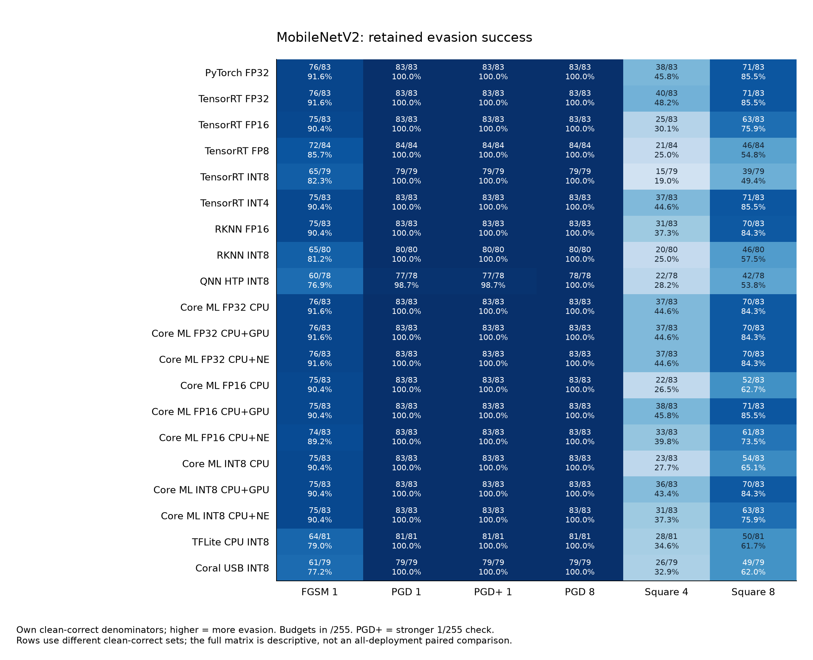

# MobileNetV2 cross-runtime evasion: PGD saturates while score-only attacks depend on deployment

Results through **10 November 2026 (Hong Kong time)**. Model: TorchVision
MobileNetV2 `IMAGENET1K_V1`, checkpoint `b0353104…9889`, canonical ONNX
`9f2d5d94…3a77`. This is the first standalone cross-runtime synthesis in this
archive: **20 configurations** spanning PyTorch, TensorRT, RKNN, QNN,
TFLite/Coral and Core ML. Existing runtime-specific reports remain the detailed
experiment records.

## Executive summary

- **Gradient attacks overwhelm every configuration at small budgets.** At
  1/255, PGD fools every clean-correct image in 19 of 20 configurations; QNN
  HTP is 77/78 (98.7%). At 2/255 and 8/255 all 20 reach 100% success.
  Quantization does not provide a substantial PGD barrier on this model.
- **Score-only outcomes differ much more.** At Square 8/255 with 500 queries,
  the full matrix ranges from TensorRT INT8 **39/79 (49.4%)** to TensorRT
  FP32/INT4 and Core ML FP16 GPU **71/83 (85.5%)**. These are conditional rates
  on different eligible sets; the matched-study analyses below confirm that
  membership alone does not explain the main differences.
- **Runtime/device matters even at fixed precision.** On Core ML's shared 82
  images, FP16 Square 8/255 is 51/82 on CPU, 60/82 on Neural Engine and 70/82
  on GPU. The same ordering persists across all three supplementary seeds.
- **Weight-only compression differs from full activation quantization.** Core
  ML W8A16 adds no consistent Square resistance over FP16 on the same compute
  request. TensorRT INT4 quantizes only the classifier weights; it does not
  represent an all-INT4 network. The INT8/INT4 labels cannot be ranked as a
  universal robustness scale.

## Measurement and comparison rules

The cohort is 100 stratified Imagenette validation images, ten per class, seed
`20261030`, with predictions over the original 1,000 ImageNet classes. All
attacks are untargeted digital input attacks in pixel space before ImageNet
normalization. Budgets are L∞ **1, 2, 4 and 8/255**. FGSM is one step; primary
PGD/BPDA uses 20 steps, two starts and step size ε/4. **PGD+** retains primary
successes and adds a 100-step, five-start search on 1/255 survivors. Square is
score-only, capped at 500 search queries per eligible image at 4 and 8/255.
Random perturbations and FP32 transfer candidates remain in the complete
evidence tables. Every scored forward pass belongs to the actual deployment;
forward-only runtimes use the recorded differentiable replica/BPDA for the
backward pass. This report does not rerun inference or attacks.

**Attack success = fooled / that deployment's clean-correct images.** Higher
means more successful evasion. Clean accuracy is clean-correct /100.
**Robust accuracy for one condition = (clean-correct − fooled) /100**; this
counts initially incorrect images as incorrect and is not `100 − attack success`.
It is also not an attack-union result. Different eligible sets make the full
cross-runtime table descriptive. A common-clean table controls that particular
membership difference within its stated study; separate common-clean tables
must not be merged into one cohort.

All displayed values are recomputed from integer counts. Per-cell 95% Wilson
intervals describe sampling uncertainty for this pilot, not attack-search
variability, a certified radius or uncertainty in a paired difference. Three
extra Core ML Square seeds provide a separate search-variability check. No
formal significance test or confidence interval for runtime/model differences
is claimed.

MobileNet uses RGB, shorter-side resize **256 with bicubic interpolation and
antialiasing**, center crop 224 and ImageNet normalization. TFLite/Coral accept
raw RGB UINT8 NHWC and embed normalization; QNN's native UINT8 input instead
encodes normalized NCHW floats. These interfaces are different and must not be
interchanged. [Input contracts](../../RUNTIMES.md).

## All 20 deployments

Each cell is **fooled / own clean-correct (percentage)**. Budgets are /255.
Core ML INT8 is W8A16. FP32 `CPU_AND_NE` has CPU placement, so a request label
does not by itself establish Neural Engine execution.

| Deployment | Clean /100 | FGSM 1 | PGD 1 | PGD+ 1 | PGD 8 | Square 4 | Square 8 |
| --- | ---: | ---: | ---: | ---: | ---: | ---: | ---: |
| [PyTorch FP32](evasion_rknn/results/run/pytorch_fp32/summary.json) | 83 | 76/83 (91.6%) | 83/83 (100.0%) | 83/83 (100.0%) | 83/83 (100.0%) | 38/83 (45.8%) | 71/83 (85.5%) |
| [TensorRT FP32](evasion_trt/results/fp32/summary.json) | 83 | 76/83 (91.6%) | 83/83 (100.0%) | 83/83 (100.0%) | 83/83 (100.0%) | 40/83 (48.2%) | 71/83 (85.5%) |
| [TensorRT FP16](evasion_trt/results/fp16/summary.json) | 83 | 75/83 (90.4%) | 83/83 (100.0%) | 83/83 (100.0%) | 83/83 (100.0%) | 25/83 (30.1%) | 63/83 (75.9%) |
| [TensorRT FP8](evasion_trt/results/fp8/summary.json) | 84 | 72/84 (85.7%) | 84/84 (100.0%) | 84/84 (100.0%) | 84/84 (100.0%) | 21/84 (25.0%) | 46/84 (54.8%) |
| [TensorRT INT8](evasion_trt/results/int8/summary.json) | 79 | 65/79 (82.3%) | 79/79 (100.0%) | 79/79 (100.0%) | 79/79 (100.0%) | 15/79 (19.0%) | 39/79 (49.4%) |
| [TensorRT INT4](evasion_trt/results/int4/summary.json) | 83 | 75/83 (90.4%) | 83/83 (100.0%) | 83/83 (100.0%) | 83/83 (100.0%) | 37/83 (44.6%) | 71/83 (85.5%) |
| [RKNN FP16](evasion_rknn/results/run/rknn_fp16/summary.json) | 83 | 75/83 (90.4%) | 83/83 (100.0%) | 83/83 (100.0%) | 83/83 (100.0%) | 31/83 (37.3%) | 70/83 (84.3%) |
| [RKNN INT8](evasion_rknn/results/run/rknn_int8/summary.json) | 80 | 65/80 (81.2%) | 80/80 (100.0%) | 80/80 (100.0%) | 80/80 (100.0%) | 20/80 (25.0%) | 46/80 (57.5%) |
| [QNN HTP INT8](evasion_qnn/results/run/qnn_htp/summary.json) | 78 | 60/78 (76.9%) | 77/78 (98.7%) | 77/78 (98.7%) | 78/78 (100.0%) | 22/78 (28.2%) | 42/78 (53.8%) |
| [Core ML FP32 CPU](evasion_coreml/results/fp32_cpu_only/summary.json) | 83 | 76/83 (91.6%) | 83/83 (100.0%) | 83/83 (100.0%) | 83/83 (100.0%) | 37/83 (44.6%) | 70/83 (84.3%) |
| [Core ML FP32 CPU+GPU](evasion_coreml/results/fp32_cpu_and_gpu/summary.json) | 83 | 76/83 (91.6%) | 83/83 (100.0%) | 83/83 (100.0%) | 83/83 (100.0%) | 37/83 (44.6%) | 70/83 (84.3%) |
| [Core ML FP32 CPU+NE](evasion_coreml/results/fp32_cpu_and_ne/summary.json) | 83 | 76/83 (91.6%) | 83/83 (100.0%) | 83/83 (100.0%) | 83/83 (100.0%) | 37/83 (44.6%) | 70/83 (84.3%) |
| [Core ML FP16 CPU](evasion_coreml/results/fp16_cpu_only/summary.json) | 83 | 75/83 (90.4%) | 83/83 (100.0%) | 83/83 (100.0%) | 83/83 (100.0%) | 22/83 (26.5%) | 52/83 (62.7%) |
| [Core ML FP16 CPU+GPU](evasion_coreml/results/fp16_cpu_and_gpu/summary.json) | 83 | 75/83 (90.4%) | 83/83 (100.0%) | 83/83 (100.0%) | 83/83 (100.0%) | 38/83 (45.8%) | 71/83 (85.5%) |
| [Core ML FP16 CPU+NE](evasion_coreml/results/fp16_cpu_and_ne/summary.json) | 83 | 74/83 (89.2%) | 83/83 (100.0%) | 83/83 (100.0%) | 83/83 (100.0%) | 33/83 (39.8%) | 61/83 (73.5%) |
| [Core ML INT8 CPU](evasion_coreml/results/int8_cpu_only/summary.json) | 83 | 75/83 (90.4%) | 83/83 (100.0%) | 83/83 (100.0%) | 83/83 (100.0%) | 23/83 (27.7%) | 54/83 (65.1%) |
| [Core ML INT8 CPU+GPU](evasion_coreml/results/int8_cpu_and_gpu/summary.json) | 83 | 75/83 (90.4%) | 83/83 (100.0%) | 83/83 (100.0%) | 83/83 (100.0%) | 36/83 (43.4%) | 70/83 (84.3%) |
| [Core ML INT8 CPU+NE](evasion_coreml/results/int8_cpu_and_ne/summary.json) | 83 | 75/83 (90.4%) | 83/83 (100.0%) | 83/83 (100.0%) | 83/83 (100.0%) | 31/83 (37.3%) | 63/83 (75.9%) |
| [TFLite CPU INT8](TPU/evasion/results/run/tflite_int8/summary.json) | 81 | 64/81 (79.0%) | 81/81 (100.0%) | 81/81 (100.0%) | 81/81 (100.0%) | 28/81 (34.6%) | 50/81 (61.7%) |
| [Coral USB INT8](TPU/evasion/results/run/edgetpu_int8/summary.json) | 79 | 61/79 (77.2%) | 79/79 (100.0%) | 79/79 (100.0%) | 79/79 (100.0%) | 26/79 (32.9%) | 49/79 (62.0%) |

At PGD 1/255, single-condition robust accuracy is **0/100** in every row except
QNN's **1/100**. By 2/255 it is 0/100 everywhere. At Square 8/255, TensorRT
INT8 leaves 40/100 correct and PyTorch FP32 leaves 12/100, while their clean
accuracies are 79 and 83/100. This distinguishes clean accuracy, conditional
evasion success and the resulting robust accuracy.

Representative 95% Wilson intervals are shown here; all conditions are in the
[complete ledger](../cross_runtime/all_conditions.csv). Near-100% observed
success still has sampling uncertainty and does not describe an unseen image.

| Deployment | PGD 1/255: success (95% Wilson) | Square 8/255: success (95% Wilson) |
| --- | ---: | ---: |
| PyTorch FP32 | 100.0% (95.6–100.0%) | 85.5% (76.4–91.5%) |
| RKNN INT8 | 100.0% (95.4–100.0%) | 57.5% (46.6–67.7%) |
| Core ML INT8 CPU+NE | 100.0% (95.6–100.0%) | 75.9% (65.7–83.8%) |
| Coral USB INT8 | 100.0% (95.4–100.0%) | 62.0% (51.0–71.9%) |

## Quantization effects on matched images

The TensorRT study's five configurations share **78 clean-correct images**.
PGD 1/255 and PGD+ fool **78/78** in every precision. Square 8/255 fools:

| TensorRT configuration | Fooled /78 | Success |
| --- | ---: | ---: |
| FP32 | 66/78 | 84.6% |
| FP16 | 58/78 | 74.4% |
| FP8 E4M3 Q/DQ | 40/78 | 51.3% |
| INT8 Q/DQ | 38/78 | 48.7% |
| Mixed INT4 classifier weights | 66/78 | 84.6% |

Thus the observed FP32 → INT8 Square reduction is **28/78 (35.90 percentage
points)** on identical image membership, while the PGD reduction is zero.
INT4 leaves convolution layers floating point and tracks FP32 here; it is
not evidence that lower bit width generally causes higher attack success.
[TensorRT common-clean matrix](evasion_trt/results/comparisons/matrix.json).

RKNN's PyTorch/FP16/INT8 intersection contains **80 images**. FP16 → INT8 changes
Square 8/255 from **67/80 to 46/80**, a **26.25-point** reduction, while PGD
1/255 and PGD+ stay **80/80**. Quantization reduces this finite-query search's
success, but it does not block the available adaptive gradient attack.
[RKNN common-clean matrix](evasion_rknn/results/comparisons/matrix.json).

## Core ML on the same 82 clean-correct images

All nine Core ML configurations have 83/100 clean accuracy, but their joint
intersection is **82**, not 83. Use the following matched table for compute-unit
and weight-only comparisons. [Core ML matrix](evasion_coreml/results/comparisons/matrix.json).

| Core ML deployment | PGD 1 | PGD+ 1 | Square 4 | Square 8 |
| --- | ---: | ---: | ---: | ---: |
| `fp32_cpu_only` | 82/82 (100.0%) | 82/82 (100.0%) | 36/82 (43.9%) | 69/82 (84.1%) |
| `fp32_cpu_and_gpu` | 82/82 (100.0%) | 82/82 (100.0%) | 36/82 (43.9%) | 69/82 (84.1%) |
| `fp32_cpu_and_ne` | 82/82 (100.0%) | 82/82 (100.0%) | 36/82 (43.9%) | 69/82 (84.1%) |
| `fp16_cpu_only` | 82/82 (100.0%) | 82/82 (100.0%) | 21/82 (25.6%) | 51/82 (62.2%) |
| `fp16_cpu_and_gpu` | 82/82 (100.0%) | 82/82 (100.0%) | 37/82 (45.1%) | 70/82 (85.4%) |
| `fp16_cpu_and_ne` | 82/82 (100.0%) | 82/82 (100.0%) | 32/82 (39.0%) | 60/82 (73.2%) |
| `int8_cpu_only` | 82/82 (100.0%) | 82/82 (100.0%) | 22/82 (26.8%) | 53/82 (64.6%) |
| `int8_cpu_and_gpu` | 82/82 (100.0%) | 82/82 (100.0%) | 35/82 (42.7%) | 69/82 (84.1%) |
| `int8_cpu_and_ne` | 82/82 (100.0%) | 82/82 (100.0%) | 30/82 (36.6%) | 62/82 (75.6%) |

FP16 → W8A16 changes Square 8/255 success by **+2/82 on CPU, −1/82 on GPU and
+2/82 on Neural Engine**. The corresponding reduction in evasion is −2.44,
+1.22 and −2.44 points: no consistent weight-compression benefit. At fixed FP16,
GPU versus CPU differs by **19/82 (23.17 points)**, a much larger change on the
same image membership. All Core ML PGD and transfer-PGD conditions reach
100% across the tested budgets.

At Square 8/255, supplementary seeds give **mean [min–max]** below. Every
CPU range lies below every Neural Engine range, which lies below every GPU
range for the same precision. Ranges describe three extra search seeds, not
confidence intervals or a larger image sample.
[Supplementary seeds](evasion_coreml/results/supplementary/square_seeds.json).

| Model / precision | CPU | CPU+NE | CPU+GPU |
| --- | ---: | ---: | ---: |
| MobileNetV2 / FP16 | 62.2% [61.4–62.7] | 73.1% [69.9–75.9] | 84.7% [81.9–88.0] |
| MobileNetV2 / W8A16 | 61.0% [59.0–63.9] | 75.5% [72.3–78.3] | 85.5% [84.3–86.7] |

The recorded sensitivity probes show coarser CPU/Neural Engine margin changes
than GPU and more unchanged scores, which is consistent with greater
finite-query difficulty. This does not establish the cause of the CPU-versus-NE
gap. Native gradient/BPDA attacks still succeed. Core ML compute plans, not
execution traces, establish the recorded placement; OS/runtime updates could
change it. [Core ML implementation and portability](evasion_coreml/README.md).

## QNN and Coral extend the hardware evidence

QNN uses the actual QCS6490 HTP service with the hash-pinned INT8 context.
Its primary 1/255 PGD and PGD+ result is **77/78**; a separate 5,000-query Square
search on the one primary survivor adds no success. The primary attack union
is also 77/78 at 1/255 and 78/78 at 2/255. That union is specific to QNN's saved
candidate evaluation, not a computed union for the whole table. The larger
held-out clean set has 2665/3903 correct for INT8 versus 2761/3903 FP32, after
excluding 20 calibration-overlapping images. It is separate from the 100-image
attack cohort. [Q6A report](evasion_qnn/REPORT.md).

Coral and TFLite CPU have clean counts of **79 and 81/100** and share **75**
clean-correct images. Their Square 8/255 candidates fool **45/75 and 44/75**
respectively when optimized/scored on their own runtime. Identical candidate
cross-scoring differs: Coral's candidates fool **24/75** on CPU, and CPU's fool
**21/75** on Coral. Similar aggregate success therefore does not make the
runtimes interchangeable. Both PGD 1/255 results reach 75/75 on the common set.
[Native replay and transfer](TPU/evasion/results/verification/verification.json),
[Coral report](TPU/evasion/EVASION_TPU_REPORT.md).

## Interpretation and limits

For this MobileNet checkpoint and protocol, **gradient evasion is saturated;
score-only evasion is deployment-sensitive**. Lower 500-query Square success
does not imply robustness against the stronger available gradient attack.
Evaluate accuracy and performance alongside attack success; selecting a runtime
only because it reduces finite-query success would overread this pilot.

The archive does not contain a common 20-way clean mask or Core ML per-image
candidate data. This report therefore retains own-denominator results and
separate study-level matched views rather than fabricating one unified
intersection or attack union. It does not demonstrate transfer between these
models or between all runtimes. The 100-image, ten-class pilot, finite attack
budgets, approximate BPDA gradients, different calibration recipes and one
primary attack seed limit generalization. Only the Core ML Square subset has
three extra seeds. Core ML INT4 and Apple's structurally different reference
MobileNet are excluded from the attacks. TensorRT precision-specific engines
are absent from the archive even though their completed runtime measurements
are retained. [Artifact scope](../../PROVENANCE.md).

## Evidence and reproduction

- Detailed studies: [TensorRT](evasion_trt/README.md), [RKNN](evasion_rknn/README.md),
  [Core ML](evasion_coreml/README.md), [QNN](evasion_qnn/REPORT.md),
  [Coral/TFLite](TPU/evasion/EVASION_TPU_REPORT.md).
- [Normalized results](../cross_runtime/normalized_results.json),
  [complete condition ledger and intervals](../cross_runtime/all_conditions.csv),
  [source hashes and calculation rules](../cross_runtime/source_index.json),
  [synthesis validation](../cross_runtime/validation.json).
- From the archive root, run `python docs/reports/cross_runtime/build_reports.py`
  with NumPy and Matplotlib to regenerate evidence, table fragments and figures.
  This reporting step performs no inference or attacks; report prose remains
  in Markdown. Refresh report checksums after any edit.

For comparison with ResNet, read [the cross-model report](../CROSS_MODEL_REPORT.md).
