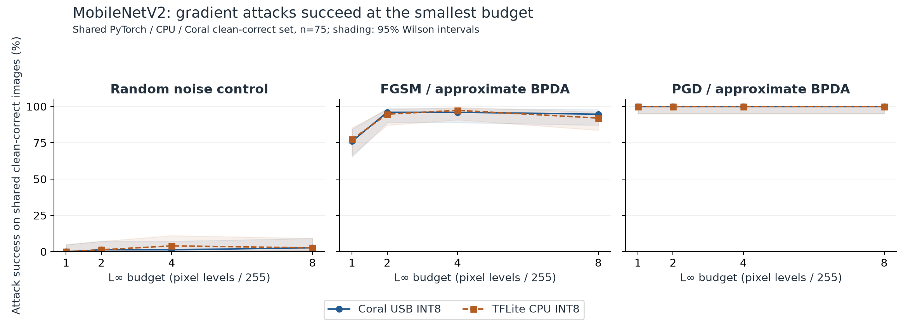
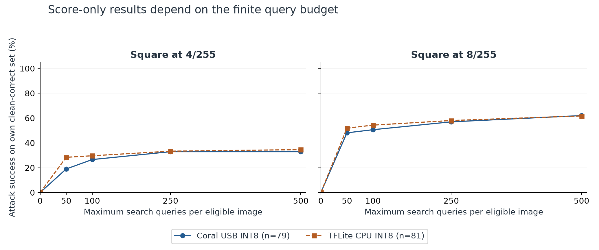
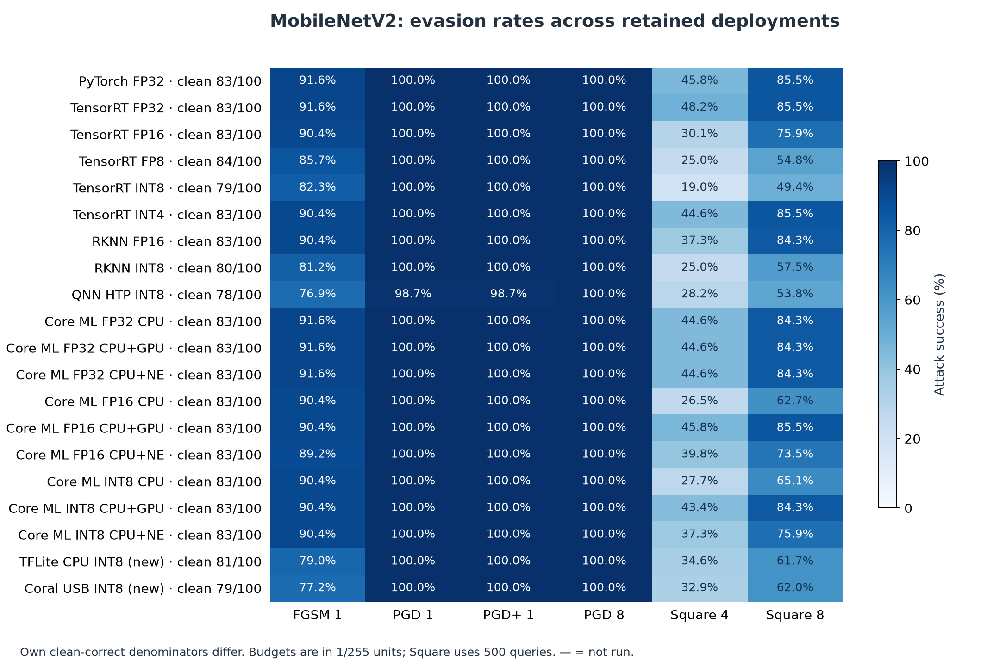
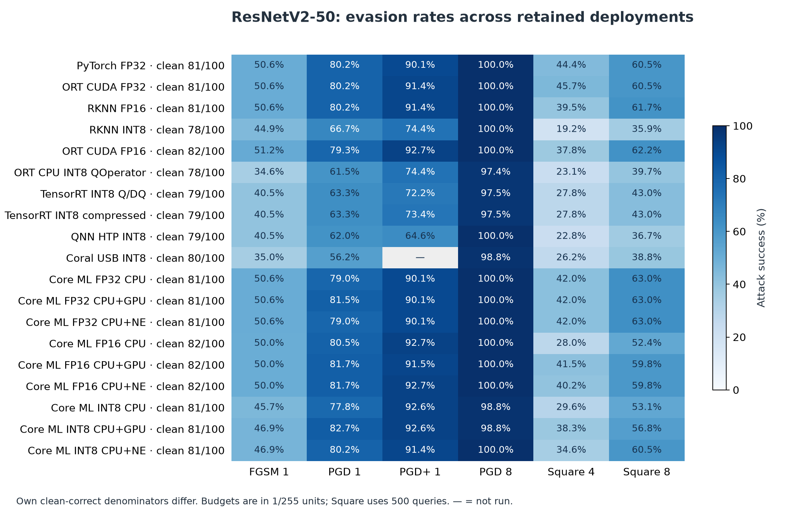

# MobileNetV2 remains vulnerable on Coral despite 8-bit input and output

Evasion evaluation completed on 10 November 2026 (Hong Kong time).

## Executive summary

- **Coral PGD / approximate BPDA evaded 79/79 (100.0%) at 1/255**, and all clean-correct images at each larger budget. The TFLite CPU deployment was evaded on 81/81 (100.0%) at 1/255. These attacks changed the deployed byte inputs; 8-bit I/O did not prevent evasion.
- **Square is weaker under its 500-query limit:** Coral success was 26/79 (32.9%) at 4/255 and 49/79 (62.0%) at 8/255. This finite-search result must be read alongside the successful gradient attacks.
- This report adds **two new native-runtime attack campaigns** and places them alongside **37 completed prior deployments**: 20 MobileNetV2 configurations in total and 19 canonical timm ResNetV2-50 configurations. Historical experiments are retained results, not fresh reruns.
- Interpretation is limited to a stratified 100-image pilot, one attack seed, approximate gradients, and the tested deployments. No certified robustness claim follows.

## New deployments and clean behavior

| Deployment | Clean correct /100 | Native interface | Replica agreement | Sign-gradient / random / negative-gradient prediction flips at 8/255 |
| --- | ---: | --- | ---: | --- |
| Coral USB INT8 | 79 | UINT8 RGB NHWC → UINT8 1000 logits | 93/100 | 83 / 13 / 27 |
| TFLite CPU INT8 | 81 | UINT8 RGB NHWC → UINT8 1000 logits | 93/100 | 85 / 18 / 26 |

The source FP32 model is correct on 83/100 images. The native CPU and Coral clean results are 81/100 and 79/100. Both use the same fully quantized TFLite model; the compiled Coral model maps all 73 operations to one TPU subgraph. Inputs are raw RGB bytes, with ImageNet normalization inside the graph before the padded stem. Output dequantization uses scale 0.1706031858921051 and zero point 84.

The derivative replica reads the actual exported TFLite weights, biases, fused activations, padding and quantization grids. It uses float convolutions with straight-through rounding, so its derivatives remain approximate. Every attack score, success decision, restart selection and final candidate score comes from the requested native runtime. The bridge forward is bit-identical to ordinary native scoring. Both new arms pass the 90% clean replica-agreement gate.

[Conversion and clean validation](../README.md) · [Coral preflight](results/run/edgetpu_int8/preflight.json) · [CPU preflight](results/run/tflite_int8/preflight.json)

## Attack protocol and denominators

- Untargeted 1000-class digital input evasion. The same 100 Imagenette2-320 validation image identities as the prior studies, ten per class, sample seed 20261030.
- MobileNet crops: shorter side 256, bicubic antialias, center crop 224. Existing validated RGB crop tensors are reused exactly. Perturbations occur after cropping and before normalization, in `[0,1]` pixel space.
- Random uniform noise, FGSM, and PGD at 1, 2, 4 and 8/255. FGSM takes one CE-ascent step; PGD takes 20 steps × 2 random starts, step size ε/4, retaining successful candidates over steps/restarts.
- The 1/255 stronger-survivor condition uses 100 steps × 5 restarts on any PGD survivors, retaining baseline successes. A zero-survivor result means no additional optimization was necessary.
- Score-only Square at 4 and 8/255: 500 native queries per clean-correct image, stripe initialization, margin objective, decreasing patch schedule, early stop on success, no gradient or transfer warm start.
- PyTorch FP32 FGSM/PGD candidates from the existing matched-checkpoint study are queried on both new deployments without adaptation. Seeds are 20261030 + 100 × ε255; stronger seed 20262730.
- Own-clean denominators are Coral n=79 and CPU n=81. The primary paired comparison uses **n=75 images correct under PyTorch FP32, CPU INT8 and Coral INT8**. The CPU/Coral-only intersection is n=77. These denominators are never pooled.
- Attack success = fooled / clean-correct. Robust accuracy = still correct among the originally clean-correct images / all 100 images. Reported intervals are 95% Wilson intervals for the corresponding eligible set; they do not capture attack-seed variability.

## Adaptive attacks succeed even at one byte level



| Condition | Coral: own clean-correct | CPU: own clean-correct | Coral on shared set | CPU on shared set |
| --- | --- | --- | --- | --- |
| fgsm at 1 /255 | 61/79 (77.2%); 95% CI 66.8–85.1% | 64/81 (79.0%); 95% CI 68.9–86.5% | 57/75 (76.0%) | 58/75 (77.3%) |
| pgd at 1 /255 | 79/79 (100.0%); 95% CI 95.4–100.0% | 81/81 (100.0%); 95% CI 95.5–100.0% | 75/75 (100.0%) | 75/75 (100.0%) |
| pgd_stronger at 1 /255 | 79/79 (100.0%); 95% CI 95.4–100.0% | 81/81 (100.0%); 95% CI 95.5–100.0% | 75/75 (100.0%) | 75/75 (100.0%) |
| pgd at 8 /255 | 79/79 (100.0%); 95% CI 95.4–100.0% | 81/81 (100.0%); 95% CI 95.5–100.0% | 75/75 (100.0%) | 75/75 (100.0%) |
| square at 4 /255 | 26/79 (32.9%); 95% CI 23.6–43.9% | 28/81 (34.6%); 95% CI 25.1–45.4% | 22/75 (29.3%) | 22/75 (29.3%) |
| square at 8 /255 | 49/79 (62.0%); 95% CI 51.0–71.9% | 50/81 (61.7%); 95% CI 50.8–71.6% | 45/75 (60.0%) | 44/75 (58.7%) |

On the shared 75-image set, the new CPU and Coral results are close: FGSM at 1/255 fools 58 and 57 images respectively; Square at 4/255 fools 22 on each, and Square at 8/255 fools 44 and 45. Those small differences do not justify a deployment ranking on this pilot. In contrast, PGD fools all 75 shared images at every budget, while random-noise controls remain low.

The one-level budget is meaningful at this interface: the verified effective UINT8 L∞ change is at most one code at ε=1/255. Rounding does not erase a perturbation that crosses a byte boundary. The successful PGD candidates are verified both in floating pixel space and after conversion to native bytes.

Lower FGSM success or finite-query Square success does not establish a protective quantization effect. Optimizer strength, approximate derivatives, input rounding, output grids, calibration and native kernels all differ across deployments. The successful adaptive PGD runs directly demonstrate evasion of the measured deployments.

## Square search and cross-runtime transfer



| Source of saved candidates | Condition | Scored on Coral, shared set | Scored on CPU, shared set |
| --- | --- | --- | --- |
| Coral USB INT8 | fgsm@1 | 57/75 (76.0%) | 58/75 (77.3%) |
| Coral USB INT8 | pgd@1 | 75/75 (100.0%) | 75/75 (100.0%) |
| Coral USB INT8 | square@4 | 22/75 (29.3%) | 7/75 (9.3%) |
| Coral USB INT8 | square@8 | 45/75 (60.0%) | 24/75 (32.0%) |
| TFLite CPU INT8 | fgsm@1 | 62/75 (82.7%) | 58/75 (77.3%) |
| TFLite CPU INT8 | pgd@1 | 74/75 (98.7%) | 75/75 (100.0%) |
| TFLite CPU INT8 | square@4 | 8/75 (10.7%) | 22/75 (29.3%) |
| TFLite CPU INT8 | square@8 | 21/75 (28.0%) | 44/75 (58.7%) |

Gradient candidates transfer strongly: Coral’s 1/255 PGD inputs fool all 75 shared images on CPU, and CPU’s inputs fool 74/75 on Coral. Square candidates transfer much less well. At 8/255, Coral’s inputs fool 45/75 on Coral but 24/75 on CPU; CPU’s inputs fool 44/75 on CPU but 21/75 on Coral. Similar aggregate success rates therefore conceal different successful inputs, making native-runtime scoring necessary.

Each row transfers the identical saved pixel tensor; it does not rerun the attack against the destination. This distinguishes attack transfer from separately optimized success. The full matrix, query counts and intervals are in [the verification results](results/verification/verification.json).

## Comparison with the previous MobileNetV2 deployments

These rows share the MobileNetV2 checkpoint and nominal crop recipe. Counts use each deployment’s own clean-correct images, so different denominators must not be interpreted as paired comparisons. The native interfaces, calibration, internal compute and output precision differ. Core ML INT8 is weight-only W8A16, TensorRT INT4 quantizes the classifier weights only, and the Core ML device labels are compute-unit requests rather than proof that every operator executes there.



| Deployment | Clean /100 | FGSM 1/255 | PGD 1/255 | PGD+ 1/255 | PGD 8/255 | Square 8/255 |
| --- | ---: | ---: | ---: | ---: | ---: | ---: |
| [PyTorch FP32](../../evasion_rknn/results/run/pytorch_fp32/summary.json) | 83 | 76/83 (91.6%) | 83/83 (100.0%) | 83/83 (100.0%) | 83/83 (100.0%) | 71/83 (85.5%) |
| [TensorRT FP32](../../evasion_trt/results/fp32/summary.json) | 83 | 76/83 (91.6%) | 83/83 (100.0%) | 83/83 (100.0%) | 83/83 (100.0%) | 71/83 (85.5%) |
| [TensorRT FP16](../../evasion_trt/results/fp16/summary.json) | 83 | 75/83 (90.4%) | 83/83 (100.0%) | 83/83 (100.0%) | 83/83 (100.0%) | 63/83 (75.9%) |
| [TensorRT FP8](../../evasion_trt/results/fp8/summary.json) | 84 | 72/84 (85.7%) | 84/84 (100.0%) | 84/84 (100.0%) | 84/84 (100.0%) | 46/84 (54.8%) |
| [TensorRT INT8](../../evasion_trt/results/int8/summary.json) | 79 | 65/79 (82.3%) | 79/79 (100.0%) | 79/79 (100.0%) | 79/79 (100.0%) | 39/79 (49.4%) |
| [TensorRT INT4](../../evasion_trt/results/int4/summary.json) | 83 | 75/83 (90.4%) | 83/83 (100.0%) | 83/83 (100.0%) | 83/83 (100.0%) | 71/83 (85.5%) |
| [RKNN FP16](../../evasion_rknn/results/run/rknn_fp16/summary.json) | 83 | 75/83 (90.4%) | 83/83 (100.0%) | 83/83 (100.0%) | 83/83 (100.0%) | 70/83 (84.3%) |
| [RKNN INT8](../../evasion_rknn/results/run/rknn_int8/summary.json) | 80 | 65/80 (81.2%) | 80/80 (100.0%) | 80/80 (100.0%) | 80/80 (100.0%) | 46/80 (57.5%) |
| [QNN HTP INT8](../../evasion_qnn/results/run/qnn_htp/summary.json) | 78 | 60/78 (76.9%) | 77/78 (98.7%) | 77/78 (98.7%) | 78/78 (100.0%) | 42/78 (53.8%) |
| [Core ML FP32 CPU](../../evasion_coreml/results/fp32_cpu_only/summary.json) | 83 | 76/83 (91.6%) | 83/83 (100.0%) | 83/83 (100.0%) | 83/83 (100.0%) | 70/83 (84.3%) |
| [Core ML FP32 CPU+GPU](../../evasion_coreml/results/fp32_cpu_and_gpu/summary.json) | 83 | 76/83 (91.6%) | 83/83 (100.0%) | 83/83 (100.0%) | 83/83 (100.0%) | 70/83 (84.3%) |
| [Core ML FP32 CPU+NE](../../evasion_coreml/results/fp32_cpu_and_ne/summary.json) | 83 | 76/83 (91.6%) | 83/83 (100.0%) | 83/83 (100.0%) | 83/83 (100.0%) | 70/83 (84.3%) |
| [Core ML FP16 CPU](../../evasion_coreml/results/fp16_cpu_only/summary.json) | 83 | 75/83 (90.4%) | 83/83 (100.0%) | 83/83 (100.0%) | 83/83 (100.0%) | 52/83 (62.7%) |
| [Core ML FP16 CPU+GPU](../../evasion_coreml/results/fp16_cpu_and_gpu/summary.json) | 83 | 75/83 (90.4%) | 83/83 (100.0%) | 83/83 (100.0%) | 83/83 (100.0%) | 71/83 (85.5%) |
| [Core ML FP16 CPU+NE](../../evasion_coreml/results/fp16_cpu_and_ne/summary.json) | 83 | 74/83 (89.2%) | 83/83 (100.0%) | 83/83 (100.0%) | 83/83 (100.0%) | 61/83 (73.5%) |
| [Core ML INT8 CPU](../../evasion_coreml/results/int8_cpu_only/summary.json) | 83 | 75/83 (90.4%) | 83/83 (100.0%) | 83/83 (100.0%) | 83/83 (100.0%) | 54/83 (65.1%) |
| [Core ML INT8 CPU+GPU](../../evasion_coreml/results/int8_cpu_and_gpu/summary.json) | 83 | 75/83 (90.4%) | 83/83 (100.0%) | 83/83 (100.0%) | 83/83 (100.0%) | 70/83 (84.3%) |
| [Core ML INT8 CPU+NE](../../evasion_coreml/results/int8_cpu_and_ne/summary.json) | 83 | 75/83 (90.4%) | 83/83 (100.0%) | 83/83 (100.0%) | 83/83 (100.0%) | 63/83 (75.9%) |
| [TFLite CPU INT8 (new)](results/run/tflite_int8/summary.json) | 81 | 64/81 (79.0%) | 81/81 (100.0%) | 81/81 (100.0%) | 81/81 (100.0%) | 50/81 (61.7%) |
| [Coral USB INT8 (new)](results/run/edgetpu_int8/summary.json) | 79 | 61/79 (77.2%) | 79/79 (100.0%) | 79/79 (100.0%) | 79/79 (100.0%) | 49/79 (62.0%) |

The new Coral result extends the previous MobileNet pattern: PGD at 1/255 reaches 100% on every listed deployment except QNN HTP, where the retained run reaches 77/78 (98.7%). At 8/255 every listed MobileNet deployment reaches 100%. Square varies much more: the new Coral value is 49/79 (62.0%), compared with 71/83 (85.5%) for the retained PyTorch/TensorRT FP32 controls and 39/79 (49.4%) for TensorRT INT8. These are deployed-configuration observations, not an isolated bit-width experiment.

## ResNetV2-50 provides context, not a hardware-only control

The canonical timm ResNetV2-50 study uses the same image identities with resize 232 and bilinear crops, a different architecture and checkpoint. Its rates cannot identify a causal architecture-independent TPU or quantization effect. The previous Coral campaign did not run the stronger-survivor condition; the missing entry is not zero. The two retained TensorRT ResNetV2 arms carry documented replica-gate exceptions in their original summaries.



| Deployment | Clean /100 | FGSM 1/255 | PGD 1/255 | PGD+ 1/255 | PGD 8/255 | Square 8/255 |
| --- | ---: | ---: | ---: | ---: | ---: | ---: |
| [PyTorch FP32](../../../resnetv2_50/evasion_rknn/results/run/pytorch_fp32/summary.json) | 81 | 41/81 (50.6%) | 65/81 (80.2%) | 73/81 (90.1%) | 81/81 (100.0%) | 49/81 (60.5%) |
| [ORT CUDA FP32](../../../resnetv2_50/evasion_rknn/results/run/onnx_fp32/summary.json) | 81 | 41/81 (50.6%) | 65/81 (80.2%) | 74/81 (91.4%) | 81/81 (100.0%) | 49/81 (60.5%) |
| [RKNN FP16](../../../resnetv2_50/evasion_rknn/results/run/rknn_fp16/summary.json) | 81 | 41/81 (50.6%) | 65/81 (80.2%) | 74/81 (91.4%) | 81/81 (100.0%) | 50/81 (61.7%) |
| [RKNN INT8](../../../resnetv2_50/evasion_rknn/results/run/rknn_int8/summary.json) | 78 | 35/78 (44.9%) | 52/78 (66.7%) | 58/78 (74.4%) | 78/78 (100.0%) | 28/78 (35.9%) |
| [ORT CUDA FP16](../../../resnetv2_50/evasion_onnx/results/timm_rnv2_fp16/summary.json) | 82 | 42/82 (51.2%) | 65/82 (79.3%) | 76/82 (92.7%) | 82/82 (100.0%) | 51/82 (62.2%) |
| [ORT CPU INT8 QOperator](../../../resnetv2_50/evasion_onnx/results/timm_rnv2_int8_ort_qop/summary.json) | 78 | 27/78 (34.6%) | 48/78 (61.5%) | 58/78 (74.4%) | 76/78 (97.4%) | 31/78 (39.7%) |
| [TensorRT INT8 Q/DQ](../../../resnetv2_50/evasion_onnx/results/timm_rnv2_int8_ptq_ort/summary.json) | 79 | 32/79 (40.5%) | 50/79 (63.3%) | 57/79 (72.2%) | 77/79 (97.5%) | 34/79 (43.0%) |
| [TensorRT INT8 compressed](../../../resnetv2_50/evasion_onnx/results/timm_rnv2_int8_dq_ort/summary.json) | 79 | 32/79 (40.5%) | 50/79 (63.3%) | 58/79 (73.4%) | 77/79 (97.5%) | 34/79 (43.0%) |
| QNN HTP INT8 (`Models/resnet50/evasion/results/qnn_v2_matched/run/summary.json`; source workspace only) | 79 | 32/79 (40.5%) | 49/79 (62.0%) | 51/79 (64.6%) | 79/79 (100.0%) | 29/79 (36.7%) |
| [Coral USB INT8](../../../resnetv2_50/TPU/evasion/results/edgetpu_int8/summary.json) | 80 | 28/80 (35.0%) | 45/80 (56.2%) | — | 79/80 (98.8%) | 31/80 (38.8%) |
| [Core ML FP32 CPU](../../../resnetv2_50/evasion_coreml/results/fp32_cpu_only/summary.json) | 81 | 41/81 (50.6%) | 64/81 (79.0%) | 73/81 (90.1%) | 81/81 (100.0%) | 51/81 (63.0%) |
| [Core ML FP32 CPU+GPU](../../../resnetv2_50/evasion_coreml/results/fp32_cpu_and_gpu/summary.json) | 81 | 41/81 (50.6%) | 66/81 (81.5%) | 73/81 (90.1%) | 81/81 (100.0%) | 51/81 (63.0%) |
| [Core ML FP32 CPU+NE](../../../resnetv2_50/evasion_coreml/results/fp32_cpu_and_ne/summary.json) | 81 | 41/81 (50.6%) | 64/81 (79.0%) | 73/81 (90.1%) | 81/81 (100.0%) | 51/81 (63.0%) |
| [Core ML FP16 CPU](../../../resnetv2_50/evasion_coreml/results/fp16_cpu_only/summary.json) | 82 | 41/82 (50.0%) | 66/82 (80.5%) | 76/82 (92.7%) | 82/82 (100.0%) | 43/82 (52.4%) |
| [Core ML FP16 CPU+GPU](../../../resnetv2_50/evasion_coreml/results/fp16_cpu_and_gpu/summary.json) | 82 | 41/82 (50.0%) | 67/82 (81.7%) | 75/82 (91.5%) | 82/82 (100.0%) | 49/82 (59.8%) |
| [Core ML FP16 CPU+NE](../../../resnetv2_50/evasion_coreml/results/fp16_cpu_and_ne/summary.json) | 82 | 41/82 (50.0%) | 67/82 (81.7%) | 76/82 (92.7%) | 82/82 (100.0%) | 49/82 (59.8%) |
| [Core ML INT8 CPU](../../../resnetv2_50/evasion_coreml/results/int8_cpu_only/summary.json) | 81 | 37/81 (45.7%) | 63/81 (77.8%) | 75/81 (92.6%) | 80/81 (98.8%) | 43/81 (53.1%) |
| [Core ML INT8 CPU+GPU](../../../resnetv2_50/evasion_coreml/results/int8_cpu_and_gpu/summary.json) | 81 | 38/81 (46.9%) | 67/81 (82.7%) | 75/81 (92.6%) | 80/81 (98.8%) | 46/81 (56.8%) |
| [Core ML INT8 CPU+NE](../../../resnetv2_50/evasion_coreml/results/int8_cpu_and_ne/summary.json) | 81 | 38/81 (46.9%) | 65/81 (80.2%) | 74/81 (91.4%) | 81/81 (100.0%) | 49/81 (60.5%) |

On the same accelerator family, the retained ResNetV2-50 campaign is less often evaded at the smallest budget: PGD fools 45/80 (56.2%) at 1/255, versus 79/79 for the new MobileNet run. At 8/255 its PGD result rises to 79/80 (98.8%). The different base model, crops and derivative approximations prevent attributing this contrast to TPU hardware. One ResNet image survived that recorded 8/255 run; this finite-attack survival is not a robustness guarantee.

The older TorchVision ResNet-50 experiments are a separate cross-architecture/checkpoint replication and remain in the [historical ONNX report](../../../resnetv2_50/evasion_onnx/README.md). They are not mixed into the canonical timm model matrix. Duplicate FP32 transfer-reference runs are also not counted as additional deployments.

## Validation, interpretation and limits

An independent fresh process reconciled **46 conditions / 4,600 per-image rows**. It issued **9,200 native candidate scores**, plus 200 clean scores, to replay every saved result and test CPU↔Coral transfer. Every saved logit was reproduced bit-for-bit. Floating and native-byte bounds, labels/order, Square query caps and traces, zero search queries on ineligible images, stronger-success retention, transfer-candidate identity and source/model/code hashes passed.

The previous 37 deployments are read from their retained summaries with exact source SHA-256s. A fresh arithmetic audit reconciled 35,900 available per-image CSV rows across 17 prior deployments and matched 18 Core ML summaries to their retained independently verified comparison matrices. The remaining two sources (MobileNet QNN and ResNet Coral) are explicitly summary-only imports in the [historical audit](results/comparisons/historical_audit.json). Their binaries and attacks were not rerun during this campaign. Historical robust-accuracy fields are not copied where definitions differ: this report derives robust accuracy from clean-correct minus fooled, over 100. All 39 deployments’ condition-level counts, 95% intervals and source paths are available in [JSON](results/comparisons/all_deployments.json) and [CSV](results/comparisons/all_deployments.csv).

The evidence supports susceptibility to the attempted digital attacks. It does not establish a worst-case risk, certified radius, full ImageNet accuracy, physical/camera robustness, or a causal effect of bit width alone. Adjacent percentages are not ranked as statistically distinct. Wilson intervals describe uncertainty across the eligible pilot images; one attack seed leaves search variability unmeasured.

For deployment decisions, evaluate a broader representative clean set and rerun the same adaptive and score-only attacks on the final production preprocessing path. The current lower finite-query success should not be used as a security guarantee.

## Reproduce and inspect

```bash
cd /home/ross/QA
export TF_CPP_MIN_LOG_LEVEL=2 TF_NUM_INTRAOP_THREADS=2 TF_NUM_INTEROP_THREADS=1
/tmp/tpu_rt/bin/python Models/mobilenetV2/TPU/evasion/scripts/run_suite.py --arm edgetpu_int8
/tmp/tpu_rt/bin/python Models/mobilenetV2/TPU/evasion/scripts/run_suite.py --arm tflite_int8
/tmp/tpu_rt/bin/python Models/mobilenetV2/TPU/evasion/scripts/verify_results.py
venv/bin/python Models/mobilenetV2/TPU/evasion/scripts/build_report.py
```

The runner resumes completed conditions only for unchanged artifacts/configuration, holds a hardware lock, and never substitutes CPU for a requested TPU run. The existing attack function ASTs are loaded unchanged from the MobileNet TensorRT reference, excluding its unused torchvision image loader to avoid a TensorFlow/torchvision LLVM registration conflict. The derivative model reads the exported TFLite graph directly; no ONNX or model binary is edited.

- [Independent validation and cross-transfer](results/verification/verification.json)
- [Candidate SHA-256 ledger](results/verification/candidate_sha256.json)
- [Coral attack summary](results/run/edgetpu_int8/summary.json) · [per-image rows](results/run/edgetpu_int8/per_image.csv)
- [CPU attack summary](results/run/tflite_int8/summary.json) · [per-image rows](results/run/tflite_int8/per_image.csv)
- [Coral runtime](results/run/edgetpu_int8/runtime.json) · [CPU runtime](results/run/tflite_int8/runtime.json)

## Complete new-condition tables

### Coral USB INT8

| Condition | ε /255 | Fooled / own clean-correct | 95% Wilson interval | Robust correct /100 | Fooled / shared clean-correct | Native L∞ max | Search queries |
| --- | ---: | ---: | --- | ---: | ---: | ---: | ---: |
| random | 1 | 1/79 (1.3%) | 0.2–6.8% | 78 | 0/75 (0.0%) | 1 | — |
| fgsm | 1 | 61/79 (77.2%) | 66.8–85.1% | 18 | 57/75 (76.0%) | 1 | — |
| pgd | 1 | 79/79 (100.0%) | 95.4–100.0% | 0 | 75/75 (100.0%) | 1 | — |
| pgd_stronger | 1 | 79/79 (100.0%) | 95.4–100.0% | 0 | 75/75 (100.0%) | 1 | — |
| random | 2 | 1/79 (1.3%) | 0.2–6.8% | 78 | 1/75 (1.3%) | 2 | — |
| fgsm | 2 | 75/79 (94.9%) | 87.7–98.0% | 4 | 72/75 (96.0%) | 2 | — |
| pgd | 2 | 79/79 (100.0%) | 95.4–100.0% | 0 | 75/75 (100.0%) | 2 | — |
| random | 4 | 1/79 (1.3%) | 0.2–6.8% | 78 | 1/75 (1.3%) | 4 | — |
| fgsm | 4 | 76/79 (96.2%) | 89.4–98.7% | 3 | 72/75 (96.0%) | 4 | — |
| pgd | 4 | 79/79 (100.0%) | 95.4–100.0% | 0 | 75/75 (100.0%) | 4 | — |
| square | 4 | 26/79 (32.9%) | 23.6–43.9% | 53 | 22/75 (29.3%) | 4 | 27743 |
| random | 8 | 3/79 (3.8%) | 1.3–10.6% | 76 | 2/75 (2.7%) | 8 | — |
| fgsm | 8 | 75/79 (94.9%) | 87.7–98.0% | 4 | 71/75 (94.7%) | 8 | — |
| pgd | 8 | 79/79 (100.0%) | 95.4–100.0% | 0 | 75/75 (100.0%) | 8 | — |
| square | 8 | 49/79 (62.0%) | 51.0–71.9% | 30 | 45/75 (60.0%) | 8 | 17464 |
| transfer_pytorch_fgsm | 1 | 64/79 (81.0%) | 71.0–88.1% | 15 | 60/75 (80.0%) | 1 | — |
| transfer_pytorch_pgd | 1 | 78/79 (98.7%) | 93.2–99.8% | 1 | 74/75 (98.7%) | 1 | — |
| transfer_pytorch_fgsm | 2 | 71/79 (89.9%) | 81.3–94.8% | 8 | 67/75 (89.3%) | 2 | — |
| transfer_pytorch_pgd | 2 | 79/79 (100.0%) | 95.4–100.0% | 0 | 75/75 (100.0%) | 2 | — |
| transfer_pytorch_fgsm | 4 | 74/79 (93.7%) | 86.0–97.3% | 5 | 70/75 (93.3%) | 4 | — |
| transfer_pytorch_pgd | 4 | 79/79 (100.0%) | 95.4–100.0% | 0 | 75/75 (100.0%) | 4 | — |
| transfer_pytorch_fgsm | 8 | 75/79 (94.9%) | 87.7–98.0% | 4 | 71/75 (94.7%) | 8 | — |
| transfer_pytorch_pgd | 8 | 79/79 (100.0%) | 95.4–100.0% | 0 | 75/75 (100.0%) | 8 | — |

### TFLite CPU INT8

| Condition | ε /255 | Fooled / own clean-correct | 95% Wilson interval | Robust correct /100 | Fooled / shared clean-correct | Native L∞ max | Search queries |
| --- | ---: | ---: | --- | ---: | ---: | ---: | ---: |
| random | 1 | 2/81 (2.5%) | 0.7–8.6% | 79 | 0/75 (0.0%) | 1 | — |
| fgsm | 1 | 64/81 (79.0%) | 68.9–86.5% | 17 | 58/75 (77.3%) | 1 | — |
| pgd | 1 | 81/81 (100.0%) | 95.5–100.0% | 0 | 75/75 (100.0%) | 1 | — |
| pgd_stronger | 1 | 81/81 (100.0%) | 95.5–100.0% | 0 | 75/75 (100.0%) | 1 | — |
| random | 2 | 4/81 (4.9%) | 1.9–12.0% | 77 | 1/75 (1.3%) | 2 | — |
| fgsm | 2 | 77/81 (95.1%) | 88.0–98.1% | 4 | 71/75 (94.7%) | 2 | — |
| pgd | 2 | 81/81 (100.0%) | 95.5–100.0% | 0 | 75/75 (100.0%) | 2 | — |
| random | 4 | 5/81 (6.2%) | 2.7–13.6% | 76 | 3/75 (4.0%) | 4 | — |
| fgsm | 4 | 79/81 (97.5%) | 91.4–99.3% | 2 | 73/75 (97.3%) | 4 | — |
| pgd | 4 | 81/81 (100.0%) | 95.5–100.0% | 0 | 75/75 (100.0%) | 4 | — |
| square | 4 | 28/81 (34.6%) | 25.1–45.4% | 53 | 22/75 (29.3%) | 4 | 27537 |
| random | 8 | 3/81 (3.7%) | 1.3–10.3% | 78 | 2/75 (2.7%) | 8 | — |
| fgsm | 8 | 75/81 (92.6%) | 84.8–96.6% | 6 | 69/75 (92.0%) | 8 | — |
| pgd | 8 | 81/81 (100.0%) | 95.5–100.0% | 0 | 75/75 (100.0%) | 8 | — |
| square | 8 | 50/81 (61.7%) | 50.8–71.6% | 31 | 44/75 (58.7%) | 8 | 17442 |
| transfer_pytorch_fgsm | 1 | 62/81 (76.5%) | 66.2–84.4% | 19 | 56/75 (74.7%) | 1 | — |
| transfer_pytorch_pgd | 1 | 80/81 (98.8%) | 93.3–99.8% | 1 | 74/75 (98.7%) | 1 | — |
| transfer_pytorch_fgsm | 2 | 72/81 (88.9%) | 80.2–94.0% | 9 | 66/75 (88.0%) | 2 | — |
| transfer_pytorch_pgd | 2 | 81/81 (100.0%) | 95.5–100.0% | 0 | 75/75 (100.0%) | 2 | — |
| transfer_pytorch_fgsm | 4 | 77/81 (95.1%) | 88.0–98.1% | 4 | 71/75 (94.7%) | 4 | — |
| transfer_pytorch_pgd | 4 | 81/81 (100.0%) | 95.5–100.0% | 0 | 75/75 (100.0%) | 4 | — |
| transfer_pytorch_fgsm | 8 | 76/81 (93.8%) | 86.4–97.3% | 5 | 70/75 (93.3%) | 8 | — |
| transfer_pytorch_pgd | 8 | 81/81 (100.0%) | 95.5–100.0% | 0 | 75/75 (100.0%) | 8 | — |

