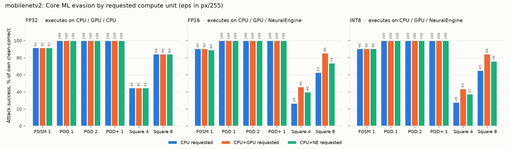
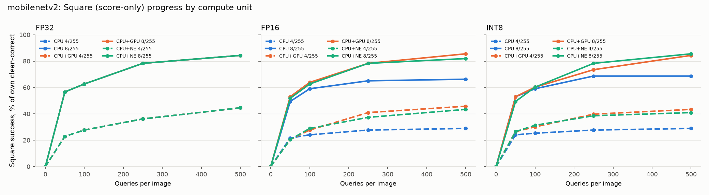

# MobileNetV2 Core ML input-evasion study (CPU, CPU+GPU, CPU+Neural Engine)

Untargeted digital **input evasion** against the archive's MobileNetV2 Core ML
packages. The packages were tested on all three Apple compute-unit requests:
`CPU_ONLY`, `CPU_AND_GPU` and `CPU_AND_NE`. Only input pixels change: no
training, poisoning or parameter attack. Unlike the copied reports elsewhere in
this archive, this is a **new experiment run locally on 10 November 2026**
(macOS 26.6.2, Apple Silicon, coremltools 9.0, torch 2.14.0). It follows the
protocol of the [TensorRT study](../evasion_trt/README.md) so results are
directly comparable.

Apple's official MobileNetV2 Core ML models are a structurally different network
(TF-Slim 1.4×, 1001 classes). They live on the `reference/apple-mobilenetv2`
branch for reference only and were **not attacked**. INT4 packages were also
excluded: they are experimental exports with large clean-accuracy loss.

---

## TL;DR

* **White-box attacks fully evade every precision on every compute unit.**
  PGD / adaptive BPDA-PGD reaches **100.0%** at 1, 2, 4 and 8/255 on all nine
  arms. FGSM reaches 89–92% at 1/255. The compute unit makes no material
  difference to the gradient attack.
* **The score-only Square attack depends on the compute unit for FP16 and INT8.**
  `CPU_ONLY` is consistently the hardest to evade, the GPU the easiest and the
  Neural Engine in between. At 8/255 the rates are 63–65% on CPU, 74–76% on the
  Neural Engine and 84–86% on the GPU. Three extra seeds per arm reproduce the
  ordering with non-overlapping seed ranges. As in the TensorRT study, a lower
  black-box rate is a **finite-query effect, not protection**.
* **FP32 behaves identically on all three requests.** Core ML places FP32 on the
  CPU even when `CPU_AND_NE` is requested, and the GPU's FP32 logits differ by
  at most 3.4e-5. FP16 and INT8 execute on the requested device; their clean
  logits differ across units by up to 0.47 with identical clean accuracy.
* **Gradient adversarial examples carry across compute units; Square examples
  often do not.** FGSM/PGD candidates fool the other two units 99–100% of the
  time. FP16/INT8 Square candidates fool another unit only 55–95% of the time.
* **The FP32 CPU arm reproduces the TensorRT FP32 arm**: 83/100 clean, identical
  random-control, FGSM and PGD rates, and Square within its confidence interval.

---

## 1. What was attacked

| Property | Value |
| --- | --- |
| Model | TorchVision MobileNetV2, `IMAGENET1K_V1`, checkpoint SHA-256 `b03531047ffa…` |
| Packages | `weights/mobilenetv2/coreml/mobilenetv2_{fp32,fp16,int8}.mlpackage` (ML Program, iOS 18 / macOS 15); hashes in each `results/<arm>/runtime.json` and the root manifest |
| Precisions | FP32; FP16 compute; INT8 per-channel weight-only with FP16 compute (W8A16) |
| Compute-unit requests | `CPU_ONLY`, `CPU_AND_GPU`, `CPU_AND_NE`; 3 × 3 = **9 arms** |
| Preprocessing | shorter side 256, bicubic with antialiasing → center crop 224 → `[0,1]` → ImageNet mean/std (outside the package) |
| Population | The same 100 Imagenette2-320 `val` images as the TensorRT, RKNN and ONNX studies (10 per class, seed `20261030`). All 100 were re-verified against the recorded SHA-256s. |
| Threat model | digital L∞ on `[0,1]` pixels before normalization; 1, 2, 4, 8/255 |

### Where each arm actually executes

Core ML treats the compute-unit setting as a request. Each package's compiled
**compute plan** records which device each operation is placed on:

| Precision | `CPU_ONLY` | `CPU_AND_GPU` | `CPU_AND_NE` |
| --- | --- | --- | --- |
| FP32 | CPU (100 ops) | GPU (100) | **CPU (100)**: the Neural Engine has no FP32 path |
| FP16 | CPU (102) | GPU (102) | Neural Engine (102) |
| INT8 | CPU (102) | GPU (102) | Neural Engine (102) |

All 12 runtime/package pairs that were probed returned bit-identical logits on
repeated calls and between batched and single predictions. This determinism is
what allows the exact-forward bridge below.

## 2. Method

Core ML is forward-only, with no input gradients. As in the TensorRT study, every
**forward score is the real Core ML output** for the requested compute unit, and
the backward pass uses a differentiable FP32 replica of **the same package**.
Missing native gradients do not count as robustness.

* **Replica.** The package's own MIL program is interpreted op by op: `conv`,
  `clip` (ReLU6), `add`, `reduce_mean`, `reshape`, `linear` and `cast`. Unknown
  ops raise an error. Weights come from the package: FP16 constants as stored,
  and INT8 weights decoded exactly as Core ML decodes them
  (`constexpr_blockwise_shift_scale`). Casts are identity, so FP16 rounding of
  activations has a straight-through derivative (BPDA). The replica ran on MPS
  for speed; its gradient signs agree 99.99% with a CPU replica, and it never
  scores a result.
* **Bridge.** `forward = runtime logits` (verified bit-identical per arm);
  `backward = replica gradient`.
* **Replica gate.** Replica-vs-runtime clean top-1 agreement must be ≥90%.
  Observed: 100% on eight arms and 99% on FP16 CPU. A one-step 8/255 probe
  flips 88–92 runtime predictions with the gradient sign, versus 12–14 with a
  random sign.

| Condition | Budgets (/255) | Settings |
| --- | --- | --- |
| `random` | 1, 2, 4, 8 | uniform `[-ε, ε]`, clipped |
| `fgsm` | 1, 2, 4, 8 | one cross-entropy ascent step of size ε |
| `pgd` | 1, 2, 4, 8 | 20 steps × 2 random starts, step ε/4; keeps the lowest-margin runtime-scored candidate per image |
| `pgd_stronger` | 1 | 1/255 survivors: 100 steps × 5 starts, seed `20262730` |
| `square` | 4, 8 | 500 queries per clean-correct image, stripe init, margin objective, p = 0.05 schedule; stops on success |
| `transfer_fp32_{fgsm,pgd}` | 1, 2, 4, 8 | FP32 `CPU_ONLY` candidates scored without adaptation |

The per-ε seed is `20261030 + 100·ε`; every arm uses the same seed. Each arm's
final candidates were also **re-scored on the other two compute units**.

## 3. Results

Percentages are `fooled / clean-correct`. 95% Wilson intervals and raw counts
are in [`results/comparisons/matrix.json`](results/comparisons/matrix.json).
The full tables are in [`matrix.md`](results/comparisons/matrix.md).

### 3.1 Clean

All nine arms classify **83/100** correctly. **82** images are correct in all
nine arms; this is the shared denominator.

| Precision | Unit vs `CPU_ONLY` | Top-1 agreement /100 | Max abs logit difference | Bit-identical |
| --- | --- | ---: | ---: | --- |
| FP32 | CPU+GPU | 100 | 3.4e-5 | no |
| FP32 | CPU+NE | 100 | 0 | **yes** (CPU fallback) |
| FP16 | CPU+GPU / CPU+NE | 99 / 99 | 0.365 / 0.344 | no |
| INT8 | CPU+GPU / CPU+NE | 100 / 100 | 0.446 / 0.469 | no |

FP16 GPU and Neural Engine logits are closer to each other (max 0.054) than to
the CPU.

### 3.2 Attack matrix (own denominator, n = 83 per arm)

| Arm | FGSM 1 | FGSM 8 | PGD 1–8 | PGD+ 1 | Square 4 | Square 8 | Random 1/2/4/8 |
| --- | ---: | ---: | ---: | ---: | ---: | ---: | --- |
| `fp32_cpu_only` | 91.6 | 95.2 | 100 | 100 | 44.6 | 84.3 | 1.2 / 0.0 / 1.2 / 1.2 |
| `fp32_cpu_and_gpu` | 91.6 | 95.2 | 100 | 100 | 44.6 | 84.3 | 1.2 / 0.0 / 1.2 / 1.2 |
| `fp32_cpu_and_ne` | 91.6 | 95.2 | 100 | 100 | 44.6 | 84.3 | 1.2 / 0.0 / 1.2 / 1.2 |
| `fp16_cpu_only` | 90.4 | 97.6 | 100 | 100 | **26.5** | **62.7** | 0.0 / 1.2 / 0.0 / 1.2 |
| `fp16_cpu_and_gpu` | 90.4 | 96.4 | 100 | 100 | 45.8 | 85.5 | 1.2 / 0.0 / 1.2 / 1.2 |
| `fp16_cpu_and_ne` | 89.2 | 96.4 | 100 | 100 | 39.8 | 73.5 | 1.2 / 0.0 / 1.2 / 1.2 |
| `int8_cpu_only` | 90.4 | 92.8 | 100 | 100 | **27.7** | **65.1** | 1.2 / 1.2 / 1.2 / 2.4 |
| `int8_cpu_and_gpu` | 90.4 | 92.8 | 100 | 100 | 43.4 | 84.3 | 2.4 / 1.2 / 2.4 / 2.4 |
| `int8_cpu_and_ne` | 90.4 | 92.8 | 100 | 100 | 37.3 | 75.9 | 2.4 / 1.2 / 2.4 / 2.4 |

No image survived PGD at 1/255, so the 100×5 survivor check had nothing to
re-attack. FP32 candidates transfer at **100%** under PGD at every budget to
every FP16/INT8 arm. Under FGSM they transfer at 89–98%.



### 3.3 Does the compute unit change the result?

**White-box: no.** PGD saturates everywhere. FGSM differs by at most one
image between units of the same precision.

**Score-only Square: yes, for the precisions that execute on different
hardware.** One run's single trajectory could diverge by chance, so Square was
repeated with **three extra seeds** per FP16/INT8 arm
([`results/supplementary/square_seeds.json`](results/supplementary/square_seeds.json)).
The table gives the mean with the seed range in brackets:

| Arm | Square 4/255 | Square 8/255 | Unchanged-score probes | Smallest non-zero margin change |
| --- | --- | --- | ---: | ---: |
| `fp16_cpu_only` | 27.3 [25.3–28.9] | 62.3 [61.4–62.7] | 3.4% | 0.0078 |
| `fp16_cpu_and_ne` | 35.7 [34.9–36.1] | 73.1 [69.9–75.9] | 5.2% | 0.0078 |
| `fp16_cpu_and_gpu` | 45.8 [44.6–47.0] | 84.7 [81.9–88.0] | 0.0% | 0.00013 |
| `int8_cpu_only` | 26.9 [25.3–30.1] | 61.0 [59.0–63.9] | 3.7% | 0.0078 |
| `int8_cpu_and_ne` | 34.9 [33.7–36.1] | 75.5 [72.3–78.3] | 4.3% | 0.0039 |
| `int8_cpu_and_gpu` | 44.2 [43.4–45.8] | 85.5 [84.3–86.7] | 0.0% | 0.00017 |

The ordering **CPU < Neural Engine < GPU** holds for every seed, and the seed
ranges never overlap. The two right-hand columns come from a diagnostic: 20
Square-style window perturbations at 4/255 per clean-correct image. CPU and
Neural Engine scores change in steps of about 2⁻⁷, consistent with FP16 output
rounding at these logit magnitudes. Small perturbations leave their scores
unchanged 3–5% of the time, which starves the score-only search. The GPU
reports scores about 50× more finely and never returns an unchanged score,
which fits it being the easiest to evade. This explains the GPU's position. It
does **not** explain why the CPU is harder to evade than the Neural Engine,
which has similar granularity. That ordering is measured, not explained.

**Cross-unit portability** asks: of images fooled on one unit, and clean-correct
on another, what percentage also fool the other unit?

| Precision | FGSM / PGD candidates | Square 4/255 | Square 8/255 |
| --- | --- | --- | --- |
| FP32 | 100% everywhere | 100% | 100% |
| FP16 | 98.7–100% | 71–92% | 71–93% |
| INT8 | 98.7–100% | 55–87% | 67–95% |

Square examples land just past the decision boundary. A logit difference of a
few tenths between units is enough to undo some of them. Examples from CPU+GPU
and CPU+NE carry over to each other better (83–95%) than to or from the CPU.



### 3.4 Comparison with the TensorRT study

The FP32 `CPU_ONLY` arm reproduces the TensorRT FP32 arm on the same 100
images. Clean accuracy, random control, FGSM and PGD are identical, as is the
sign-direction probe (92/20/12). Square differs slightly (44.6/84.3 vs
48.2/85.5) and stays within its 95% interval. Square is randomized, so single
runs are not expected to match exactly. The quantized arms are **not**
like-for-like with TensorRT. TensorRT INT8 quantizes activations (W8A8, Square
49.4% at 8/255). Core ML INT8 is weight-only with FP16 activations; it behaves
like TensorRT FP16 under white-box attack, and its Square rate depends on the
compute unit.

## 4. Validation

`summarize.py` independently reconciled **9 arms / 199 conditions** (15 for the
reference arm, 23 for each other arm; 19,900 per-image rows) with **0 problems**. It checked:

* the sample hashes and labels against the recorded population;
* that package files were unchanged after each run;
* that the bridged forward pass was bit-identical, and that every replica gate
  passed;
* that every candidate was finite, inside `[0,1]` and within L∞ ≤ ε;
* Square budgets: ≤500 queries, and no queries or perturbation for ineligible
  images;
* that counts in `summary.json` equal counts re-derived from the rows;
* that every arm has the same clean set across all its conditions.

## 5. Limitations

This is a 100-image pilot with one protocol seed (plus three supplementary Square
seeds). Gradients are approximate BPDA through an FP32 replica, and the
attacks are finite. These results are empirical evasion rates, not robustness
certificates, and say nothing about physical-world inputs. Compute-plan
placement is Core ML's planned device for each op, not an execution trace.
Core ML may change placement across OS versions; results apply to macOS 26.6.2
on this machine. Adjacent arms whose Wilson intervals overlap are not ranked,
except where the multi-seed check establishes an ordering. The cause of the
CPU-vs-Neural Engine Square gap is not established.

## 6. Reproduction (source workspace only)

The harness is outside this archive (`AISR/evasion_coreml/`, see
[SOURCE_REFERENCES.md](../../SOURCE_REFERENCES.md)). It uses the repository's
`coreml` conda environment and the Imagenette2-320 dataset:

```bash
cd AISR/evasion_coreml
./run_all.sh                                   # 18 arms, FP32 CPU reference first per model
python scripts/summarize.py                    # independent reconciliation -> results/comparisons
python scripts/square_seeds.py --model mobilenetv2   # supplementary Square seeds + sensitivity
python scripts/figures.py
```

The archive keeps each arm's `summary.json` and `runtime.json`, the reconciled
matrix, the supplementary JSON and the figures. Per-image CSVs, adversarial
candidates and logs remain in the source workspace.
