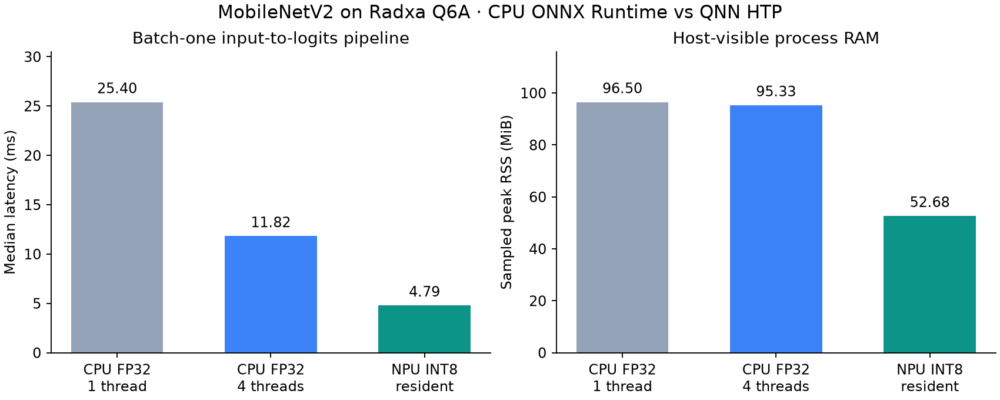
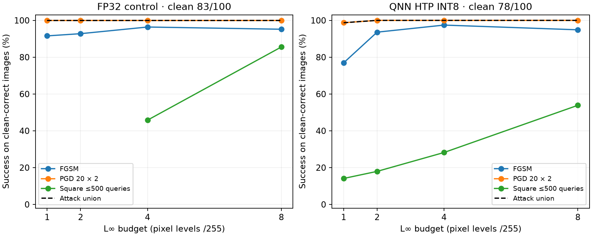

# MobileNetV2 Q6A evaluation results

Completed on 10 November 2026 (HKT), on the Radxa Dragon Q6A at **192.168.1.40**.

The FP32 ONNX/DLC, INT8 DLC/context and matching QAIRT 2.42 CPU/HTP runtimes are synced to `/home/ross/mobilenetv2_qairt/6490_v242`. The NPU model is served by the running `mobilenetv2-qnn` user systemd service. [Service health](http://192.168.1.40:8088/health).

## CPU versus NPU

Batch one, pre-cropped float32 RGB → normalized input → runtime → 1,000 float32 logits. Network and image decode/resize/crop are excluded. Each median uses 400 measured runs after warmup.

| Runtime | Median | P95 | Sampled peak process RSS | Sampled peak process PSS |
| --- | ---: | ---: | ---: | ---: |
| CPU FP32, ONNX Runtime, 1 thread | 25.40 ms | 25.60 ms | 96.50 MiB | 88.76 MiB |
| CPU FP32, ONNX Runtime, 4 threads | 11.82 ms | 19.04 ms | 95.33 MiB | 87.75 MiB |
| NPU INT8, resident QNN HTP scorer | 4.79 ms | 5.70 ms | 52.68 MiB | 41.91 MiB |

The NPU pipeline is **2.47× faster** than the four-thread FP32 CPU pipeline. The NPU memory figure includes the board-local Python driver and resident C scorer. RSS can count shared pages more than once; PSS apportions them. DSP-private allocations, firmware and VTCM are outside these host process measurements. This compares FP32 CPU with INT8 NPU; the accuracy cost is reported below.

The native HTP `graphExecute` median is **0.976 ms**, with 14.14 MiB peak C-process RSS. That boundary excludes normalization, quantization, Python pipes and the network.

The same-QAIRT tool comparison uses 200 steady-state profile samples after discarding 20 warmups:

| QAIRT execution | Backend-call median | NETRUN execution median | Peak RSS during process |
| --- | ---: | ---: | ---: |
| FP32 DLC, CPU | 27.983 ms | 28.040 ms | 65.91 MiB |
| INT8 DLC, CPU | 10.488 ms | 10.506 ms | 24.83 MiB |
| INT8 context, HTP | 1.004 ms | 1.019 ms | 15.39 MiB |

For the running HTTP service, host-to-board batch-one median is **8.27 ms**, P95 **10.04 ms** over 200 requests after 20 warmups. This includes host normalization/encoding, LAN transport, board inference and decoding; it is a separate boundary from the local measurements.

## Clean accuracy

The fixed 100-image attack cohort scores **83/100 FP32** and **78/100 INT8 HTP**. Both CPU ONNX Runtime thread settings preserve all source ONNX predictions. The served native-input path matches all saved float-input HTP logits bit-for-bit on the cohort.

The broader evaluation uses all **3,923 local ImageNet-mini validation images**. The original ResNet calibration recipe contains **20** of these images, so the primary held-out accuracy excludes them (**3,903 images**). None overlap the 100-image attack cohort by JPEG content hash. This is not full ImageNet validation.

| Model | All local validation | Held-out validation |
| --- | ---: | ---: |
| FP32 source | 2772/3923 (70.66%) | 2761/3903 (70.74%) |
| INT8 HTP service | 2677/3923 (68.24%) | 2665/3903 (68.28%) |

## Evasion results

Budgets are L∞ pixel changes in /255. Counts below are evaded predictions out of each target’s own clean-correct subset. PGD uses 20 steps and two starts; Square uses at most 500 score queries per eligible input. NPU BPDA scores every candidate on the actual board and uses the matched FP32 source only for derivatives.

| Budget | FP32 PGD /83 | NPU FGSM /78 | NPU PGD /78 | NPU Square /78 | NPU attack union /78 | Rounded NPU union /78 |
| --- | ---: | ---: | ---: | ---: | ---: | ---: |
| 1/255 | 83 | 60 | 77 | 11 | 77 | 77 |
| 2/255 | 83 | 73 | 78 | 14 | 78 | 78 |
| 4/255 | 83 | 76 | 78 | 22 | 78 | 78 |
| 8/255 | 83 | 74 | 78 | 42 | 78 | 78 |

The primary attack union evades **77/78** at 1/255 and **78/78** at 2/255. The union includes FGSM, PGD, stronger PGD, Square and FP32 transfer candidates at equal or smaller budgets; random controls are excluded.

Both models are clean-correct on **77** of the same images. The verification JSON also reports attack-union survival restricted to that joint subset, avoiding a denominator change when comparing the two runtimes.

The additional 1/255 check found 1 primary survivor and evaded **0** of them with up to 5,000 new Square queries each. All candidates are checked after RGB byte rounding as well. Surviving these finite searches is not a certified robustness result.

## Verification and artifacts

- FP32: **1,500 saved candidates** and **1,500 rounded candidates** independently replayed. All saved logits match bit-for-bit; all pixel bounds pass.
- HTP: **2,500 saved candidates** and **2,500 rounded candidates** independently replayed. All saved logits match bit-for-bit; all pixel bounds pass.
- The additional survivor-search candidates are independently replayed when present.
- [Per-image verification CSV](results/verification/per_image.csv), [verification JSON](results/verification/verification.json).
- [Performance JSON](results/performance.json), raw timing/profile/memory evidence in `results/benchmark/`.
- [Full clean-evaluation JSON](results/full_validation/evaluation.json) and saved logits/manifest in the same directory.
- Attack checkpoints and adversarial tensors: `results/run/{pytorch_fp32,qnn_htp}/`.
- [Service measurements and final health](results/service.json), [deployment hashes](results/deployment.json).
- [Method, API and reproduction instructions](README.md).

Context SHA-256: `c7377092adbacd327409e421f867981db49e8cf0bea4013ce72b376cbb3ec6bb`.
