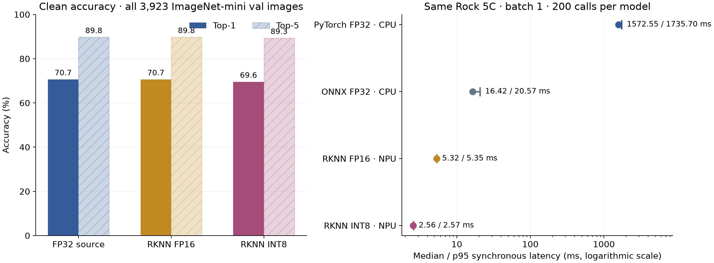
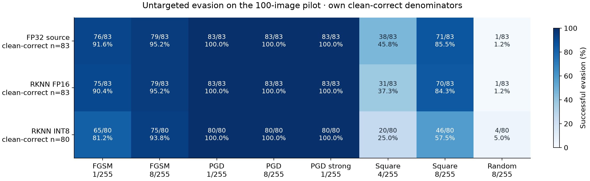
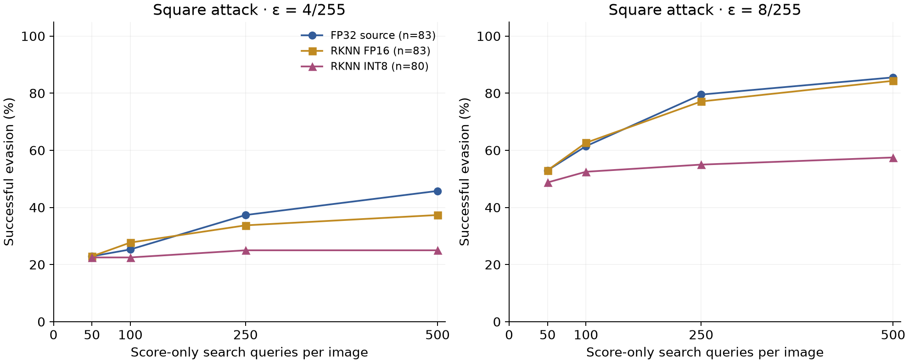

# MobileNetV2 RKNN: hardware evaluation and input evasion

Measured on the Rock 5C at `192.168.1.39`; report generated 6 November 2026, 22:42 HKT.

INT8 has median batch-one latency **2.557 ms**, versus **5.325 ms** for FP16 (2.08× faster). On the fixed 100-image attack cohort, FP16 correctly classifies **83/100** and INT8 **80/100**.

At **1/255**, deployed-runtime PGD/BPDA evades **83/83** for FP16 and **80/80** for INT8. These are empirical results on each model’s own clean-correct images. They do not establish certified robustness.

## Deployment and provenance

- Board files: `/home/ross/QA/Models/mobilenetV2/rknn/mobilenetv2.rknn` and `mobilenetv2_int8.rknn`; source ONNX and compatible opset-19 copy also synced. Remote SHA-256 matches the retained local artifacts before and after evaluation.
- Original torchvision MobileNetV2 ImageNet V1 checkpoint; all 1,000 classes retained. The FP32 derivative/reference is the corresponding ONNX graph executed in PyTorch, validated against both the original checkpoint and ONNX Runtime. The same-board PyTorch CPU baseline uses the original checkpoint exported to TorchScript, bit-identical to eager PyTorch on all 100 source images.
- Same conversion recipe as ResNet: Toolkit2 2.5.0, RK3588, batch 1, 224×224, RGB ImageNet mean/std baked into RKNN, 256 ImageNet-mini training calibration images. Source weights and deployed binaries are unchanged.
- Runtime evidence below records native interfaces, not an assertion that every internal operator uses one arithmetic dtype. The C scorer invokes the native NPU API with no CPU model fallback.

| Artifact | Native input / output | Runtime / driver | SHA-256 |
|---|---|---|---|
| RKNN FP16 | FP16 / FP16 | 2.5.0 (74ea630ce8@2026-09-30T09:41:17) / 0.9.8 | `b7a1684245b943a0aa8a02c60fccc2b898b01f4941ac6bc5c421c07c9dac5eaf` |
| RKNN INT8 | INT8 / INT8 | 2.5.0 (74ea630ce8@2026-09-30T09:41:17) / 0.9.8 | `e3266188be528f43e2431c4cd6067148e4c3d7ef9b340637baae2fc8de66c901` |

## Clean accuracy

The broad clean test uses **all 3,923 local ImageNet-mini validation images**, spanning 1000 classes, with a 1,000-class head. This is a subset dataset, not full ImageNet validation. Zero calibration/evaluation content-hash overlap was found. Top-1 and top-5 use the complete population; the macro column weights each represented class equally.

| Model | Correct / total | Top-1 | Top-5 | Macro class top-1 | FP32 prediction agreement |
|---|---:|---:|---:|---:|---:|
| PyTorch FP32 source replica | 2772/3923 | 70.66% | 89.75% | 70.94% | 3923/3923 |
| RKNN FP16 | 2772/3923 | 70.66% | 89.75% | 70.98% | 3915/3923 |
| RKNN INT8 | 2729/3923 | 69.56% | 89.34% | 70.04% | 3496/3923 |

INT8 loses 131 FP32-correct predictions and gains 88 previously incorrect ones on this set. Matching aggregate accuracy does not imply identical predictions; FP16’s agreement count is shown above.

The attack cohort remains the prior stratified Imagenette2-320 validation population: ten images per class, ten classes, seed 20261030, with the original image hashes checked. It is separate from the broad clean test.

| Hardware model, attack cohort | Correct / 100 | FP32 top-1 agreement | Logit MAE vs ONNX | Simulator top-1 agreement |
|---|---:|---:|---:|---:|
| RKNN FP16 | 83 | 100/100 | 0.012316 | 100/100 |
| RKNN INT8 | 80 | 96/100 | 0.514234 | 91/100 |

Hardware results take precedence over the earlier PC simulator measurements. The simulator and hardware are not identical numerical executions. All reported attack results below are rescored on the real device.

## Same-board latency

All four cases start with the same pre-cropped UINT8 RGB array in board memory and end with 1,000 FP32 logits. Timings include layout/normalization for FP32 and baked preprocessing for RKNN; they exclude image decode/resize/crop, file I/O and network transfer. Batch one, 20 warmups per sweep, two sweeps of 100 calls with model order reversed. CPU execution uses four A76 cores (affinity 4–7), four intra-op threads and one inter-op thread. No concurrent attack workload ran during these measurements.

| Runtime | Median | p95 | Serial images/s |
|---|---:|---:|---:|
| PyTorch 2.2.0 FP32 TorchScript / CPU | 1572.552 ms | 1735.705 ms | 0.6 |
| ONNX Runtime 1.26.0 FP32 / CPU | 16.416 ms | 20.573 ms | 60.9 |
| RKNN FP16 / NPU | 5.325 ms | 5.349 ms | 187.6 |
| RKNN INT8 / NPU | 2.557 ms | 2.569 ms | 390.5 |

The slow TorchScript result describes this installed PyTorch CPU backend and exported model; it is not the best available FP32 baseline. Use ONNX Runtime for the stronger same-board FP32 comparison. Executed-provider tracing confirms CPU-only ONNX execution. Raw samples and clock/temperature readings are retained in [same_board.json](results/board_cpu/same_board.json).



## Attack protocol

- Digital untargeted L∞ input evasion, applied after resize/crop and before normalization. Budgets 1, 2, 4, 8 / 255; pixels remain in [0,1]. All inputs use resize shorter-side 256 bicubic/antialias and center crop 224.
- FGSM: one sign-ascent step. PGD: 20 steps × two random starts, step ε/4, projection after every step, best successful candidate retained across steps and starts; clean input is also a candidate.
- RKNN BPDA: every forward and final score comes from the real RKNN deployment. Backward derivatives come from the matched FP32 source ONNX graph. Compiled RKNN quantization grids and FP16 rounding are **not** reproduced in this derivative model; gradients are approximate. No native NPU autograd is claimed.
- Stronger 1/255 check: PGD survivors receive 100 steps × five fresh starts; baseline successes are retained.
- Square: independent score-only attack, no gradient, surrogate or transfer warm start; at most 500 search queries per clean-correct image at 4/255 and 8/255. Clean eligibility and final verification are outside the search budget.
- Controls: random noise at every budget; source FP32 FGSM/PGD candidates transferred to each RKNN deployment without adaptation. Attack seeds are 20261030 + 100·ε; strong-check seed is 20262730.
- The generic ResNet C scorer is reused unchanged. Attacks use three independent NPU contexts, one per core; latency uses one default synchronous Lite2 context. Single- and three-worker C outputs match RKNNLite bit-for-bit for integer RGB and continuous fractional RGB, including repeat checks. Fractional inputs change logits, ruling out a hidden UINT8-rounding adapter.

Input dtype is fixed for each live context. A preflight experiment found that changing an INT8 context from UINT8 to FLOAT32 can retain stale input-conversion settings and return wrong scores. The transport now rejects such changes. Fresh contexts give bit-identical integer and float clean outputs, and both types match independent RKNNLite scoring. The failed diagnostic is preserved in `results/preflight_initial_mixed_dtype/`; it was stopped before any RKNN attack result was recorded.

Square executes on the board using the exact `margin` and `square` function bodies extracted from the host attack source, with raw float RGB pipes to the same C scorer. For each arm and Square budget, a ten-image/five-query smoke comparison requires bit-identical host/board candidates, query counts and traces. Board-local final logits must also equal ordinary host-driven device scoring. This removes repeated image transfers without changing the algorithm; final candidates are replayed again during independent verification.

## Attack outcomes

Each cell is successful evasions / that model’s **own clean-correct denominator**. The full [independently reconciled matrix](results/comparisons/matrix.md) includes every budget, random/transfer condition, robust accuracy and 95% Wilson intervals.

| Model | Clean | FGSM 1 | PGD 1 | PGD strong 1 | PGD 8 | Square 4 | Square 8 | Random 8 |
|---|---:|---:|---:|---:|---:|---:|---:|---:|
| PyTorch FP32 source replica | 83/100 | 76/83 | 83/83 | 83/83 | 83/83 | 38/83 | 71/83 | 1/83 |
| RKNN FP16 | 83/100 | 75/83 | 83/83 | 83/83 | 83/83 | 31/83 | 70/83 | 1/83 |
| RKNN INT8 | 80/100 | 65/80 | 80/80 | 80/80 | 80/80 | 20/80 | 46/80 | 4/80 |

The numbers of 1/255 survivors entering the additional 100-step × five-start stage were: PyTorch FP32 source replica: 0, RKNN FP16: 0, RKNN INT8: 0. A zero means PGD already evaded the whole eligible set, so there were no additional images to re-attack.



The paired comparison uses only the **80 images clean-correct in all three arms**. This denominator is separate from the table above.

| Model | PGD 1 | PGD 8 | Square 4 | Square 8 |
|---|---:|---:|---:|---:|
| PyTorch FP32 source replica | 80/80 | 80/80 | 35/80 | 68/80 |
| RKNN FP16 | 80/80 | 80/80 | 28/80 | 67/80 |
| RKNN INT8 | 80/80 | 80/80 | 20/80 | 46/80 |

### UINT8 post-rounding control

The primary attacks use the validated continuous FLOAT32 raw-RGB interface. As a separate control, every final candidate was rounded to UINT8 and scored again, using fresh UINT8 contexts. This is post-processing of the same candidates, **not** a separately optimized integer-input attack. Pixel budgets remain valid after rounding. Cells below use each model’s own clean-correct denominator.

| Model | Rounded FGSM 1 | Rounded PGD 1 | Rounded PGD 8 | Rounded Square 8 |
|---|---:|---:|---:|---:|
| PyTorch FP32 source replica | 76/83 | 83/83 | 83/83 | 71/83 |
| RKNN FP16 | 75/83 | 83/83 | 83/83 | 70/83 |
| RKNN INT8 | 65/80 | 80/80 | 80/80 | 46/80 |

### Transfer and query budgets

| Destination | ε /255 | FP32 FGSM transfer | FP32 PGD transfer |
|---|---:|---:|---:|
| RKNN FP16 | 1 | 76/83 | 83/83 |
| RKNN FP16 | 2 | 77/83 | 83/83 |
| RKNN FP16 | 4 | 80/83 | 83/83 |
| RKNN FP16 | 8 | 79/83 | 83/83 |
| RKNN INT8 | 1 | 64/80 | 79/80 |
| RKNN INT8 | 2 | 75/80 | 80/80 |
| RKNN INT8 | 4 | 77/80 | 80/80 |
| RKNN INT8 | 8 | 74/80 | 80/80 |

| Model | Square ε /255 | Search queries used | Mean per eligible image | Median per successful evasion |
|---|---:|---:|---:|---:|
| PyTorch FP32 source replica | 4 | 27327 | 329.2 | 65.5 |
| PyTorch FP32 source replica | 8 | 10758 | 129.6 | 21.0 |
| RKNN FP16 | 4 | 28382 | 342.0 | 22.0 |
| RKNN FP16 | 8 | 11575 | 139.5 | 16.5 |
| RKNN INT8 | 4 | 30385 | 379.8 | 3.5 |
| RKNN INT8 | 8 | 18513 | 231.4 | 1.0 |



Lower Square success at a fixed query limit is not a robustness guarantee. Read it alongside the gradient, transfer and stronger-survivor results. Adjacent point estimates are not ranked as statistically distinct without a paired comparison.

## Derivative diagnostics and verification

| Model | Clean source agreement | Mean logit gap | Sign-gradient / random / negative-gradient prediction flips (8/255) |
|---|---:|---:|---:|
| PyTorch FP32 source replica | 100/100 | 0.000000 | 92 / 15 / 20 |
| RKNN FP16 | 100/100 | 0.012316 | 92 / 15 / 20 |
| RKNN INT8 | 96/100 | 0.514234 | 90 / 15 / 23 |

All derivative models clear the ≥90% clean-agreement gate, have finite nonzero input gradients, and produce bridged forwards bit-identical to ordinary deployment scoring. Fresh verification reconciled **61 conditions / 6,100 per-image rows** and rescored **all 6,100 saved inputs** in a separate process. Every saved logit was reproduced exactly. Bounds, [0,1] clipping, query caps, zero search queries for ineligible images, stronger-attack retention, transfer candidate identity, sample hashes and deployed model hashes passed. Square traces were independently rebuilt from the saved success/query arrays.

The broad clean-test counts/top-5 values and all 200 latency samples per model were independently reconciled. [Machine-readable matrix and checks](results/comparisons/matrix.json), [candidate SHA-256 ledger](results/comparisons/candidate_sha256.json), and [native/Lite transport parity](results/preflight/preflight.json) retain the evidence.

FP32 replay preserves the original contiguous NCHW input storage. A diagnostic channel-last reconstruction changed logits by at most 1.34e-5 while preserving every clean prediction; restoring the actual layout reproduced the scores exactly without a tolerance override. The [layout diagnostic](results/comparisons/source_layout_diagnostic.json) and initial verification log retain that finding.

An additional **6,100 UINT8 post-rounding inputs** were evaluated, with per-condition logits retained under `results/comparisons/rounded_logits/`. These queries are separate from the original attack search budgets.

## Reproduction and artifacts

From `/home/ross/QA`, using the existing environments:

```bash
bash Models/mobilenetV2/evasion_rknn/sync.sh
venv/bin/python Models/mobilenetV2/evasion_rknn/scripts/run_suite.py --model pytorch_fp32
# Run uncontended same-board timing before the rest of the pipeline:
ssh ross@192.168.1.39 /home/ross/rknn-venv/bin/python /home/ross/QA/Models/mobilenetV2/evasion_rknn/scripts/benchmark_same_board.py
bash Models/mobilenetV2/evasion_rknn/run_remaining.sh
venv/bin/python Models/mobilenetV2/evasion_rknn/scripts/make_figures.py
venv/bin/python Models/mobilenetV2/evasion_rknn/scripts/write_report.py
```

Completed attack arms resume only when their source/checkpoint/model hashes still match. Keep latency measurements free from concurrent board workloads. The pipeline saves every 100-image candidate tensor, final logits, per-image rows, query counts, population hashes and execution metadata; original ResNet and TensorRT experiments are untouched. Conversion artifacts remain in [`../rknn/`](../rknn/README.md).

## Limits

100-image attack pilot, one seed, approximate BPDA gradients, deployed configurations only, no certified robustness. The broader 3,923-image clean set is ImageNet-mini, not the full ImageNet validation set. Attacks perturb pre-cropped digital pixels, not camera/physical inputs. CPU and NPU runtime/backend differences are part of these measured deployments; the observations do not isolate a causal effect of precision alone.
