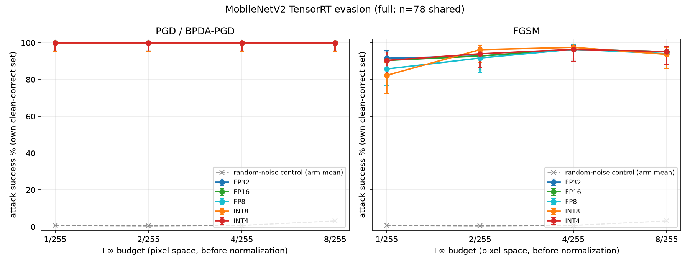
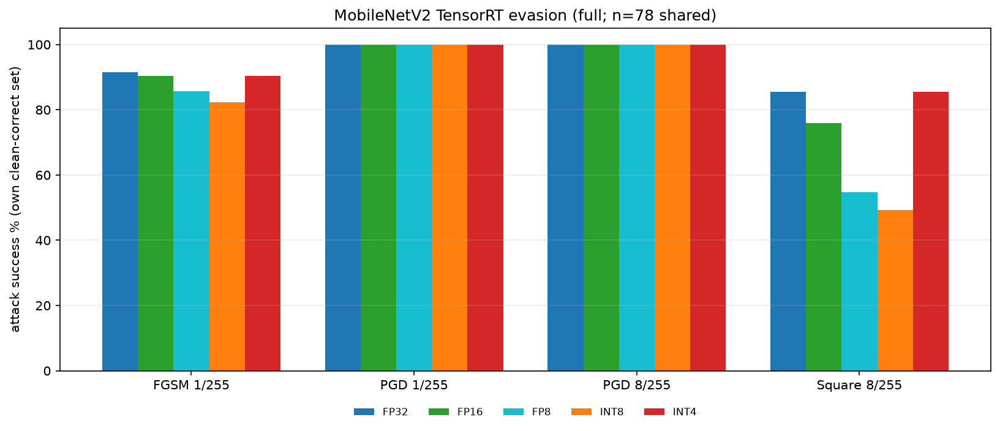
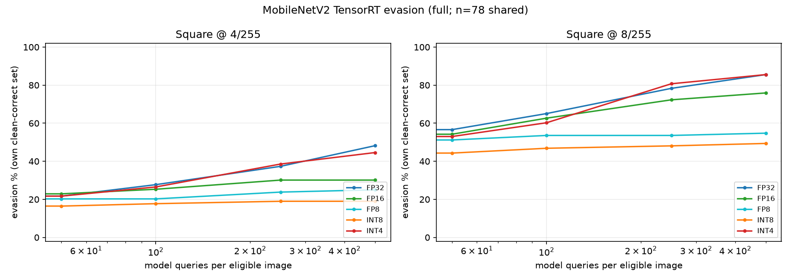
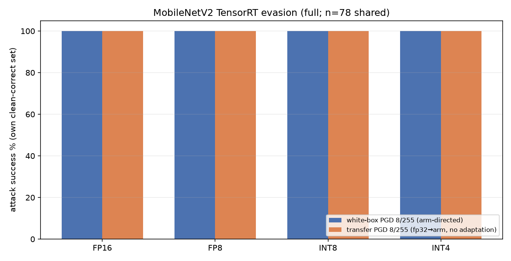
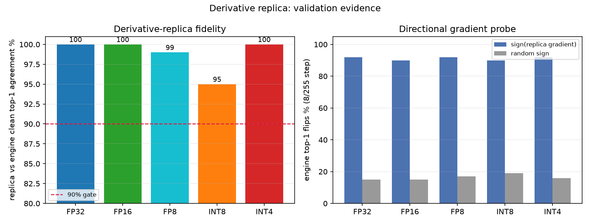

# MobileNetV2 TensorRT input-evasion study

Untargeted digital **input-evasion** against the deployed MobileNetV2
TensorRT engines on `pro4000` (RTX PRO 4000 Blackwell, TensorRT 11.3.0.99,
CUDA 13.2). Only input pixels change: no training, no poisoning, no parameter
attack. This ports the ResNet-50 protocol in
[`../../resnet50/evasion_onnx/`](../../resnetv2_50/evasion_onnx/README.md) to
MobileNetV2 and runs the **two attack families** against **all five deployment
precisions**.

The reusable procedure, gates and pitfalls are captured as a durable skill in
`~/.dsh/skills/adversarial-evasion/SKILL.md` (`/home/ross/.dsh/skills/adversarial-evasion/SKILL.md`; source workspace only)
(project memory: [`METHODOLOGY.md`](METHODOLOGY.md)).

---

## TL;DR

* **The deployment is fully evaded by the white-box attack at every tested
  budget.** PGD / adaptive BPDA-PGD reaches **100.0%** evasion (own clean-correct
  denominator) at **1/255, 2/255, 4/255 and 8/255 on all five precisions**
  (FP32, FP16, FP8, INT8, INT4). One FGSM step already evades 82–92% at 1/255.
  Quantization provides **no meaningful robustness** against the adaptive attack.
* **The score-only attack is much weaker at a 500-query budget**: Square
  evades 19–48% at 4/255 and 49–86% at 8/255, with **INT8 and FP8 the most
  resistant** (49%/55% at 8/255) and FP32/INT4 the least (86%). A lower
  black-box success rate is a **finite-query** effect, not protection.
* **FP32 white-box examples transfer with no adaptation**: 100% of the FP32
  PGD candidates evade every quantized arm at every budget, and 93.6–97.4% of
  the FP32 FGSM candidates do so at 8/255.
* Every number was independently reconciled from the per-image rows
  (10,700 rows / 107 conditions) with explicit, non-mixed denominators; all
  artifact, bound, query-budget and replica-agreement gates pass.

---

## 1. What was attacked

| Property | Value |
|---|---|
| Model | `torchvision` MobileNetV2, `MobileNet_V2_Weights.IMAGENET1K_V1` (3.49 M params) |
| Weights | `pytorch/mobilenet_v2-b0353104.pth` (SHA-256 pinned in each `summary.json`) |
| ONNX source | `trt/mobilenetv2.onnx` (14.20 MB, opset 20, IR 10, dynamic batch 1–16 / h,w 64–512) |
| Runtime | native TensorRT 11.3.0.99, CUDA device 0; **no CPU fallback** |
| Engines | `trt/engine/mobilenetv2_{fp32,fp16,fp8,int8,int4}_bs1.engine` (built on pro4000/sm_120; hardware- and version-specific) |
| Preprocessing | shorter-side resize **256 BICUBIC antialias** → CenterCrop 224 → ToTensor → ImageNet mean/std |
| Task | ImageNet-1k, untargeted; all 1,000 classes retained |
| Threat model | digital L∞ on pixels in [0,1] **before** normalization; budgets 1, 2, 4, 8 / 255 |
| Population | Imagenette2-320 `val`, 10 images/class × 10 classes = 100, seed 20261030, same 100 images for every arm |

### Measured arms

`bs1` is the **authoritative attack target**: the prebuilt `bs1` and `bs8`
engines are not bit-identical (max logit difference 0.0092 on the 100 images,
identical top-1), so scoring every condition on one fixed engine keeps the
comparison internally consistent. Clean top-1 is measured on that engine.

| Arm | Engine SHA-256 (first 16) | Clean correct | Clean acc |
|---|---|---|---|
| `fp32` | `de6c44806e79ad8e` | 83/100 | 83.0% |
| `fp16` | `7c9a2d74b1097cb1` | 83/100 | 83.0% |
| `fp8`  | `16638a12ea186453` | 84/100 | 84.0% |
| `int8` | `7636d85e9e859fc4` | 79/100 | 79.0% |
| `int4` | `11a44751c11d23ed` | 83/100 | 83.0% |

78 images are clean-correct in **all five** arms. Success is always reported on
two explicit denominators — each arm's **own** clean-correct set (above) and
that **shared 78-image** set — and they are never mixed.

### The five precisions are genuinely different graphs

They are not one model at five flags: TensorRT 11 is strongly typed, so
precision comes from the ONNX dtypes.
`fp16` is an FP16 graph conversion; `fp8`/`int8` are ModelOpt Q/DQ graphs
(64 / 104 Q/DQ pairs, per-channel weights, per-tensor activations, zero-point 0);
`int4` is weight-only RTN blocked quantization (block 128) on the classifier
Gemm **only** — 52 conv layers stay float, which is why INT4 behaves like FP32
here and is not faster.

---

## 2. The two attack families

Every deployment runtime is **forward-only**: TensorRT exposes no input
autograd. Lack of native gradients is not robustness.

### Type 1 — white-box gradient attack (FGSM, PGD, adaptive BPDA)

**Exact-runtime-forward / replica-backward autograd bridge.** Each forward
score is the **real engine logit** (asserted bit-identical to `predict()`);
each backward derivative comes from a differentiable **FP32 replica of that
arm's own ONNX graph**. The replica is a derivative model only — it never
scores an attack result.

* **FGSM**: one sign-ascent step of size ε.
* **PGD**: 20 steps, 2 uniform random starts, step ε/4, L∞ projection and
  [0,1] clip after each step, best candidate retained per image over all steps
  and starts (success preferred over failure, clean input also a candidate).
* **Adaptive BPDA for the quantized arms**: the replica executes the graph's
  own recorded quantization grid with straight-through estimators
  (per-channel weight Q/DQ, per-tensor activation Q/DQ, FP8 E4M3 rounding,
  INT4 block-128 dequantization).
* **Stronger survivor check** at 1/255: survivors of the 20-step attack get
  100 steps × 5 fresh starts (`pgd_stronger`), baseline successes retained.

The full construction of the replica — constant folding, per-precision
quantizers, INT4 block dequantization, forward-pass memory handling, the
`ExactOutput` bridge and the validation gates — is documented in
[`TYPE1_REPLICA.md`](TYPE1_REPLICA.md).

### Type 2 — black-box score-only attack (Square)

Local reimplementation of the authors' L∞ Square algorithm: stripe
initialization, margin objective (true class vs best other), the authors'
decreasing patch schedule starting at p = 0.05, up to **500 model queries per
clean-correct image**, stop on success. **No gradients, no surrogate, no
transfer warm start**; the clean eligibility query and final verification are
outside the search budget. Successful evasions include the initial stripe
evaluation (query 1) — several arms' median successful query is 1.

### Supporting controls

* **Random-noise control** at every ε (one uniform draw inside the ball).
* **FP32 → arm transfer**: the FP32 arm's saved FGSM/PGD candidates are scored
  on each destination engine with **no adaptation**.

### Why the white-box result is trustworthy

| Arm | Replica vs engine clean top-1 | mean \|Δlogit\| | max \|Δlogit\| | min per-image cosine | sign(gradient) flips vs random (8/255, engine-scored) |
|---|---|---|---|---|---|
| fp32 | 100.0% | 0.0044 | 0.042 | 0.99999 | 92% vs 15% |
| fp16 | 100.0% | 0.0064 | 0.070 | 0.99999 | 90% vs 15% |
| fp8  | 99.0%  | 0.202  | 1.40  | 0.99120 | 92% vs 17% |
| int8 | 95.0%  | 0.250  | 2.68  | 0.95896 | 90% vs 19% |
| int4 | 100.0% | 0.0043 | 0.038 | 0.99999 | 92% vs 16% |

The gate is ≥90% replica-vs-engine clean top-1 agreement; all arms pass with no
override. The directional probe shows the replica gradient is informative: one
sign step along it flips 90–92/100 engine predictions versus 12–19/100 for a
random direction. The FP8/INT8 residual gap is the TensorRT engine's own
quantized arithmetic vs the ONNX Q/DQ reference (engine INT8 agrees with engine
FP32 on only 92% of clean predictions), not a replica defect. A full validation
report is in [`results/_probe/REPORT.md`](results/_probe/REPORT.md).

---

## 3. Protocol

Per arm: clean evaluation → replica gate → random control, FGSM, PGD (20×2) at
ε ∈ {1,2,4,8}/255 → stronger-survivor check at 1/255 → Square at 4/255 and
8/255 (500 queries) → FP32→arm transfer (non-FP32 arms). Seeds:
population 20261030, per-ε attack seed `20261030 + 100·ε`, strong check
20262730. Every final candidate is re-scored on the bs1 engine and checked for
finite values, [0,1] bounds and the requested L∞ bound.

Artifacts per arm: `summary.json`, `per_image.csv` (one row per
image × condition), `clean.npz`, `samples.json`, candidate tensors
(`*.pt`), `runtime.json`, `tensorrt_layers.json`.

---

## 4. Results

Own clean-correct denominators. `pgd_stronger` equals `pgd` because PGD at
1/255 had **no survivors** left to re-attack on any arm. Wilson 95% intervals
for every cell are in [`results/comparisons/matrix.md`](results/comparisons/matrix.md).

| Arm | clean | FGSM 1/255 | FGSM 8/255 | **PGD 1/255** | **PGD 8/255** | Square 4/255 | Square 8/255 | random 8/255 |
|---|---|---|---|---|---|---|---|---|
| fp32 | 83 | 91.6% | 95.2% | **100.0%** | **100.0%** | 48.2% | 85.5% | 1.2% |
| fp16 | 83 | 90.4% | 95.2% | **100.0%** | **100.0%** | 30.1% | 75.9% | 1.2% |
| fp8  | 84 | 85.7% | 94.0% | **100.0%** | **100.0%** | 25.0% | 54.8% | 6.0% |
| int8 | 79 | 82.3% | 93.7% | **100.0%** | **100.0%** | 19.0% | 49.4% | 5.1% |
| int4 | 83 | 90.4% | 95.2% | **100.0%** | **100.0%** | 44.6% | 85.5% | 2.4% |

Shared 78-image denominator (never mixed with the table above):

| Arm | PGD 1/255 | PGD 8/255 | Square 4/255 | Square 8/255 |
|---|---|---|---|---|
| fp32 | 100.0% | 100.0% | 44.9% | 84.6% |
| fp16 | 100.0% | 100.0% | 25.6% | 74.4% |
| fp8  | 100.0% | 100.0% | 20.5% | 51.3% |
| int8 | 100.0% | 100.0% | 17.9% | 48.7% |
| int4 | 100.0% | 100.0% | 41.0% | 84.6% |

**FP32 → arm transfer** (no adaptation, own denominator) — PGD transfers at
**100.0%** at every ε on every arm; FGSM transfer at 8/255 is 95.2% (fp16),
94.0% (fp8), 97.5% (int8), 95.2% (int4).

### Figures











---

## 5. Findings

1. **MobileNetV2 on every sampled precision is highly vulnerable to an
   adaptive white-box attacker.** 100% evasion at 1/255 means the attack is
   not even close to budget-limited: the model's decision boundary is reached
   within a single 8-bit code step when gradients are available. This is
   markedly weaker than the ResNet-50 arms in the companion study at the same
   budgets.
2. **Quantization is not a defense.** FP8 and INT8 are the *hardest* black-box
   targets at 500 queries (49–55% at 8/255) but are *fully* evaded by the
   adaptive BPDA attack at 1/255. Any "quantization improves robustness"
   claim from the score-only arm alone would be an artifact of the query budget.
3. **The FP32 fixpoint is not a safe oracle.** FP32's own PGD examples evade
   every quantized engine at 100%, so a base-model evaluation badly
   underestimates deployment risk here.
4. **The black-box gap is a query-budget phenomenon.** Square success rises
   steeply with ε (19→49% for INT8, 48→86% for FP32/INT4 from 4 to 8/255) and
   the median successful query is often 1 for the more vulnerable arms — the
   initial stripe alone already evades many images.
5. **INT4 behaves like FP32** because only the classifier Gemm is quantized;
   its accuracy, evasion and transfer numbers track FP32 within noise.

---

## 6. Validation

`scripts/summarize.py` independently reconciles **all 10,700 per-image rows /
107 conditions** from the retained artifacts and re-derives every count from
`per_image.csv` + `clean.npz`; it does not trust the runner's aggregates. It
re-checks sample identity and SHA-256, ONNX/engine hashes, bs1 authoritative
scoring, runtime evidence, every L∞ bound, every Square query cap, the replica
gate, PGD → stronger-survivor retention, and transfer-candidate identity
(`results/comparisons/matrix.json`):

| Gate | Result |
|---|---|
| arms reconciled | fp32, fp16, fp8, int8, int4 |
| per-image rows / conditions | 10,700 / 107 |
| engine, ONNX and sample hashes unchanged | PASS |
| every L∞ bound within budget | PASS |
| every Square query budget ≤ 500 | PASS |
| runner aggregate counts reconciled | PASS |
| replica agreement ≥ 90% all arms | PASS (100/100/99/95/100) |
| transfer candidates verified as FP32 PGD/FGSM | PASS |

An **independent verifier** (`scripts/verify_independent.py`) then rebuilt the
whole result from the artifacts with separate code — it does not import the
attack, runner, runtime or reconciliation modules. It re-selected the
population, re-scored all 87 saved candidate tensors / 1,860 candidates on the
engines, reconciled all 3,200 transfer rows, rebuilt every per-arm / transfer /
union cell and the Markdown tables, re-hashed every artifact, and actively
hunted failure modes (denominator bugs, leaked clean candidates, over-ε
candidates, mislabeled transfer rows). Result: **PASS on all six checks, zero
discrepancies** ([`results/verification/REPORT.md`](results/verification/REPORT.md)).

Two independent findings worth recording:

* The FP32 FGSM **1/255** candidates shift the deployed engine logits by a mean
  max |Δlogit| of **9.84** and flip **83%** of top-1 predictions — the model is
  genuinely brittle at one 8-bit code step, so the 91.6% success is not a
  scoring or counting artifact.
* `pgd_stronger` at 1/255 is identical to `pgd` because PGD had **zero
  survivors** on every arm; the 100×5 survivor check was vacuous, not skipped.

The independent check also notes that this model's 1/255 success is not a
sub-pixel rounding effect, and that FGSM success need not be monotone in ε
(per-step best retention plus [0,1] clipping can make 8/255 slightly lower
than 4/255); both are observations, not defects.

---

## 7. Reproducing

Code is edited locally and executed on pro4000 through `sync.sh`
(`push` / `pull` / `run`). Remote interpreter: `/home/ross/QA/venv/bin/python`.

```bash
cd /home/ross/QA/Models/mobilenetV2

# 0. read-only replica validation (must pass ≥90% on all five arms)
./evasion_trt/sync.sh run evasion_trt/scripts/probe_replica.py --device cuda

# 1. FP32 first: it supplies the transfer candidates
./evasion_trt/sync.sh run evasion_trt/scripts/run_evasion.py --arm fp32  --out evasion_trt/results
./evasion_trt/sync.sh run evasion_trt/scripts/run_evasion.py --arm fp16  --out evasion_trt/results
./evasion_trt/sync.sh run evasion_trt/scripts/run_evasion.py --arm fp8   --out evasion_trt/results
./evasion_trt/sync.sh run evasion_trt/scripts/run_evasion.py --arm int8  --out evasion_trt/results
./evasion_trt/sync.sh run evasion_trt/scripts/run_evasion.py --arm int4  --out evasion_trt/results

# 2. reconcile and plot
./evasion_trt/sync.sh run evasion_trt/scripts/summarize.py
./evasion_trt/sync.sh pull
PYTHONPATH=evasion_trt/scripts /home/ross/QA/venv/bin/python evasion_trt/scripts/make_figures.py
```

The whole five-arm matrix takes about 5 minutes of GPU time (attack compute
~249 s plus replica build/probe); Square dominates.

---

## 8. Layout

| Path | Contents |
|---|---|
| `scripts/config.py` | paths, arm registry, preprocessing and protocol constants (single source of truth) |
| `scripts/runtimes.py` | TensorRT `EngineRuntime` + exact-forward/replica-backward `AttackTarget` |
| `scripts/replica.py` | differentiable FP32 replica of each ONNX graph (BPDA/STE) |
| `scripts/attacks.py` | sample loader, FGSM/PGD/Square primitives |
| `scripts/run_evasion.py` | per-arm protocol runner |
| `scripts/probe_replica.py` | replica-vs-engine validation probe |
| `scripts/summarize.py` | independent reconciliation → `results/comparisons/matrix.{json,md}` |
| `scripts/make_figures.py` | figures in `figures/` |
| `scripts/verify_independent.py` | independent verifier (separate code path) |
| `results/<arm>/` | per-arm artifacts |
| `results/comparisons/` | reconciled matrix |
| `results/_probe/`, `results/verification/` | validation evidence |
| `SPEC.md`, `METHODOLOGY.md` | interface contract / project memory |
| `TYPE1_REPLICA.md` | how the Type-1 differentiable replica is built (constant folding, quantizers, bridge, validation) |

---

## 9. Limitations

* 100 stratified Imagenette validation images over ten ImageNet classes with a
  full 1,000-class head, one population seed and one attack seed per ε. This is
  a **pilot**, not a full ImageNet robustness benchmark.
* Finite FGSM/PGD/Square attacks are not certificates of worst-case
  robustness. A failure of BPDA is not evidence of protection.
* The white-box gradient is an approximation: TensorRT has no input autograd,
  so derivatives come from a differentiable replica (BPDA for quantized arms).
  The FP32 surrogate gap (max |Δlogit| 0.042) is the engine's own TF32 conv
  tactics; the INT8/FP8 gap is the engine's quantized arithmetic.
* Engines are specific to pro4000 / TensorRT 11.3.0.99 / sm_120 and are not
  portable; the bs8 engines were validated for top-1 but are not the scoring
  target.
* Only digital input evasion; no physical/camera, original-resolution, patch,
  or targeted attacks.
* The 1/255 stronger-survivor check had no survivors to re-attack (PGD was
  already 100%), so it extends coverage only on models that resist the 20-step
  attack. Independent verification re-scored the saved candidate pools; it could
  not re-run the PGD trajectories or rebuild the replica gradients.

## 10. Relation to the ResNet-50 study

This study reuses the ResNet-50 methodology (`../../resnet50/evasion_onnx/`):
the same two attack families, the same exact-forward/replica-backward bridge,
the same population/seed and the same acceptance gates. It differs in the
model (MobileNetV2), the deployment target (native TensorRT engines for five
precisions), the preprocessing (**resize 256 bicubic antialias**, not 232), and
the recommendation to score the authoritative target on a single fixed engine.
Headline contrast: at 1/255 the ResNet-50 arms were only partly evaded by
PGD, while MobileNetV2 is fully evaded on every precision.
