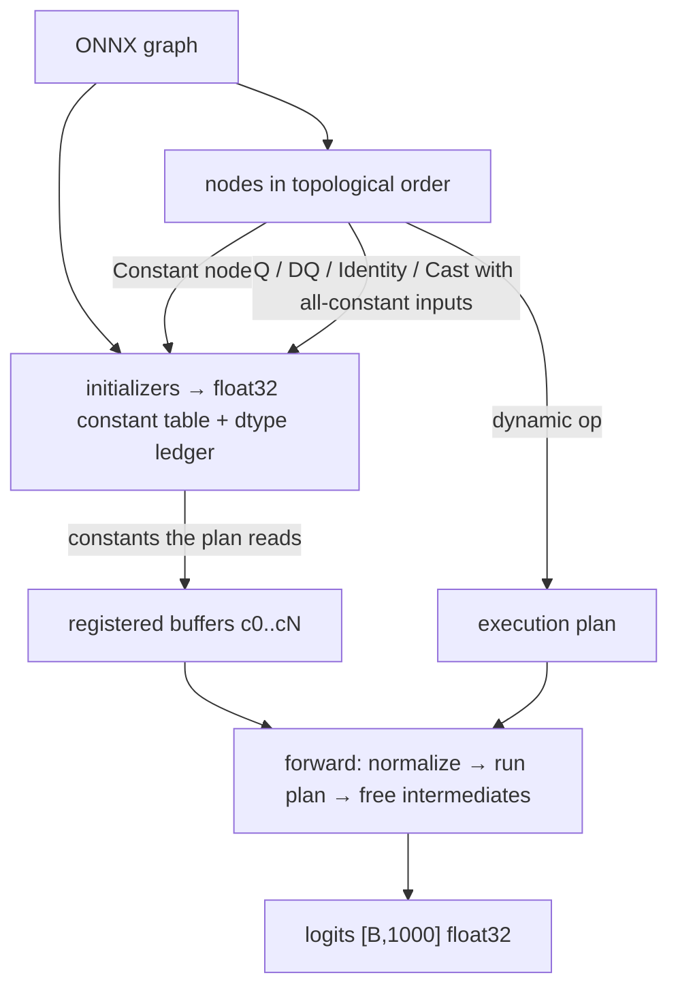

# Type-1 attack: how the differentiable replica is built

**Status:** implemented, validated and used for the full MobileNetV2 TRT matrix.
**Scope:** this document explains *only* how the project constructs the
differentiable FP32 **replica** that supplies the gradients for the Type-1
(white-box) FGSM/PGD/BPDA attacks. It does not re-describe the attack protocol
(see [`README.md`](README.md) and [`METHODOLOGY.md`](METHODOLOGY.md)).

| Item | Value |
|---|---|
| Replica code | `scripts/replica.py` (`Models/mobilenetV2/evasion_trt/scripts/replica.py`; source workspace only) (295 lines) |
| Attack bridge | `scripts/runtimes.py` (`Models/mobilenetV2/evasion_trt/scripts/runtimes.py`; source workspace only) (`ExactOutput`, `AttackTarget`) |
| Validation probe | `scripts/probe_replica.py` (`Models/mobilenetV2/evasion_trt/scripts/probe_replica.py`; source workspace only) (717 lines) |
| Validation artifacts | [`results/_probe/replica_validation.json`](results/_probe/replica_validation.json), [`results/_probe/REPORT.md`](results/_probe/REPORT.md) |
| Overall probe verdict | **PASS** — all five arms ≥ 90 % replica-vs-engine clean top-1 agreement, INT4 dequant error 0.00459 < 0.01 |

---

## 0. What the replica is (and is not)

`GraphReplica` is a `torch.nn.Module` that executes **the target arm's own ONNX
graph** in float32 with autograd enabled. It is built from that graph's
initializers, including its recorded quantization scales and zero-points, so it
carries the target's **own weights, architecture and quantization grids**.

It exists because the deployed TensorRT engines are **forward-only**: there is
no input autograd to call. The attacks therefore use an
**exact-runtime-forward / replica-backward bridge**:

```
forward  : real TensorRT engine logits        (bit-identical to deployment)
backward : d(logits)/d(pixels) from the replica (a differentiable reconstruction)
```

Classification: this is a **white-box attack with an approximate gradient**
(BPDA-style, "Backward Pass Differentiable Approximation"). It is *not*
black-box — a black-box attacker has only input→output query access and no
weights. The replica is not an independently trained substitute; it is the
target's own graph. The gradient is called *approximate* only because it is
computed in float32 arithmetic rather than through the TensorRT kernels
(and, for quantized arms, through straight-through estimators). Every result
records `native_runtime_autograd: false`.

---

## 1. Inputs and contract

### Inputs

| Input | Where it comes from |
|---|---|
| ONNX graph | `config.ARMS[arm]['onnx']` — `trt/mobilenetv2{,_fp16,_fp8,_int8,_int4}.onnx` |
| Weights / biases | graph initializers (fp16, int4-packed, …) |
| Quantization grids | graph initializers: per-channel scales, zero-points, blocked INT4 scales |
| Graph constants | `Constant` nodes / initializers: ReLU6 min-max, ReduceMean axes, Reshape shape |
| Preprocessing | ImageNet mean `[0.485,0.456,0.406]`, std `[0.229,0.224,0.225]` (applied **inside** the module) |

### Contract (must stay identical for the attack code to compose)

```python
class GraphReplica(torch.nn.Module):
    def __init__(self, onnx_path): ...
    # pixels: float32 [B, 3, 224, 224] in [0, 1]; normalizes internally
    def forward(self, pixels) -> Tensor[B, 1000]   # float32 logits
    op_counts: dict          # Counter of dynamic-plan ops, recorded in summary.json
    n_folded_tensors: int    # size of the folded constant environment
    anchor: nn.Parameter     # non-trainable; lets shared code find the device
```

* Always computes in **float32**, even for the FP16/FP8/INT8 graphs (`Cast` is
  treated as identity).
* Never scores an attack: `run_evasion.py` scores every candidate on the real
  engine; the replica only supplies derivatives.
* Raises `NotImplementedError` for any operator it does not implement, instead
  of silently returning a wrong value.

Instantiated in `run_evasion.py` (`Models/mobilenetV2/evasion_trt/scripts/run_evasion.py`; source workspace only) as

```python
graph = GraphReplica(onnx_path).to(device).eval().requires_grad_(False)
target = AttackTarget(arm, runtime, batch_size, graph)   # runtime = EngineRuntime(bs1 engine)
```

---

## 2. Build pipeline (constructor)

### 2.1 Parse the graph

```python
graph = onnx.load(onnx_path).graph
self.input_name  = graph.input[0].name
self.output_name = graph.output[0].name
constants = {t.name: onnx.numpy_helper.to_array(t) for t in graph.initializer}
self.types = {name: np.dtype(array.dtype) for name, array in constants.items()}
folded     = {name: _to_float32_tensor(array) for name, array in constants.items()}
```

* `self.types` is a **dtype ledger**: it remembers each constant's *recorded*
  encoding (`int8`, `float8_e4m3fn`, `int4`, `float16`, …). This is needed later
  because the clipping range of a `QuantizeLinear` is implied by its
  zero-point's dtype.
* `folded` is the **float32 constant environment**: every initializer is stored
  as a float32 tensor. `_to_float32_tensor` promotes the extension dtypes that
  NumPy/`torch.from_numpy` cannot carry directly:
  * `int4` / `uint4` → `int32` → float32 (values preserved; the INT4 grid is
    applied later by the blocked dequantizer);
  * `float8_*` → float32.

### 2.2 Walk the nodes once, folding everything constant

Nodes are visited in ONNX topological order. Three cases:

```python
for node in graph.node:
    attrs = {a.name: onnx.helper.get_attribute_value(a) for a in node.attribute}

    if node.op_type == 'Constant':                         # (a) literal constant
        folded[node.output[0]] = _to_float32_tensor(attrs['value'])

    entry = (node.op_type, list(node.input), list(node.output), attrs)

    if node.op_type in _FOLDABLE and all(not x or x in folded for x in node.input):
        folded[node.output[0]] = self.execute(entry, [folded[x] if x else None
                                                      for x in node.input])   # (b) fold
    else:
        self.plan.append(entry)                            # (c) keep for runtime
```

`_FOLDABLE = {QuantizeLinear, DequantizeLinear, Identity, Cast}`.

**The folding rule is the key trick.** A node is folded when **all of its
inputs are already constants**. Because a weight quantization chain has the
form

```
weight(initializer) → QuantizeLinear(scale, zero_point) → DequantizeLinear → Conv
```

the `QuantizeLinear` folds first (weight, scale, zero-point are all
initializers), its output enters `folded`, and then the following
`DequantizeLinear` *also* folds — producing a plain float32 **dequantized
weight** that the dynamic `Conv` node can consume. This:

* makes the replica run on the graph's **recorded quantization grid** (the same
  grid the deployed engine uses), and
* leaves the weight/scale/zero-point tensors out of the dynamic plan, keeping
  it small.

Activation Q/DQ pairs are *not* foldable (their data input is a dynamic tensor),
so they stay in the plan and use straight-through estimators — this is the
BPDA part.

### 2.3 Residual execution plan

Every non-folded node is kept in `self.plan` and must be one of

```python
_SUPPORTED = {QuantizeLinear, DequantizeLinear, Identity, Cast,
              Conv, Clip, Add, ReduceMean, Reshape, Gemm}
```

Anything else raises `NotImplementedError` **at construction time** — a missing
operator cannot silently produce a wrong gradient. For MobileNetV2 this set is
complete; the graphs need no exotic ops.

### 2.4 Register only the constants the plan reads

```python
used = {name for _, ins, _, _ in self.plan for name in ins if name}
for name, value in folded.items():
    if name not in used: continue
    key = f'c{len(self.names)}'
    self.register_buffer(key, value)          # moves with .to(device)
    self.names[name] = key                    # ONNX tensor name → buffer key
```

`register_buffer` means constants follow the module across `.to('cuda')` and
are excluded from `state_dict` gradients. Only constants actually referenced by
the dynamic plan are registered; the rest stay in `folded` for diagnostics
(`n_folded_tensors`).

### 2.5 Metadata

```python
self.register_buffer('mean', torch.tensor(MEAN)[None, :, None, None])
self.register_buffer('std',  torch.tensor(STD )[None, :, None, None])
self.op_counts       = dict(Counter(op for op, _, _, _ in self.plan))
self.n_folded_tensors = len(folded)
self.anchor           = nn.Parameter(torch.zeros(()), requires_grad=False)
self.uses             = Counter(name for _, ins, _, _ in self.plan for name in ins if name)
```

* `op_counts` is exported into `summary.json` (`replica_dynamic_ops`) so a
  reviewer can see exactly what executed.
* `anchor` is a non-trainable parameter whose only purpose is to let generic
  code find the module's device without asking for weight gradients.
* `uses` is a reference count used to free intermediates during the forward pass.

### Pipeline at a glance



---

## 3. Operator coverage and semantics

`execute(entry, values)` implements the following, matching ONNX semantics
closely enough for gradient purposes:

| ONNX op | Replica implementation | Notes |
|---|---|---|
| `Conv` | `F.conv2d(x, w, bias, stride, padding, dilation, groups)` | symmetric pads passed as `padding`; asymmetric pads materialized with `F.pad([l,r,t,b])` first; handles depthwise (MobileNetV2) and pointwise convs |
| `Clip` | `torch.clamp(x, min=lo, max=hi)` | ReLU6: `lo`/`hi` arrive as **constant tensor inputs** (0.0 / 6.0), not attributes |
| `Add` | `x + y` | residual connections |
| `ReduceMean` | `x.mean(dim=axes, keepdim=keepdims)` | axes arrive as a **constant tensor input** `[-1,-2]`, `keepdims=1` (global average pool) |
| `Reshape` | `torch.reshape(x, shape)` | shape arrives as an input `[-1, 1280]` |
| `Gemm` | `alpha * (x @ w) + beta * b` | `transA` / `transB` handled; classifier head |
| `QuantizeLinear` | `quant(x, scale, zp, dtype, axis)` | see §4; straight-through |
| `DequantizeLinear` | `dequant(x, scale, zp, axis, block_size)` | see §4; blocked INT4 supported |
| `Cast` | identity | FP32 arithmetic is used even for FP16 graphs |
| `Identity` | identity | |

Foldable weight Q/DQ chains therefore never reach `execute` at run time as
separate ops; they are already constants.

**Executed dynamic plan for MobileNetV2:**

| arm | Conv | Clip | Add | ReduceMean | Reshape | Gemm | Cast | Q | DQ | total | folded consts |
|---|---:|---:|---:|---:|---:|---:|---:|---:|---:|---:|---:|
| fp32 | 52 | 35 | 10 | 1 | 1 | 1 | 0 | 0 | 0 | 100 | 110 |
| fp16 | 52 | 35 | 10 | 1 | 1 | 1 | 2 | 0 | 0 | 102 | 110 |
| fp8 | 52 | 35 | 10 | 1 | 1 | 1 | 2 | 32 | 32 | 166 | 498 |
| int8 | 52 | 35 | 10 | 1 | 1 | 1 | 2 | 52 | 52 | 206 | 698 |
| int4 | 52 | 35 | 10 | 1 | 1 | 1 | 0 | 0 | 0 | 100 | 180 |

---

## 4. Quantization handling

This is the part that makes the replica a **BPDA** surrogate rather than a
plain float model. All zero-points in these graphs are **0**, so the math is
symmetric, but the code does not assume it.

### 4.1 Primitives

**Broadcasting a per-channel constant.** `broadcast(value, x, axis)` returns a
shape that broadcasts against `x` (a scalar stays a scalar), with negative axes
normalized. This is needed because weight scales are per-output-channel
(`axis=0`) while activation scales are per-tensor.

**QuantizeLinear with a straight-through estimator.**

```python
def quant(x, scale, zp, dtype, axis=1):
    scale, zp = broadcast(scale, x, axis), broadcast(zp, x, axis)
    logged = x / scale + zp

    if is_float8(dtype):                         # FP8 E4M3
        limits = float(torch.finfo(torch.float8_e4m3fn).max)   # 448
        continuous = logged.clamp(-limits, limits)
        codes = continuous.to(torch.float8_e4m3fn).to(torch.float32)  # round-to-nearest
        return continuous + (codes - continuous).detach()

    limits = np.iinfo(dtype)                     # INT8/INT4: real integer grid
    continuous = logged.clamp(float(limits.min), float(limits.max))
    codes = continuous.round()
    # Clipping derivative is preserved: a grid with zero-point 0 can itself
    # implement a fused ReLU, so gradients stop outside the representable range.
    return continuous + (codes - continuous).detach()
```

The returned tensor is `codes` in the forward pass and carries an identity
gradient (or a 0/1 clipping mask) in the backward pass — the standard STE.

**DequantizeLinear.** `y = (x − zp) · scale`, with per-tensor, per-axis or
blocked scale:

```python
def dequant(x, scale, zp=None, axis=1, block_size=0):
    if block_size:
        scale = _block_expand(scale, x, axis, block_size)
        if zp is not None: zp = _block_expand(zp, x, axis, block_size)
    else:
        scale = broadcast(scale, x, axis)
        if zp is not None: zp = broadcast(zp, x, axis)
    return (x if zp is None else x - zp) * scale
```

### 4.2 Per-arm quantization treatment

| arm | quantized region (recorded in the graph) | replica treatment |
|---|---|---|
| **fp32** | none | plain float32 graph; no quantizer ops in the plan |
| **fp16** | none (graph is FP16-typed; I/O stays FP32) | `Cast` folds to identity; FP16-stored weights promoted to float32 |
| **fp8** | **32** of 52 conv layers: weight Q/DQ (per-channel, FP8 E4M3) + activation Q/DQ (per-tensor) | weight Q→DQ chains **fold** to their dequantized float32 weight; 32 activation Q/DQ pairs stay in the plan and use the FP8 STE above. Classifier `Gemm` stays FP16 (no Q/DQ) |
| **int8** | **52** conv layers: weight Q/DQ (per-channel INT8) + activation Q/DQ (per-tensor INT8) | same split: weight chains fold; 52 activation pairs stay dynamic and use the INT8 STE. Classifier `Gemm` stays FP16 (no Q/DQ) |
| **int4** | **classifier `Gemm` weight only** (RTN blocked INT4, block 128); all 52 conv layers stay float | the single blocked `DequantizeLinear` folds to a constant dequantized classifier weight; no dynamic quantizer ops |

*(Note: a “Q/DQ pair” is one `QuantizeLinear` node plus its `DequantizeLinear`
node. The FP8 graph has **64 pairs** — 32 weight pairs + 32 activation pairs,
i.e. **32 of 52** conv layers are quantized; the INT8 graph has **104 pairs** —
52 weight pairs + 52 activation pairs, i.e. **all 52** conv layers. The
classifier `Gemm` weight is not quantized in either graph, which is why its
folded weight differs from the FP32 checkpoint only by FP16 rounding: 7.9e-6.)*

### 4.3 FP8 E4M3 specifics

* Zero-point dtype is `float8_e4m3fn`, so `np.iinfo()` **cannot** be used —
  the code branches on dtype name and uses `torch.float8_e4m3fn` for the
  round-to-nearest cast, clamping to `±finfo.max = ±448` first.
* The FP8 weight Q/DQ chain folds at build time, so the replica's weights are
  the actual FP8-dequantized values, not the FP16 originals.

### 4.4 INT8 specifics

* Signed INT8 grid, `np.iinfo('int8')` → `[-128, 127]`.
* The clipping mask is part of the derivative. This matters for graphs whose
  unsigned output grid implements a fused ReLU; here zero-points are 0 and
  ReLU6 is an explicit `Clip`, but the implementation keeps the correct
  derivative for both cases.

### 4.5 INT4 blocked dequantization (the one non-trivial exporter quirk)

The INT4 graph quantizes only `classifier.1.weight`:

```
classifier.1.weight_i4    int4   (1000, 1280)
classifier.1.weight_scale float32 (1000, 10)
DequantizeLinear(axis=0, block_size=128)
```

The exporter writes `axis=0`, but the scale shape `(1000, 10)` does **not**
match blocked-along-axis-0 semantics. The true grid is 10 blocks of 128 along
the **input** dimension:

```
W_dq[o, i] = w4[o, i] * scale[o, i // 128]
```

`_block_expand` defends against exactly this: rather than trusting the
attribute, it infers the block axis from the recorded scale shape, requires the
inference to be **unique**, expands with `repeat_interleave(block_size)`, slices
to the input length, and raises if the result cannot match the input shape.

Verification: the folded INT4 classifier weight differs from the torchvision
FP32 checkpoint by **0.004592 mean / 0.101982 max** absolute error (gate
`< 0.01`; PASS). For the FP32/FP16/FP8/INT8 arms the same check gives
0.0 / 7.9e-6 / 7.9e-6 / 7.9e-6 — i.e. only FP16 rounding.

---

## 5. Forward pass

```python
def forward(self, pixels):                 # pixels [B,3,224,224] in [0,1]
    env = {name: getattr(self, key) for name, key in self.names.items()}
    env[self.input_name] = (pixels - self.mean) / self.std    # normalize inside

    uses = self.uses.copy()
    for entry in self.plan:
        _, ins, outs, _ = entry
        values = [env[name] if name else None for name in ins]
        assert len(outs) == 1
        env[outs[0]] = self.execute(entry, values)

        for name in ins:                  # free an intermediate at its last use
            if name:
                uses[name] -= 1
                if uses[name] == 0 and name != self.output_name:
                    env.pop(name, None)
    return env[self.output_name]
```

* The normalization is part of the replica so callers always pass raw `[0,1]`
  pixels; `EngineRuntime` applies the identical normalization to its own input,
  which keeps the bridge apples-to-apples.
* Intermediate tensors are freed as soon as their last consumer has run, so the
  peak activation memory stays close to a normal forward.
* All graph parameters are buffers/constants; the only tensor requiring grad is
  the caller's `pixels` (the module is instantiated with
  `.requires_grad_(False)`).

---

## 6. How the replica plugs into the attack

The bridge lives in `runtimes.py` (`Models/mobilenetV2/evasion_trt/scripts/runtimes.py`; source workspace only):

```python
class ExactOutput(torch.autograd.Function):
    @staticmethod
    def forward(ctx, approximate, actual):
        return actual.clone()          # forward = deployed engine logits

    @staticmethod
    def backward(ctx, gradient):
        return gradient, None          # backward = through the replica

class AttackTarget:
    def logits_for_grad(self, pixels):
        approximate = self.surrogate(pixels)
        actual = self.predict(pixels.detach().cpu()).to(pixels.device)
        return ExactOutput.apply(approximate, actual)
```

So in `pgd()`:

```python
logits = target.logits_for_grad(candidate)      # real engine logits, replica gradient
losses = F.cross_entropy(logits, y, reduction='none')
grad   = torch.autograd.grad(losses.sum(), candidate)[0]
```

The replica's output is discarded in the forward pass; only its autograd graph
survives to produce `grad`.

### Preflight assertions before any attack runs

`run_evasion.py` refuses to attack unless the bridge is provably sound:

```python
graph = GraphReplica(onnx_path).to(device).eval().requires_grad_(False)
...
exact_forward = target.logits_for_grad(probe)
assert torch.equal(exact_forward.detach().cpu(), target.predict(probe.detach().cpu()))  # bit-identical
derivative = torch.autograd.grad(F.cross_entropy(exact_forward, probe_labels), probe)[0]
assert torch.isfinite(derivative).all() and derivative.abs().sum() > 0                   # usable gradient
```

Then the **replica agreement gate** compares replica clean top-1 against engine
clean top-1 and stops (or requires a recorded override) below 90 %:

```python
approximation = torch.cat([graph(b.to(device)).detach().cpu() for b in x.split(batch_size)])
agreement = 100.0 * approximation.argmax(1).eq(clean_logits.argmax(1)).sum() / n
if agreement < 90 and not overriding:
    raise RuntimeError(...)   # a derivative-replica defect, never "robustness"
```

---

## 7. Validation

`probe_replica.py` validates the replica **before** it is trusted, using
100 images, the real bs1 engines, and the arm's own ONNX graph.

### 7.1 Method

1. Build `GraphReplica(onnx)` and `EngineRuntime(engine_bs1)`.
2. Score the 100 images on the engine (clean reference) and on the replica.
3. Measure top-1 agreement, logit-difference statistics, Pearson correlation and
   per-image cosine similarity.
4. Compute the replica gradient and require it to be finite and non-zero.
5. **Directional probe:** one ε=8/255 `sign(gradient)` step, one `sign(−gradient)`
   step and one random-sign step, each scored on the **real engine** — this
   proves the derivative moves the deployed function, which top-1 agreement
   alone cannot.
6. INT4-only: compare the folded classifier weight with the FP32 checkpoint.
7. Cross-arm context and an optional ONNX Runtime cross-check.

### 7.2 Gate results (100 images, bs1 engines)

| arm | engine clean | replica clean | top-1 agree | mean abs Δlogit | max abs Δlogit | global r | gate ≥90 % | ideal ≥97 % |
|---|---:|---:|---:|---:|---:|---:|---|---|
| fp32 | 83/100 | 83/100 | **100 %** | 0.004406 | 0.04168 | 1.00000 | PASS | PASS |
| fp16 | 83/100 | 83/100 | **100 %** | 0.006361 | 0.07045 | 0.999996 | PASS | PASS |
| fp8 | 84/100 | 84/100 | **99 %** (disagree: idx 36) | 0.2022 | 1.40 | 0.99623 | PASS | PASS |
| int8 | 79/100 | 81/100 | **95 %** (disagree: 6, 44, 66, 74, 91) | 0.2495 | 2.678 | 0.99391 | PASS | not ideal |
| int4 | 83/100 | 83/100 | **100 %** | 0.004334 | 0.03752 | 0.999997 | PASS | PASS |

Overall gate: **PASS** (`overall.gate_passed: true`). Engine clean counts
reproduce the SPEC §3 values exactly (83/83/84/79/83), which proves the probe is
scoring the agreed images and preprocessing.

### 7.3 Gradient + directional probe (ε = 8/255, engine-scored)

| arm | grad finite | zero-grad imgs | grad L1 mean | sign(grad) flips | random flips | sign(−grad) flips | grad attack success on clean-correct | random attack success |
|---|---|---|---:|---:|---:|---:|---|---|
| fp32 | yes | 0 | 88.87 | **92 %** | 12 % | 20 | 79/83 (95.2 %) | 6/83 (7.2 %) |
| fp16 | yes | 0 | 88.67 | **90 %** | 12 % | 20 | 79/83 (95.2 %) | 6/83 (7.2 %) |
| fp8 | yes | 0 | 89.68 | **92 %** | 14 % | 20 | 79/84 (94.0 %) | 8/84 (9.5 %) |
| int8 | yes | 0 | 91.88 | **92 %** | 15 % | 22 | 75/79 (94.9 %) | 6/79 (7.6 %) |
| int4 | yes | 0 | 88.47 | **92 %** | 12 % | 22 | 79/83 (95.2 %) | 6/83 (7.2 %) |

A correct gradient flips 90–92 % of engine predictions and drops the mean
top-2 margin by ~3.0; a random direction flips 12–15 % and drops it by ~0.8.
This is the evidence that the replica's derivative — not just its forward
values — is faithful enough for the attack.

Near-zero CE gradients occur on one image per arm (index 88, a saturated
correct prediction with top-2 margin ≈ 25). `sign()` still defines a valid
FGSM/PGD direction, but the magnitude carries no signal; this is a numerical
property of the data, not a replica defect. It is recorded rather than hidden.

### 7.4 Why the INT8/FP8 agreement is lower (cross-arm context)

A replica should be compared with the **deployment gap**, not in isolation:

| arm | engine vs FP32 engine | replica vs own engine | verdict |
|---|---|---:|---|
| fp32 | 100 % | 100 % | exact |
| fp16 | 100 % | 100 % | exact |
| fp8 | 94 % | **99 %** | replica is *closer* to its engine than the engine is to FP32 |
| int8 | 92 % | **95 %** | same |
| int4 | 99 % | 100 % | exact |

So the 99 %/95 % figures are the **TensorRT engine's quantized arithmetic**
departing from the ONNX Q/DQ reference, not a badly built replica. The
independently verified attack outcomes (all candidates scored on the real
engine) are unaffected.

### 7.5 ONNX Runtime cross-check (diagnostic, not a gate)

For FP32/FP16 the graph is plain ONNX and ORT is authoritative: replica vs ORT
top-1 is 100 % with mean |Δlogit| **2.2e-6 / 2.1e-6**, i.e. the replica implements
the graph faithfully. For the Q/DQ arms ORT is not authoritative (it executes
these ModelOpt→TRT INT8 graphs incorrectly: 3 % top-1 vs the engine; and it
rejects the INT4 blocked `DequantizeLinear`), which is why the deployed TRT
engine is the reference throughout.

### 7.6 Overall verdict

`overall = {all_arms_ran: true, failed_arms: [], arms_below_gate: [],
gate_passed: true, ideal_passed: true, int4_dequant_check_passed: true,
directional_probe_informative_all: true}`

The classifier weight check, the agreement gate, the gradient checks and the
directional probe all pass on all five arms.

---

## 8. Guardrails encoded in the implementation

| Pitfall | Defense in the code |
|---|---|
| Missing/unknown operator silently wrong | `NotImplementedError` at **build** time for anything outside `_SUPPORTED` |
| FP8 zero-point dtype breaks `np.iinfo` | branch on `float8*` and cast via `torch.float8_e4m3fn` with `±finfo.max` clamp |
| INT4 `axis` attribute disagrees with the scale shape | infer the block axis from the recorded shape, require a **unique** match, raise otherwise |
| Weight Q/DQ wrongly left dynamic | fold **any** node whose inputs are all constants, in topological order |
| Float16 graph dtype re-introduces fp16 arithmetic | `Cast` → identity; all folded constants promoted to float32 |
| Asymmetric convolution padding | materialize with `F.pad` when `pads[:2] != pads[2:]` |
| Per-channel vs per-tensor scale axes | `broadcast()` normalizes negative axes and reshapes only the scale axis |
| Ranking on top-1 agreement alone | separate directional probe scored on the **real engine** |
| Silently reporting a bad surrogate | 90 % gate stops the run (override requires a recorded floor + reason) |
| Accepting a broken bridge | bit-identical forward assertion before the first attack step |
| Stale/overwritten weights | ONNX hash re-checked at the end; engine hash too |

---

## 9. Porting the replica to a new model / precision

1. **Inventory the dynamic ops.** `op_counts` after construction, or
   `collections.Counter(n.op_type for n in onnx.load(g).graph.node)`. MobileNetV2
   needs only `Conv, Clip, Add, ReduceMean, Reshape, Gemm, Cast, Q/DQ`.
2. **Add missing op handlers** to `_SUPPORTED` and `execute()`. Keep them
   autograd-friendly (PyTorch ops); use constant folding for anything with
   all-constant inputs.
3. **Handle the quantization form** the exporter emits:
   * QDQ form → weight chains fold, activations use STE;
   * QOperator (`QLinearConv`, `QGemm`, …) → expand to float conv + recorded grid
     (see the ResNet-50 `onnx_surrogate.py` for that family);
   * blocked INT4 → verify the block-axis interpretation against the FP32 weight
     numerically before trusting it;
   * FP8 → use the `torch.float8_*` cast, never `np.iinfo`.
4. **Run the probe** (`probe_replica.py` equivalent). Do not run a full matrix
   until every arm is ≥ 90 % agreement and the directional probe is informative.
5. **Gate the runner** on replica agreement, and record the method + numbers in
   `summary.json`.
6. **Cross-check FP32/FP16 against ONNX Runtime** (mean |Δlogit| should be ~1e-6)
   to prove the replica implements the graph, separately from the engine.

---

## 10. Limitations

* The replica computes in float32; the deployed engine computes in its own
  precision (and TF32 tactics in the FP32 engine). The gradient is therefore an
  approximation to the deployed function's derivative, not an exact analytic
  gradient through TensorRT. This is the BPDA premise and is recorded as
  `native_runtime_autograd: false`.
* Straight-through estimators are a heuristic; they do not undo a quantization
  boundary that the deployed engine implements differently.
* Top-1 agreement is a blunt proxy for gradient fidelity; the directional probe
  is stronger evidence but still a one-step diagnostic.
* The replica is not a defense evaluation: it cannot prove robustness, only
  supply a white-box attack gradient.
* MobileNetV2 graphs were fully covered by the implemented op set; a new
  architecture may need new handlers before the gate can pass.

---

## 11. Reproduce the replica validation

```bash
cd /home/ross/QA/Models/mobilenetV2

# read-only probe: replica vs all five bs1 engines, gradients + directional test
./evasion_trt/sync.sh run evasion_trt/scripts/probe_replica.py --device cuda
# with the optional ONNX Runtime cross-check
./evasion_trt/sync.sh run evasion_trt/scripts/probe_replica.py --device cuda --ort-check

./evasion_trt/sync.sh pull
```

Artifacts: `results/_probe/replica_validation.json`,
`results/_probe/REPORT.md`, `logs/probe_replica.log`. Refuses to modify any ONNX
file or engine; writes only under `results/_probe/`.

---

## 12. File map

| Location | Role in the replica pipeline |
|---|---|
| `scripts/replica.py :: GraphReplica` | graph parsing, constant folding, buffers, op execution, STE quantizers |
| `scripts/replica.py :: quant / dequant / _block_expand / broadcast` | the quantizer math and broadcasting rules |
| `scripts/runtimes.py :: ExactOutput` | the exact-forward/replica-backward autograd bridge |
| `scripts/runtimes.py :: AttackTarget.logits_for_grad` | wires engine forward + replica backward |
| `scripts/runtimes.py :: EngineRuntime` | scores candidates on the real bs1 TensorRT engine |
| `scripts/run_evasion.py` | builds the replica, runs preflight asserts, enforces the gate, runs attacks |
| `scripts/probe_replica.py` | independent replica validation (agreement, gradients, directional, INT4, ORT) |
| `results/_probe/replica_validation.json` | machine-readable validation evidence |
| `results/_probe/REPORT.md` | human-readable validation report |
