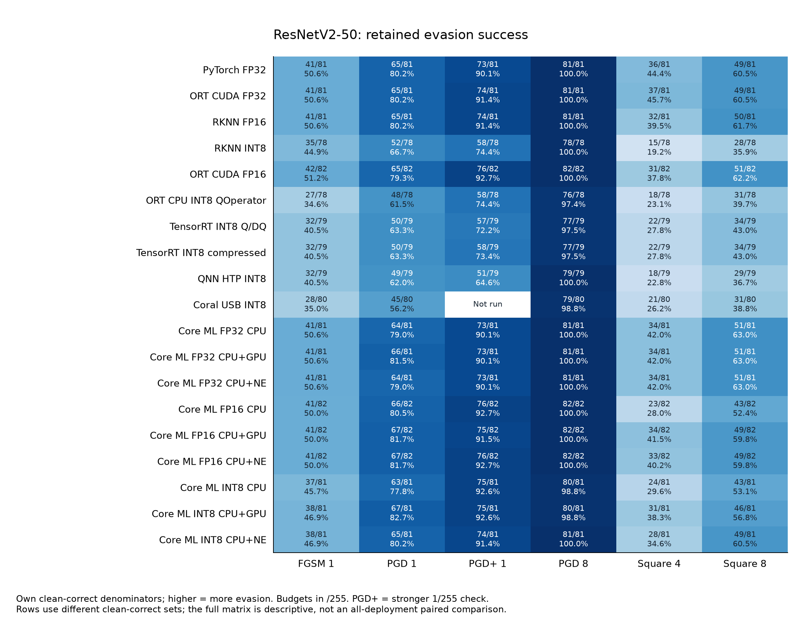

# ResNetV2-50 cross-runtime evasion: Core ML separates weight compression from activation quantization

Results through **10 November 2026 (Hong Kong time)**. Model:
`timm/resnetv2_50.a1h_in1k`, checkpoint `b809e8c0…a61b`, canonical ONNX
`6416f2e9…c13f4`. This report covers **19 deployment configurations**: the
original nine-deployment matrix, Coral Edge TPU and nine Core ML configurations.
The [original nine-deployment report](RESNETV2_50_REPORT.md) is retained as a
historical analysis; the conclusions below apply to the expanded scope.

## Executive summary

- **The INT8 label does not predict evasion resistance.** Core ML W8A16 has
  77.8–82.7% PGD success at 1/255, close to its floating-point configurations.
  Activation-quantized INT8 deployments range from 56.2% on Coral to 66.7% on
  RKNN. These are deployed-configuration observations, with different
  calibrations and own denominators; they do not isolate activation precision
  causally. [Full matrix](#all-19-deployments).
- **The older broad claim that runtime is unimportant needs narrowing.** Core
  ML's nine configurations share 81 clean-correct images. At the same FP16
  precision, Square 4/255 fools 22/81 on CPU, 33/81 on GPU and 32/81 on Neural
  Engine. PGD 1/255 varies by only one image across those FP16 requests.
  [Controlled Core ML view](#core-ml-on-the-same-81-clean-correct-images).
- **Larger-budget PGD still removes almost all correct predictions.** At 8/255,
  every float configuration is fully evaded. The strongest retained single-run
  survival is two images for ORT QOperator and each TensorRT INT8 arm; Coral
  and Core ML W8A16 CPU/GPU retain one each. This is finite-attack survival.
- **Weight-only INT8 adds no consistent benefit over Core ML FP16.** On the
  same 81 images, the change in PGD 1/255 success is −2, +1 and −1 images for
  CPU, GPU and Neural Engine respectively. Square 8/255 changes by +1, −2 and
  +1. The direction depends on the configuration.

## Measurement and comparison rules

The cohort is 100 stratified Imagenette validation images, ten per class, seed
`20261030`, with predictions over the original 1,000 ImageNet classes. All
attacks are untargeted digital input attacks in pixel space before ImageNet
normalization. Budgets are L∞ **1, 2, 4 and 8/255**. FGSM is one step; primary
PGD/BPDA uses 20 steps, two starts and step size ε/4. **PGD+** retains primary
successes and adds a 100-step, five-start search on 1/255 survivors. Square is
score-only, capped at 500 search queries per eligible image at 4 and 8/255.
Random perturbations and FP32 transfer candidates remain in the complete
evidence tables. Every scored forward pass belongs to the actual deployment;
forward-only runtimes use the recorded differentiable replica/BPDA for the
backward pass. This report does not rerun inference or attacks.

**Attack success = fooled / that deployment's clean-correct images.** Higher
means more successful evasion. Clean accuracy is clean-correct /100.
**Robust accuracy for one condition = (clean-correct − fooled) /100**; this
counts initially incorrect images as incorrect and is not `100 − attack success`.
It is also not an attack-union result. Different eligible sets make the full
cross-runtime table descriptive. A common-clean table controls that particular
membership difference within its stated study; separate common-clean tables
must not be merged into one cohort.

All displayed values are recomputed from integer counts. Per-cell 95% Wilson
intervals describe sampling uncertainty for this pilot, not attack-search
variability, a certified radius or uncertainty in a paired difference. Three
extra Core ML Square seeds provide a separate search-variability check. No
formal significance test or confidence interval for runtime/model differences
is claimed.

ResNet uses RGB, shorter-side resize **232 with bilinear interpolation**, and
center crop 224. The retained deployments use ImageNet mean/std normalization,
including when baked into their graph; this fixed comparison recipe differs
from the checkpoint's native timm evaluation recipe. TorchVision ResNet-50 is
a different model and is excluded here. [Runtime and preprocessing notes](../../RUNTIMES.md).

## All 19 deployments

Each cell is **fooled / own clean-correct (percentage)**. Budgets in column
names are /255. `Not run` is missing evidence, not zero success. Core ML INT8
means W8A16; its CPU+NE FP32 request actually has CPU placement in the retained
compute plan. Configurations are counted separately even when placement or
outcomes coincide.

| Deployment | Clean /100 | FGSM 1 | PGD 1 | PGD+ 1 | PGD 8 | Square 4 | Square 8 |
| --- | ---: | ---: | ---: | ---: | ---: | ---: | ---: |
| [PyTorch FP32](evasion_rknn/results/run/pytorch_fp32/summary.json) | 81 | 41/81 (50.6%) | 65/81 (80.2%) | 73/81 (90.1%) | 81/81 (100.0%) | 36/81 (44.4%) | 49/81 (60.5%) |
| [ORT CUDA FP32](evasion_rknn/results/run/onnx_fp32/summary.json) | 81 | 41/81 (50.6%) | 65/81 (80.2%) | 74/81 (91.4%) | 81/81 (100.0%) | 37/81 (45.7%) | 49/81 (60.5%) |
| [RKNN FP16](evasion_rknn/results/run/rknn_fp16/summary.json) | 81 | 41/81 (50.6%) | 65/81 (80.2%) | 74/81 (91.4%) | 81/81 (100.0%) | 32/81 (39.5%) | 50/81 (61.7%) |
| [RKNN INT8](evasion_rknn/results/run/rknn_int8/summary.json) | 78 | 35/78 (44.9%) | 52/78 (66.7%) | 58/78 (74.4%) | 78/78 (100.0%) | 15/78 (19.2%) | 28/78 (35.9%) |
| [ORT CUDA FP16](evasion_onnx/results/timm_rnv2_fp16/summary.json) | 82 | 42/82 (51.2%) | 65/82 (79.3%) | 76/82 (92.7%) | 82/82 (100.0%) | 31/82 (37.8%) | 51/82 (62.2%) |
| [ORT CPU INT8 QOperator](evasion_onnx/results/timm_rnv2_int8_ort_qop/summary.json) | 78 | 27/78 (34.6%) | 48/78 (61.5%) | 58/78 (74.4%) | 76/78 (97.4%) | 18/78 (23.1%) | 31/78 (39.7%) |
| [TensorRT INT8 Q/DQ](evasion_onnx/results/timm_rnv2_int8_ptq_ort/summary.json) | 79 | 32/79 (40.5%) | 50/79 (63.3%) | 57/79 (72.2%) | 77/79 (97.5%) | 22/79 (27.8%) | 34/79 (43.0%) |
| [TensorRT INT8 compressed](evasion_onnx/results/timm_rnv2_int8_dq_ort/summary.json) | 79 | 32/79 (40.5%) | 50/79 (63.3%) | 58/79 (73.4%) | 77/79 (97.5%) | 22/79 (27.8%) | 34/79 (43.0%) |
| [QNN HTP INT8](../cross_runtime/inputs/resnetv2_50_qnn_summary.json) | 79 | 32/79 (40.5%) | 49/79 (62.0%) | 51/79 (64.6%) | 79/79 (100.0%) | 18/79 (22.8%) | 29/79 (36.7%) |
| [Coral USB INT8](TPU/evasion/results/edgetpu_int8/summary.json) | 80 | 28/80 (35.0%) | 45/80 (56.2%) | Not run | 79/80 (98.8%) | 21/80 (26.2%) | 31/80 (38.8%) |
| [Core ML FP32 CPU](evasion_coreml/results/fp32_cpu_only/summary.json) | 81 | 41/81 (50.6%) | 64/81 (79.0%) | 73/81 (90.1%) | 81/81 (100.0%) | 34/81 (42.0%) | 51/81 (63.0%) |
| [Core ML FP32 CPU+GPU](evasion_coreml/results/fp32_cpu_and_gpu/summary.json) | 81 | 41/81 (50.6%) | 66/81 (81.5%) | 73/81 (90.1%) | 81/81 (100.0%) | 34/81 (42.0%) | 51/81 (63.0%) |
| [Core ML FP32 CPU+NE](evasion_coreml/results/fp32_cpu_and_ne/summary.json) | 81 | 41/81 (50.6%) | 64/81 (79.0%) | 73/81 (90.1%) | 81/81 (100.0%) | 34/81 (42.0%) | 51/81 (63.0%) |
| [Core ML FP16 CPU](evasion_coreml/results/fp16_cpu_only/summary.json) | 82 | 41/82 (50.0%) | 66/82 (80.5%) | 76/82 (92.7%) | 82/82 (100.0%) | 23/82 (28.0%) | 43/82 (52.4%) |
| [Core ML FP16 CPU+GPU](evasion_coreml/results/fp16_cpu_and_gpu/summary.json) | 82 | 41/82 (50.0%) | 67/82 (81.7%) | 75/82 (91.5%) | 82/82 (100.0%) | 34/82 (41.5%) | 49/82 (59.8%) |
| [Core ML FP16 CPU+NE](evasion_coreml/results/fp16_cpu_and_ne/summary.json) | 82 | 41/82 (50.0%) | 67/82 (81.7%) | 76/82 (92.7%) | 82/82 (100.0%) | 33/82 (40.2%) | 49/82 (59.8%) |
| [Core ML INT8 CPU](evasion_coreml/results/int8_cpu_only/summary.json) | 81 | 37/81 (45.7%) | 63/81 (77.8%) | 75/81 (92.6%) | 80/81 (98.8%) | 24/81 (29.6%) | 43/81 (53.1%) |
| [Core ML INT8 CPU+GPU](evasion_coreml/results/int8_cpu_and_gpu/summary.json) | 81 | 38/81 (46.9%) | 67/81 (82.7%) | 75/81 (92.6%) | 80/81 (98.8%) | 31/81 (38.3%) | 46/81 (56.8%) |
| [Core ML INT8 CPU+NE](evasion_coreml/results/int8_cpu_and_ne/summary.json) | 81 | 38/81 (46.9%) | 65/81 (80.2%) | 74/81 (91.4%) | 81/81 (100.0%) | 28/81 (34.6%) | 49/81 (60.5%) |

The published single-attack robust accuracy at PGD 1/255 is 16/100 for PyTorch,
26/100 for RKNN INT8, 18/100 for Core ML W8A16 CPU and 35/100 for Coral. At
8/255 the corresponding values are 0, 0, 1 and 1 correct out of 100. Clean
accuracy differs too: 81, 78, 81 and 80/100 respectively. Lower conditional
evasion therefore needs to be read together with clean accuracy.

Representative uncertainty intervals are below; all 842 conditions across
both models, with counts and intervals, are in the
[complete condition ledger](../cross_runtime/all_conditions.csv).

| Deployment | PGD 1/255: success (95% Wilson) | Square 8/255: success (95% Wilson) |
| --- | ---: | ---: |
| PyTorch FP32 | 80.2% (70.3–87.5%) | 60.5% (49.6–70.4%) |
| RKNN INT8 | 66.7% (55.6–76.1%) | 35.9% (26.1–47.0%) |
| Core ML INT8 CPU+NE | 80.2% (70.3–87.5%) | 60.5% (49.6–70.4%) |
| Coral USB INT8 | 56.2% (45.3–66.6%) | 38.8% (28.8–49.7%) |

## Core ML on the same 81 clean-correct images

This table uses the **intersection across all nine Core ML configurations**,
not the original nine-deployment intersection of 71. Every denominator is 81,
including FP16, whose own clean-correct count is 82. The retained
[Core ML matrix](evasion_coreml/results/comparisons/matrix.json) supplies this
common-clean view and records passed source/runtime validation.

| Core ML deployment | PGD 1 | PGD+ 1 | Square 4 | Square 8 |
| --- | ---: | ---: | ---: | ---: |
| `fp32_cpu_only` | 64/81 (79.0%) | 73/81 (90.1%) | 34/81 (42.0%) | 51/81 (63.0%) |
| `fp32_cpu_and_gpu` | 66/81 (81.5%) | 73/81 (90.1%) | 34/81 (42.0%) | 51/81 (63.0%) |
| `fp32_cpu_and_ne` | 64/81 (79.0%) | 73/81 (90.1%) | 34/81 (42.0%) | 51/81 (63.0%) |
| `fp16_cpu_only` | 65/81 (80.2%) | 75/81 (92.6%) | 22/81 (27.2%) | 42/81 (51.9%) |
| `fp16_cpu_and_gpu` | 66/81 (81.5%) | 74/81 (91.4%) | 33/81 (40.7%) | 48/81 (59.3%) |
| `fp16_cpu_and_ne` | 66/81 (81.5%) | 75/81 (92.6%) | 32/81 (39.5%) | 48/81 (59.3%) |
| `int8_cpu_only` | 63/81 (77.8%) | 75/81 (92.6%) | 24/81 (29.6%) | 43/81 (53.1%) |
| `int8_cpu_and_gpu` | 67/81 (82.7%) | 75/81 (92.6%) | 31/81 (38.3%) | 46/81 (56.8%) |
| `int8_cpu_and_ne` | 65/81 (80.2%) | 74/81 (91.4%) | 28/81 (34.6%) | 49/81 (60.5%) |

Core ML FP32 PGD 1/255 differs by two images between CPU and GPU (64 versus
66/81), while PGD+ is 73/81 on all three requests. Core ML W8A16 PGD+ reaches
74–75/81, again resembling the float configurations. In contrast, the
activation-quantized legacy arms reach 43–51/71 under PGD+ on their own
original common-clean cohort. Those two ranges describe different
intersections and must not be subtracted as a paired effect.

The strongest direct historical precision control is RKNN on the original
**n=71** intersection: FP16 → INT8 changes PGD 1/255 from **55 to 45** successes,
PGD+ from **64 to 51**, and Square 8/255 from **40 to 21**. These are reductions
of **14.08, 18.31 and 26.76 percentage points** on identical image membership.
The conversion/calibration recipe still changes with precision, so this is
evidence about the two deployed artifacts, not a pure arithmetic-bit-width
ablation. [Original shared matrix](evasion_onnx/results/comparisons/timm_matrix.json).

## Runtime effects survive extra Square seeds

The table reports **mean [min–max]** over three supplementary seeds at 8/255,
using each configuration's own eligible set. The ranges are observed seed
ranges, not confidence intervals. Means are recomputed from the retained
integer counts. [Seed evidence](evasion_coreml/results/supplementary/square_seeds.json).

| Model / precision | CPU | CPU+NE | CPU+GPU |
| --- | ---: | ---: | ---: |
| ResNetV2-50 / FP16 | 54.9% [51.2–57.3] | 58.1% [56.1–59.8] | 58.1% [57.3–59.8] |
| ResNetV2-50 / W8A16 | 51.9% [50.6–53.1] | 59.3% [56.8–64.2] | 57.6% [55.6–60.5] |

At 4/255, CPU seed ranges are below both GPU and Neural Engine for FP16 and
W8A16. At 8/255 the gaps are smaller and some ranges touch or overlap; there
is no stable strict GPU-versus-Neural Engine ranking. CPU score sensitivity is
fine-grained in the retained diagnostic, unlike MobileNet's coarser CPU/NE
scores, so one output-rounding explanation cannot be assumed for both models.
The CPU gap is measured; its mechanism remains unresolved.

Compute-plan evidence records FP32 operations on CPU for `CPU_ONLY` and
`CPU_AND_NE`, and on GPU for `CPU_AND_GPU`; FP16 and W8A16 are placed on the
requested CPU, GPU or Neural Engine. A plan records intended placement, not an
execution trace, and these results apply to the recorded macOS 26.6.2 / Core ML
environment. [Core ML methods and portability](evasion_coreml/README.md).

## Interpretation and limits

The expanded evidence supports **separating activation quantization,
weight-only compression and runtime/device arithmetic**. Small-budget PGD
resistance appears for the retained activation-quantized artifacts, while
weight-only Core ML remains close to float. Runtime choice also changes
finite-query Square outcomes, including for FP16 without INT8 weights. The
older statement “quantization, not runtime” is too broad for the expanded
experiment. Neither observation establishes a general defense.

Calibration, graph conversion, operator implementations and hardware differ.
QNN has no matched FP32 HTP deployment; ORT FP32 CUDA versus INT8 CPU also
changes device; the two TensorRT INT8 derivatives retain a documented 88/100
replica-agreement override. Their scores are native deployment outputs, but
the quality of their BPDA search remains a material limitation.
[Replica exception](UNIFICATION_STATUS.md).

The archive lacks Core ML per-image candidate data, so this report does not
claim a new 19-way clean intersection, per-image attack union, matched runtime
significance test or cross-model candidate transfer. The pilot covers ten
Imagenette classes and a finite attack budget, not full ImageNet robustness,
physical attacks or certified worst-case accuracy. Core ML INT4 was not
attacked because of degraded clean fidelity. ResNet's CPU TFLite conversion
exists, but no comparable CPU TFLite attack campaign is present; only Coral
appears in the attack matrix.

## Evidence and reproduction

- [Original nine-deployment comparison](evasion_onnx/results/comparisons/timm_matrix.json),
  [Core ML study](evasion_coreml/README.md), [Coral study](TPU/evasion/EVASION_TPU_REPORT.md).
- [Normalized deployment results](../cross_runtime/normalized_results.json),
  [all condition counts and 95% intervals](../cross_runtime/all_conditions.csv),
  [source hashes and calculation rules](../cross_runtime/source_index.json).
- [Reporting validation](../cross_runtime/validation.json). The new synthesis
  reconciles 842 conditions from 39 hash-pinned summaries across both models;
  it does not repeat the earlier hardware/candidate validation.
- From the archive root, run `python docs/reports/cross_runtime/build_reports.py`
  with NumPy and Matplotlib to regenerate evidence, tables and figures. Report
  prose remains in these Markdown files. Refresh report checksums after any edit.

For the model interaction, read [ResNetV2-50 versus MobileNetV2](../CROSS_MODEL_REPORT.md).
