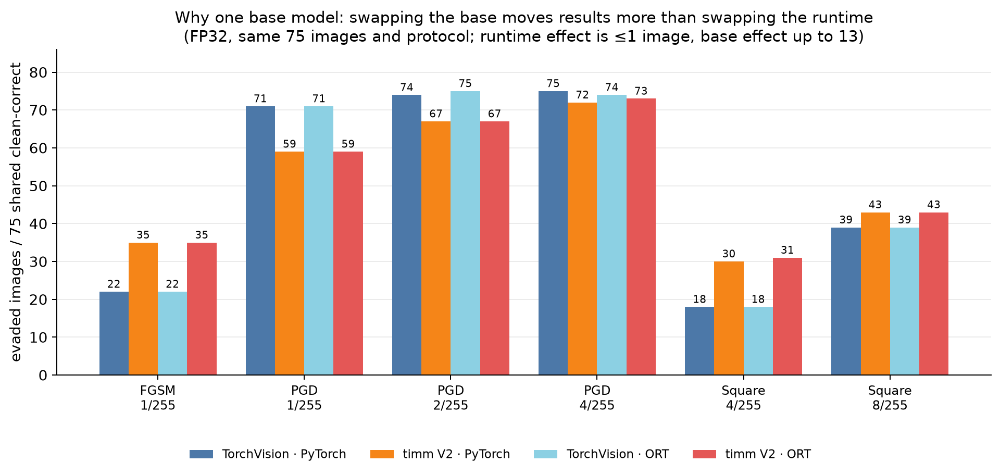
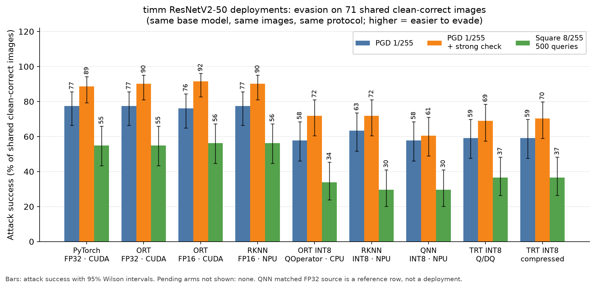
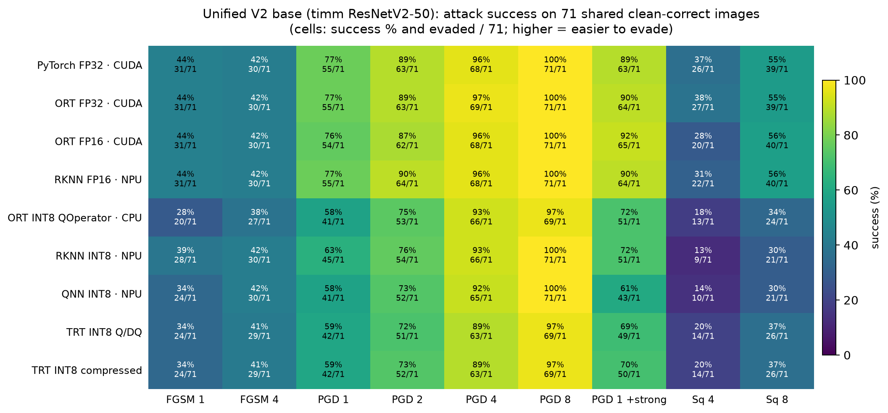
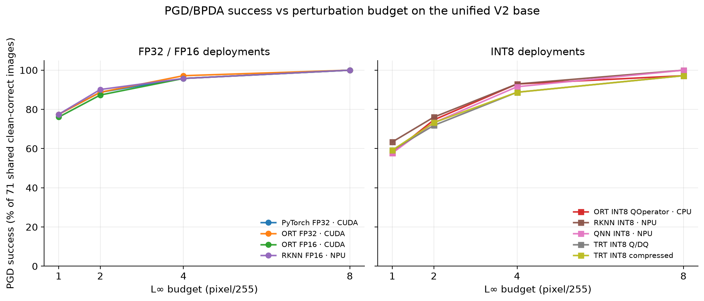
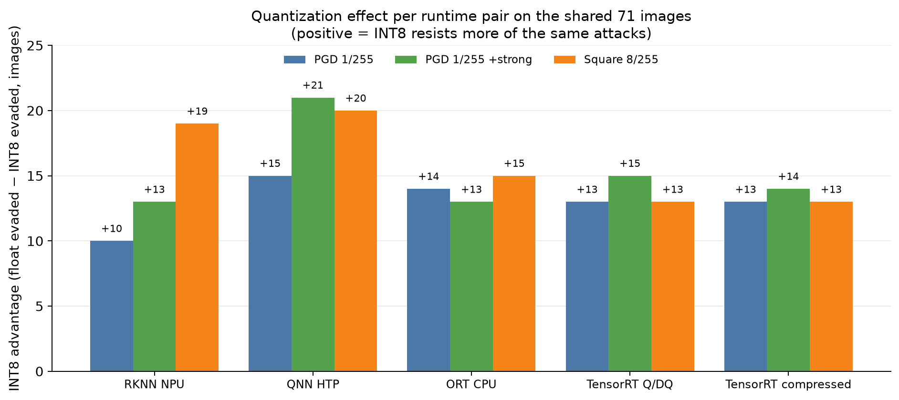
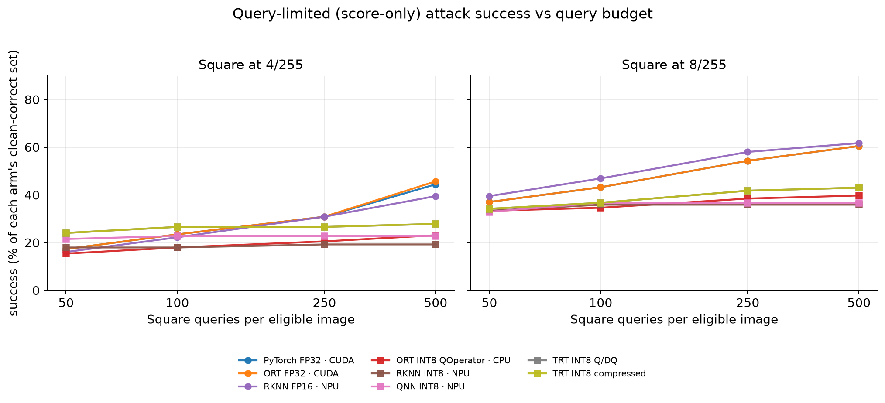

# Unified V2-family (timm ResNetV2-50) deployment robustness report

**Base model.** `timm/resnetv2_50.a1h_in1k` — the ResNetV2-50 (BiT-style
pre-activation) network that both NPU deployments already run — is now the
**single canonical base** for every deployment in the primary matrix. Nine
deployments across PyTorch, ONNX Runtime, TensorRT, Qualcomm QNN and Rockchip
RKNN are measured on the same images, the same preprocessing and the same attack
protocol; the only variables are runtime, format and quantization.

This report supersedes the cross-family ranking in
[evasion_rknn/INT8_COMPARISON.md](evasion_rknn/INT8_COMPARISON.md) for the
primary claim: that file mixes the TorchVision ResNet-50 family with the timm
family, and the base-model swap alone moves 1/255 results by ~16 percentage
points (see §2 and [BASE_MODEL_UNIFICATION.md](BASE_MODEL_UNIFICATION.md)).
TorchVision results are retained as the secondary replication
([TV_FAMILY.md](TV_FAMILY.md)). Implementation and provenance status:
[UNIFICATION_STATUS.md](UNIFICATION_STATUS.md).

| | |
| --- | --- |
| Canonical checkpoint | `b809e8c0…a61b` (`timm/resnetv2_50.a1h_in1k`) |
| Canonical ONNX | `6416f2e9…c13f4` (`onnx/resnetv2_50.onnx`, reproduced from the checkpoint) |
| Population | 100 stratified Imagenette validation images, seed 20261030, 1,000-class head |
| Shared population | **71/100** clean-correct under all nine deployments |
| Protocol | FGSM; PGD/BPDA 20×2; +100×5 survivor check at 1/255; Square 500 queries at 4 and 8/255 |
| Budgets | L∞ 1, 2, 4, 8 px/255 before ImageNet normalization |

---

## 1. Headline findings

1. **Quantization, not runtime, is the dominant robustness factor.** Every
   runtime with a float/INT8 pair shows the same direction: INT8 resists 10–15
   more images out of 71 at 1/255 PGD, 13–21 more at the strong 1/255 check, and
   13–20 more at Square 8/255 (§5 and the quantization-advantage figure).
2. **Float deployments are interchangeable.** PyTorch FP32, ORT FP32, ORT FP16
   and RKNN FP16 differ by at most 1–2 images on every gradient-attack condition,
   with one finite-query outlier at Square 4/255 (20–27/71). Runtime choice alone
   is not a robustness lever here (§5).
3. **INT8 runtime spread is real but secondary:** 4 images at 1/255 PGD
   (41–45/71), 8 images at the strong check (43–51/71), 5 images at Square 8/255
   (21–26/71). QNN HTP is the most resistant at small budgets; the INT8 spread is
   several times the float spread.
4. **White-box attacks saturate at 8/255.** Float deployments are evaded on
   71/71 images; three INT8 deployments keep 2/71 survivors (ORT QOperator,
   TensorRT ×2). This is finite-attack survivorship, not a robustness certificate.
5. **Score-only resistance persists and plateaus early for INT8.** At 8/255 and
   500 Square queries float deployments reach 60–62 % success versus 36–43 % for
   INT8; INT8 reaches its plateau by ~100 queries, while float keeps improving
   (§6).
6. **The single-base design is what makes 1–5 interpretable.** The same 2×2
   factorial (TorchVision vs timm × PyTorch vs ORT, FP32) shows runtime effects
   of ≤1 image but base-model effects of up to 13 images, in opposite directions
   for FGSM and PGD (§2).

---

## 2. Why one base: measured base-model sensitivity

Before unification the matrix compared TorchVision ResNet-50 deployments
(IMAGENET1K V1/V2 weights) with timm ResNetV2-50 deployments. These are
different networks: 0 of the 251 timm initializers match any of the 320
TorchVision-V2 float tensors (best conv-kernel cosine 0.039), and the graphs
differ structurally (49 vs 0 BatchNorm nodes, pre- vs post-activation).

A clean factorial is available in the retained runs: two bases × {PyTorch CUDA,
ORT CUDA}, all FP32, identical protocol, restricted to the **75 images all four
models classify correctly** (successful evasions / 75):

| Attack | TV · PyTorch | TV · ORT | timm · PyTorch | timm · ORT | Base effect | Runtime effect |
| --- | ---: | ---: | ---: | ---: | ---: | ---: |
| FGSM 1/255 | 22 | 22 | 35 | 35 | **+13** | 0 |
| PGD 1/255 | 71 | 71 | 59 | 59 | **−12** | 0 |
| PGD 2/255 | 74 | 75 | 67 | 67 | −7 | ≤1 |
| PGD 4/255 | 75 | 74 | 72 | 73 | −3 | ≤1 |
| PGD 8/255 | 75 | 75 | 75 | 75 | 0 | 0 |
| Square 4/255 | 18 | 18 | 30 | 31 | **+12–13** | ≤1 |
| Square 8/255 | 39 | 39 | 43 | 43 | +4 | 0 |



The direction of the base-model shift depends on the attack (timm is easier to
evade with FGSM and Square, harder with PGD), so it cannot be corrected as a
constant offset. A matrix that changes both the base and the runtime at once
cannot attribute anything. This is why the primary matrix is single-base and
the TorchVision family is reported separately.

---

## 3. Deployments

All artifacts derive from the canonical ONNX `6416f2e9…`; the provenance chain
is re-verified by `python quantize/verify_sources.py --deep --require-all`
(exit 0). Clean top-1 is on the 100-image pilot.

| Deployment | Runtime / hardware | Precision & format | Artifact / provenance | Clean /100 |
| --- | --- | --- | --- | ---: |
| PyTorch FP32 · CUDA | PyTorch 2.14, RTX 2000 Ada | FP32 eager | checkpoint → model | 81 |
| ORT FP32 · CUDA | ONNX Runtime 1.24 CUDA EP | FP32 ONNX | `6416f2e9…` | 81 |
| ORT FP16 · CUDA | ONNX Runtime 1.24 CUDA EP | FP16 ONNX | `23cc2388…` (ModelOpt fp16) | 82 |
| RKNN FP16 · NPU | RK3588, RKNN 2.5.0 | FP16 `.rknn` | `e997bb14…` | 81 |
| ORT INT8 QOperator · CPU | ONNX Runtime 1.24 CPU EP | INT8 QOperator | `ae524e4d…` (per-channel, 512 calib) | 78 |
| RKNN INT8 · NPU | RK3588, RKNN 2.5.0 | INT8 PTQ `.rknn` | `f71ab0e1…` (256 calib) | 78 |
| QNN INT8 · NPU | QCS6490 HTP, QAIRT 2.42 | INT8 per-tensor PTQ | `928508ae…` (19 calib, INT8-only HTP) | 79 |
| TRT INT8 Q/DQ | TensorRT 10.9, RTX 2000 Ada | INT8 explicit Q/DQ | `99755d64…` (54/54 Int8 convs) | 79 |
| TRT INT8 compressed | TensorRT 10.9, RTX 2000 Ada | INT8 compressed Q/DQ | `fd967b8c…` (54/54 Int8 convs) | 79 |
| *QNN matched FP32 source* (reference) | PyTorch CUDA | FP32 | reconstructed from `6416f2e9…` | 82 |

QCS6490 HTP runs INT8 only, so QNN has no float deployment on-device; its
matched FP32 source is the reference row. RKNN and the GPU arms provide the
float/FP16 controls.

---

## 4. Protocol and populations

- **Images:** ten images per class from Imagenette validation, seed `20261030`,
  100 total, predictions over all 1,000 ImageNet classes.
- **Clean /100:** the number of those 100 images classified correctly (top-1)
  on the unperturbed input, with all 1,000 ImageNet classes and folder-synset
  labels — i.e. pilot top-1 accuracy where one image = 1 percentage point. It
  is a stratified sample of the Imagenette *validation* split, not the full
  validation set: the full 3,925-image split was used for the TorchVision
  artifact accuracy tables in `quantize/README.md`, but the unified matrix is
  deliberately kept on the same 100-image pilot as every earlier evasion
  experiment.
- **Preprocessing:** shorter-side resize 232, center crop 224, pixels in
  `[0,1]`, ImageNet normalization — shared by every arm (this is the
  TorchVision-native recipe and is deliberately kept as the fixed protocol; the
  timm checkpoint's own recipe would be 236/bicubic/mean=std=0.5 and costs a
  constant ~3–4 clean images if changed, see §9).
- **Threat model:** untargeted digital input evasion, pixel-space L∞ budgets
  1/255, 2/255, 4/255, 8/255 applied before normalization.
- **Attacks:** FGSM (1 step); PGD/BPDA (20 steps, ε/4, 2 random starts);
  an additional 100-step, 5-start survivor check at 1/255; Square (score-only,
  500 queries, stripe init, no transfer warm start) at 4 and 8/255.
- **Scoring:** every forward pass is the real deployment; where the runtime has
  no native autograd, gradients come from a differentiable replica of that
  graph (FP32 exact for float arms, BPDA with straight-through rounding for
  INT8). Adversarial success is scored only on images the arm classifies
  correctly cleanly.
- **Denominators:** the headline table uses the **71 images every deployment
  classifies correctly**; §7 also gives each arm's own clean-correct
  denominator (78–82 images).

---

## 5. Results on the shared population (n = 71)

Successful evasions / 71. Higher means easier to evade; a value of 71/71 means
the arm was fully evaded by that attempted attack.

| Deployment | Clean | FGSM 1 | FGSM 4 | PGD 1 | PGD 2 | PGD 4 | PGD 8 | PGD 1 +strong | Sq 4 | Sq 8 |
| --- | ---: | ---: | ---: | ---: | ---: | ---: | ---: | ---: | ---: | ---: |
| PyTorch FP32 · CUDA | 81 | 31 (44 %) | 30 (42 %) | 55 (77 %) | 63 (89 %) | 68 (96 %) | 71 (100 %) | 63 (89 %) | 26 (37 %) | 39 (55 %) |
| ORT FP32 · CUDA | 81 | 31 (44 %) | 30 (42 %) | 55 (77 %) | 63 (89 %) | 69 (97 %) | 71 (100 %) | 64 (90 %) | 27 (38 %) | 39 (55 %) |
| ORT FP16 · CUDA | 82 | 31 (44 %) | 30 (42 %) | 54 (76 %) | 62 (87 %) | 68 (96 %) | 71 (100 %) | 65 (92 %) | 20 (28 %) | 40 (56 %) |
| RKNN FP16 · NPU | 81 | 31 (44 %) | 30 (42 %) | 55 (77 %) | 64 (90 %) | 68 (96 %) | 71 (100 %) | 64 (90 %) | 22 (31 %) | 40 (56 %) |
| ORT INT8 QOperator · CPU | 78 | 20 (28 %) | 27 (38 %) | 41 (58 %) | 53 (75 %) | 66 (93 %) | 69 (97 %) | 51 (72 %) | 13 (18 %) | 24 (34 %) |
| RKNN INT8 · NPU | 78 | 28 (39 %) | 30 (42 %) | 45 (63 %) | 54 (76 %) | 66 (93 %) | 71 (100 %) | 51 (72 %) | 9 (13 %) | 21 (30 %) |
| QNN INT8 · NPU | 79 | 24 (34 %) | 30 (42 %) | 41 (58 %) | 52 (73 %) | 65 (92 %) | 71 (100 %) | 43 (61 %) | 10 (14 %) | 21 (30 %) |
| TRT INT8 Q/DQ | 79 | 24 (34 %) | 29 (41 %) | 42 (59 %) | 51 (72 %) | 63 (89 %) | 69 (97 %) | 49 (69 %) | 14 (20 %) | 26 (37 %) |
| TRT INT8 compressed | 79 | 24 (34 %) | 29 (41 %) | 42 (59 %) | 52 (73 %) | 63 (89 %) | 69 (97 %) | 50 (70 %) | 14 (20 %) | 26 (37 %) |







### Runtime effect at fixed precision

- **Float/FP16:** at 1/255 PGD the four float arms are 54–55/71 (range 1); at
  the strong check 63–65/71 (range 2); Square 8/255 39–40/71 (range 1). The one
  larger float spread is Square 4/255 (20–27/71, range 7), a finite-query effect
  not a runtime ordering.
- **INT8:** 41–45/71 at 1/255 (range 4), 43–51/71 at the strong check (range 8;
  QNN is the most resistant), and 21–26/71 at Square 8/255 (range 5).
- The two TensorRT recipes are identical except for stored-weight compression,
  and differ by at most 1 image — as expected for the same quantized graph.

### Saturation and survivors at 8/255

Float arms are fully evaded by PGD 20×2 at 8/255 (71/71). INT8 arms are at
69–71/71: ORT QOperator and both TensorRT arms keep **2 survivors**, while
RKNN and QNN are fully evaded. Survivors are reported as observed outcomes of
this finite attack, not as certified robustness.

---

## 6. Quantization effect and score-only behaviour

### Same-runtime pairs (shared population)

"INT8 advantage" = float evaded − INT8 evaded (images). Positive means INT8
resists more of the same attack.

| Pair (float → INT8) | PGD 1/255 | PGD 1 +strong | Square 8/255 |
| --- | ---: | ---: | ---: |
| RKNN NPU (FP16 → INT8) | +10 | +13 | +19 |
| QNN HTP (matched FP32 → INT8) | +15 | +21 | +20 |
| ORT CPU (FP32 CUDA → QOperator) | +14 | +13 | +15 |
| TensorRT (FP32 → Q/DQ) | +13 | +15 | +13 |
| TensorRT (FP32 → compressed) | +13 | +14 | +13 |



Every pair points the same way and the effect is largest at the strongest
small-budget attack (the 100×5 survivor check) and against the score-only
attack. On this base, quantization is a consistent robustness factor while the
runtime choice is not.

### Score-only attack (Square) vs query budget

Success by query budget (each arm's own clean-correct denominator; see the
query-budget figure below). At 4/255 the float arms reach 39–46 % by 500 queries while INT8 arms
stay at 19–28 %; at 8/255 float reaches 60–62 % versus 36–43 % for INT8.

The shape matters: INT8 arms reach their plateau early — RKNN INT8 is at 35.9 %
already at 100 queries and stays there to 500; QNN INT8 is at 36.7 % by 100
queries; the ONNX/TRT INT8 arms gain only ~5–6 points between 100 and 500 queries.
Float arms keep gaining (e.g. PyTorch FP32: 43 % → 60 % from 100 to 500
queries). Coarse output grids and internal INT8 arithmetic are the plausible
contributors (measured output-grid spacing: QNN 0.0828 in logit units), but this
report does not isolate the cause.



---

## 7. Each deployment on its own clean-correct set

Own-denominator view (eligible = the arm's clean-correct images; these sets
differ, so do not compare them as one population):

| Deployment | Own eligible | PGD 1/255 | PGD 1 +strong | Square 8/255 |
| --- | ---: | ---: | ---: | ---: |
| PyTorch FP32 · CUDA | 81 | 65/81 (80 %) | 73/81 (90 %) | 49/81 (60 %) |
| ORT FP32 · CUDA | 81 | 65/81 (80 %) | 74/81 (91 %) | 49/81 (60 %) |
| ORT FP16 · CUDA | 82 | 65/82 (79 %) | 76/82 (93 %) | 51/82 (62 %) |
| RKNN FP16 · NPU | 81 | 65/81 (80 %) | 74/81 (91 %) | 50/81 (62 %) |
| ORT INT8 QOperator · CPU | 78 | 48/78 (62 %) | 58/78 (74 %) | 31/78 (40 %) |
| RKNN INT8 · NPU | 78 | 52/78 (67 %) | 58/78 (74 %) | 28/78 (36 %) |
| QNN INT8 · NPU | 79 | 49/79 (62 %) | 51/79 (65 %) | 29/79 (37 %) |
| TRT INT8 Q/DQ | 79 | 50/79 (63 %) | 57/79 (72 %) | 34/79 (43 %) |
| TRT INT8 compressed | 79 | 50/79 (63 %) | 58/79 (73 %) | 34/79 (43 %) |

The own-denominator ordering matches the shared-population ordering; the shared
table is the controlled comparison.

---

## 8. Validation and provenance

- **Reconciliation:** `summarize.py --source timm` re-derived **10,700
  per-image rows (107 conditions)** and checked every per-image record against
  its summary, every artifact hash, every L∞ bound, every Square query cap, and
  every executed runtime provider. `compare_timm.py` independently reconciled
  the nine-deployment matrix on the shared 71 images; all arms pass
  (`evasion_onnx/results/comparisons/timm_matrix.md`).
- **Provenance:** checkpoint `b809e8c0…` → canonical ONNX `6416f2e9…`
  (251/251 initializers byte-equal, reproducible via
  `quantize/export_timm_onnx.py`) → five ONNX artifacts with per-artifact
  metadata (`source_sha256`, calibration hash, recipe, elapsed) → QNN context
  `928508ae…` and RKNN `.rknn` `e997bb14…`/`f71ab0e1…`. The verifier
  `python quantize/verify_sources.py --deep --require-all` exits 0.
- **Native runtime evidence:** each TensorRT engine inspector reports **54/54
  Int8 convolution weights**; the ORT CPU QOperator session executes **540
  `QLinearConv` kernels**; CUDA arms report 1,390 CUDA nodes with no CPU
  fallback; board transport and native-dtype evidence for the NPU arms is
  retained in `evasion_rknn/results/validation/` and
  `evasion/results/validation/`.
- **TensorRT replica exception (documented, not silent):** both TRT arms have
  88/100 replica-vs-engine clean top-1 agreement (the engine folds BatchNorm
  into the quantized conv on this pre-activation graph). All 12 disagreements
  are near-ties (top-2 margin ≤1.15). A one-step gradient-direction probe at
  2/255 flips **11/20** engine predictions along the replica gradient versus
  **0/20** for random and **0/20** for the negated direction, so BPDA is
  informative. The exception is recorded in each summary under
  `gradient.replica_gate_override`; evidence in
  `evasion_onnx/results/diagnostics/trt_replica_probe.json`. See
  [UNIFICATION_STATUS.md](UNIFICATION_STATUS.md) §6.

---

## 9. What this does and does not establish

**Established:** on one base model, on the same 100-image pilot and protocol,
INT8 deployments resist more of these finite gradient and score-only attacks at
small budgets than their float counterparts on every runtime measured; float
deployments are interchangeable with respect to runtime; all deployments are
fully evaded by 8/255 white-box attacks except for 2/71 survivors on three INT8
arms.

**Not established:**

- **No certified robustness.** Every count is the outcome of a specific finite
  attack (20×2 PGD + 100×5 survivor check; 500-query Square). Survival is not a
  certified radius, and BPDA is an approximate-gradient attack.
- **No causal isolation of quantization vs runtime.** Calibration differs by
  design between platforms (QNN 19 images / per-tensor; RKNN 256 images; GPU
  512 images), and QNN runs INT8 only. Rows are deployed configurations, not
  bit-width ablations.
- **Small population, one seed.** 100 images from ten classes, 71 shared
  clean-correct, one attack seed. Wilson intervals are reported in the matrix
  JSON; adjacent arms overlap. A second seed or a larger population is the next
  robustness step.
- **Fixed preprocessing protocol.** The shared 232/224/ImageNet recipe is not
  the timm checkpoint's native recipe (its native eval is bicubic 236 with
  mean = std = 0.5). It is constant across runtimes and is what the NPU
  artifacts encode, so it is kept — but it costs a constant ~3–4 clean images
  and slightly changes the absolute robustness numbers.
- **Base-model family.** The timm ResNetV2-50 result does not transfer
  automatically to TorchVision ResNet-50; that family is reported separately in
  [TV_FAMILY.md](TV_FAMILY.md), and the 2×2 in §2 shows why the two cannot be
  ranked together.

---

## 10. Reproduce

All figures and tables above are generated from retained artifacts; no
inference is performed by the reporting scripts.

```bash
cd /home/ross/QA/Models/resnet50

# provenance gate
python quantize/verify_sources.py --deep --require-all

# reconciliation + matrix + figures
python evasion_onnx/scripts/summarize.py --source timm
python evasion_onnx/scripts/compare_timm.py
python evasion_onnx/scripts/make_timm_figure.py
python evasion_onnx/scripts/make_v2_report_figures.py   # figures/ + v2_report_data.json

# GPU arms (needs CUDA; TRT arms carry the recorded replica exception)
python evasion_onnx/scripts/run_model.py --model timm_rnv2_fp32
python evasion_onnx/scripts/run_gpu_variants.py --source timm
# TRT arms: add --reference timm_rnv2_fp32 --allow-replica-agreement 85 --override-reason "<evidence>"

# CPU INT8 QOperator arm (GPU-free)
python evasion_onnx/scripts/run_model.py --model timm_rnv2_int8_ort_qop --device cpu \
  --reference timm_rnv2_fp32 --reference-dir evasion_rknn/results/run/onnx_fp32
```

Data sources: `evasion_onnx/results/comparisons/timm_matrix.{json,md}`,
`evasion_onnx/results/comparisons/timm_onnx.json`,
`evasion_onnx/results/comparisons/v2_report_data.json` (machine-readable tables
behind this report), per-arm `summary.json` / `per_image.csv`.

## 11. Related documents

| Document | Role |
| --- | --- |
| [BASE_MODEL_UNIFICATION.md](BASE_MODEL_UNIFICATION.md) | Decision, measured confound, costs, migration plan |
| [UNIFICATION_STATUS.md](UNIFICATION_STATUS.md) | Implementation state, artifact hashes, provenance chain, GPU run log |
| [TV_FAMILY.md](TV_FAMILY.md) | Frozen TorchVision-family secondary replication (index) |
| [evasion_rknn/INT8_COMPARISON.md](evasion_rknn/INT8_COMPARISON.md) | Historical cross-family nine-deployment comparison (secondary) |
| [evasion_onnx/README.md](evasion_onnx/README.md) | Harness, runtime selection, reconciliation |
| [evasion/README.md](evasion/README.md) | QNN deployments, matched-surrogate methodology |
| [evasion_rknn/README.md](evasion_rknn/README.md) | RKNN deployments, board transport, latency |
| [quantize/README.md](quantize/README.md) | Artifact recipes and gates for the unified base |
