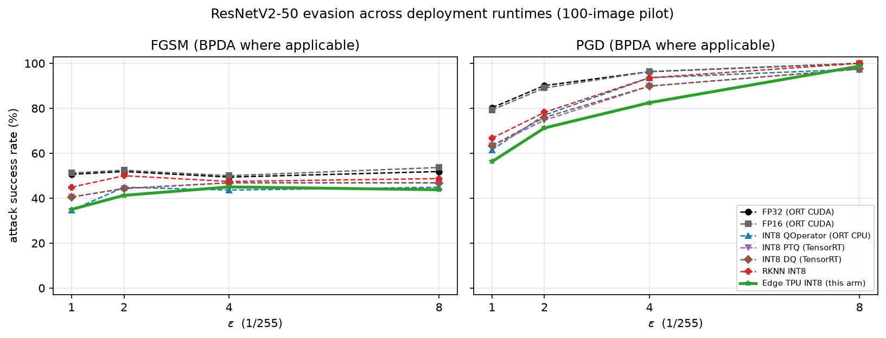

# Edge TPU arm: evasion results and cross-runtime comparison

Deployment: Coral USB Accelerator, `libedgetpu` 16.0/tf2.19.1 (runtime v14), model
`TPU/resnetv2_50_int8_nhwc_edgetpu.tflite` (single `edgetpu-custom-op`, 114/114 ops on TPU),
native interface uint8 `[1,224,224,3]` scale 1/255 → uint8 `[1,1000]` logits.
Protocol identical to the other arms: 100-image stratified Imagenette-320 pilot
(`seed=20261030`, resize 232 / crop 224), `random`/`fgsm`/`pgd` (20 steps, 2 restarts) at
$\epsilon$ = 1,2,4,8/255, `square` (500 queries) at 4,8/255. Gradient attacks use **BPDA**
(deployment forward, FP32 timm surrogate backward); `square` queries the accelerator directly.
Campaign cost: **75,977 TPU inferences, 3,572 s wall, 44.9 ms per inference**.

## Clean accuracy

| arm | correct | accuracy |
|---|---|---|
| FP32 (ORT CUDA) | 81/100 | 81% |
| FP16 (ORT CUDA) | 82/100 | 82% |
| INT8 QOperator (ORT CPU) | 78/100 | 78% |
| INT8 PTQ (TensorRT) | 79/100 | 79% |
| INT8 DQ (TensorRT) | 79/100 | 79% |
| RKNN INT8 | 78/100 | 78% |
| Edge TPU INT8 (this arm) | 80/100 | 80% |
| **Edge TPU vs FP32** | top-1 agreement 83% | common-clean 75 |

## Attack success rate (%)

| attack @ $\epsilon$/255 | FP32 (ORT CUDA) | FP16 (ORT CUDA) | INT8 QOperator (ORT CPU) | INT8 PTQ (TensorRT) | INT8 DQ (TensorRT) | RKNN INT8 | Edge TPU INT8 (this arm) |
|---|---|---|---|---|---|---|---|
| random @ 1 | 0.0 | 0.0 | 2.6 | 5.1 | 5.1 | 5.1 | 3.8 |
| random @ 2 | 1.2 | 2.4 | 3.8 | 5.1 | 5.1 | 2.6 | 1.2 |
| random @ 4 | 1.2 | 2.4 | 2.6 | 6.3 | 6.3 | 3.8 | 2.5 |
| random @ 8 | 4.9 | 6.1 | 5.1 | 7.6 | 7.6 | 9.0 | 3.8 |
| fgsm @ 1 | 50.6 | 51.2 | 34.6 | 40.5 | 40.5 | 44.9 | 35.0 |
| fgsm @ 2 | 51.9 | 52.4 | 44.9 | 44.3 | 44.3 | 50.0 | 41.2 |
| fgsm @ 4 | 49.4 | 50.0 | 43.6 | 46.8 | 46.8 | 47.4 | 45.0 |
| fgsm @ 8 | 51.9 | 53.7 | 44.9 | 46.8 | 46.8 | 48.7 | 43.8 |
| pgd @ 1 | 80.2 | 79.3 | 61.5 | 63.3 | 63.3 | 66.7 | 56.2 |
| pgd @ 2 | 90.1 | 89.0 | 76.9 | 74.7 | 75.9 | 78.2 | 71.2 |
| pgd @ 4 | 96.3 | 96.3 | 93.6 | 89.9 | 89.9 | 93.6 | 82.5 |
| pgd @ 8 | 100.0 | 100.0 | 97.4 | 97.5 | 97.5 | 100.0 | 98.8 |
| square @ 4 | 44.4 | 37.8 | 23.1 | 27.8 | 27.8 | 19.2 | 26.2 |
| square @ 8 | 60.5 | 62.2 | 39.7 | 43.0 | 43.0 | 35.9 | 38.8 |

Values are percent of each arm's own clean-correct images that are fooled; higher = less robust.

## $\Delta$ vs the FP32 reference (percentage points; negative = more robust)

| attack @ eps | FP16 (ORT CUDA) | INT8 QOperator (ORT CPU) | INT8 PTQ (TensorRT) | INT8 DQ (TensorRT) | RKNN INT8 | Edge TPU INT8 (this arm) |
|---|---|---|---|---|---|---|
| random @ 1 | +0.0 | +2.6 | +5.1 | +5.1 | +5.1 | +3.8 |
| random @ 2 | +1.2 | +2.6 | +3.8 | +3.8 | +1.3 | +0.0 |
| random @ 4 | +1.2 | +1.3 | +5.1 | +5.1 | +2.6 | +1.3 |
| random @ 8 | +1.2 | +0.2 | +2.7 | +2.7 | +4.0 | -1.2 |
| fgsm @ 1 | +0.6 | -16.0 | -10.1 | -10.1 | -5.7 | -15.6 |
| fgsm @ 2 | +0.6 | -7.0 | -7.5 | -7.5 | -1.9 | -10.6 |
| fgsm @ 4 | +0.6 | -5.8 | -2.5 | -2.5 | -1.9 | -4.4 |
| fgsm @ 8 | +1.8 | -7.0 | -5.0 | -5.0 | -3.1 | -8.1 |
| pgd @ 1 | -1.0 | -18.7 | -17.0 | -17.0 | -13.6 | -24.0 |
| pgd @ 2 | -1.1 | -13.2 | -15.4 | -14.2 | -11.9 | -18.9 |
| pgd @ 4 | +0.0 | -2.7 | -6.4 | -6.4 | -2.7 | -13.8 |
| pgd @ 8 | +0.0 | -2.6 | -2.5 | -2.5 | +0.0 | -1.2 |
| square @ 4 | -6.6 | -21.4 | -16.6 | -16.6 | -25.2 | -18.2 |
| square @ 8 | +1.7 | -20.8 | -17.5 | -17.5 | -24.6 | -21.7 |

## Quantization barrier of the 8-bit deployment interface

A perturbation only reaches the network if it changes `round(pixel*255)` (input scale 1/255,
zero point 0). Measured on the same crops with uniform $\pm\epsilon$ noise:

| $\epsilon$ (1/255) | pixels changed | mean change (when changed) |
|---|---|---|
| 1.0 | 49.8% | 1.00 LSB |
| 2.0 | 74.8% | 1.33 LSB |
| 4.0 | 87.2% | 2.28 LSB |
| 8.0 | 93.4% | 4.24 LSB |

At $\epsilon$=1/255 roughly **half of the perturbation mass is erased** and the surviving
pixels move by exactly one LSB, which is why the TPU's advantage over FP32 is concentrated at
small $\epsilon$ (PGD $\Delta$ vs FP32: -24.0 / -18.9 / -13.8 / -1.2 pp at $\epsilon$=1, 2, 4, 8).

## Where the Edge TPU sits among the INT8 deployments

PGD $\Delta$ vs the best non-TPU INT8 arm (INT8 DQ (TensorRT), INT8 PTQ (TensorRT), INT8 QOperator (ORT CPU)):
**-5.3 / -3.4 / -7.4 / +1.3 pp** at $\epsilon$=1, 2, 4, 8. The Edge TPU is the most robust target at
$\epsilon \leq$ 4/255 and converges with the others at 8/255, where quantization no longer
constrains the attack.

## Score-only (black-box) attack

| attack | TPU ASR % | best other INT8 % | FP32 arm % | TPU craft → FP32 ASR % | mean queries | wall time |
|---|---|---|---|---|---|---|
| square 4 | 26.2 | 19.2 | 44.4 | 5.0 | 307 | 23 min |
| square 8 | 38.8 | 35.9 | 60.5 | 10.0 | 254 | 19 min |

The last-but-one column is the key black-box result: perturbations optimised against the
quantized deployment **do not transfer to FP32** (5 %/10 % vs 26 %/39 % on the TPU), because
Square converges on one-LSB pixel flips that a float model does not see. Conversely the
BPDA perturbations (surrogate gradients + deployment forward) do transfer back to FP32 at
76%, 86%, 95%, 99% —
they are genuine adversarial examples, whereas the Square ones are quantization-specific.

## Cost / query economics

| arm | device | per-inference | campaign time |
|---|---|---|---|
| Edge TPU INT8 | USB3 accelerator | 44.9 ms (17.95 MiB parameter streaming per inference) | 3,572 s |
| INT8/RKNN/TRT arms | GPU / PCIe NPU | see their reports | seconds–minutes |

The accelerator is latency-bound, not compute-bound: the campaign ran at ~19 % of one CPU core
and ~0 % GPU while querying (GPU is only used for surrogate gradients during PGD).

## Caveats

* BPDA backward pass uses the FP32 timm surrogate, exactly as the other INT8 arms in this study.
* n=100 pilot, single seed, ASR relative to each arm's own clean-correct images
  (common-clean overlap with FP32: 75 images).
* Cross-arm comparisons reuse the other arms' published summaries (same images, protocol and
  seed); hosts differ (this campaign: RTX 2000 Ada laptop + USB3).
* `pgd_stronger` (the $\epsilon$=1 survivor re-attack of the other arms) was not run on the
  accelerator; it would cost ~30 min of extra TPU queries.

