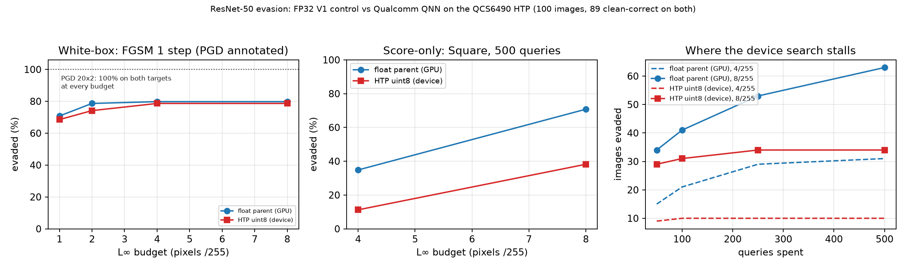

# ResNet-50 input-evasion experiment

> **Base-model status (unified matrix).** The study now uses a single canonical
> base model: `timm/resnetv2_50.a1h_in1k`, which both NPU deployments already
> use. The TorchVision ResNet-50 results retained in this file are the
> **secondary cross-architecture replication** and must not be mixed into a
> runtime/quantization ranking with timm rows: the base-model swap alone moves
> 1/255 PGD evasion by ~16 percentage points, comparable to the entire runtime
> effect. See [BASE_MODEL_UNIFICATION.md](../BASE_MODEL_UNIFICATION.md) and
> [UNIFICATION_STATUS.md](../UNIFICATION_STATUS.md) for the primary matrix,
> provenance and remaining GPU-gated steps.

This experiment compares the two supplied PyTorch checkpoints and adds both the
current V2 FP32 checkpoint and the verified historical FP32 parent. It changes input pixels only. Models
are frozen; there is no training, poisoning, parameter attack, or backdoor work.

The [RKNN comparison on the RADXA Rock 5C](../evasion_rknn/README.md) adds the
FP16 and INT8 deployments at `192.168.1.30`, with matched original timm
ResNetV2-50 PyTorch/ONNX FP32 controls, native dtype queries, latency and device
evasion. This source is distinct from TorchVision's ResNet-50 V2 weight version.
The [nine-deployment INT8 comparison](../evasion_rknn/INT8_COMPARISON.md) compares
FBGEMM, ORT, TensorRT, QNN and RKNN on shared eligible images, with source-family
controls and the older QNN ResNetV2 surrogate mismatch explicitly flagged.

## Latest comparison update

**4 November 2026 -- the ResNetV2-50 deployment was re-attacked with a matched
surrogate; its earlier numbers were wrong.** The superseded run drove a timm
ResNetV2-50 graph with TorchVision ResNet-50 gradients and reported the
resulting survival as device resistance. The matched run uses the graph's own
documented FP32 source. Headline: the device goes from 12/79 to 49/79 evaded at
1/255 and is fully evaded at 8/255. See
[the matched comparison](#matched-comparison-documented-resnetv2-source-versus-the-deployed-graph).

Results through the QCS6490 ResNetV2 deployment run saved on **3 November 2026,
22:38 HKT**, reviewed on **4 November 2026**. Two models have been quantised for
the board; both are reported. The review adds local source inference, without
new board inference or attacks.

**ResNetV2-50 deployment (`resnetv2_50_quantized.bin`, QAIRT 2.42).** The original
comparison confounded `timm`'s ResNetV2 architecture with TorchVision's V2
ResNet-50 weight version. Its identity sweep omitted the documented QAIRT source
ONNX. That source agrees with retained device predictions on **85/100** images,
with mean per-image logit correlation **0.9453**. A differentiable module loaded
from all 251 source initializer tensors matches ONNX locally.

- **Corrected 4 November 2026: the retained device BPDA-PGD counts (12/79 at
  1/255, 37/79 at 8/255) were produced with a mismatched surrogate** -- an
  FBGEMM TorchVision ResNet-50 driving gradients for a timm ResNetV2-50 graph.
  Their gradient fields have cosine 0.0068, so the attack was misdirected and
  the device looked robust. Those rows measure attack failure, not resistance.
- **The matched rerun reverses the picture.** Using the graph's own documented
  source as both float control and surrogate, the device is evaded 49/79 at
  1/255 and **79/79 at 8/255**; with the 100-step, five-start survivor check,
  51/79 at 1/255. The score-only Square arm reproduces the superseded run
exactly (18/79 at 4/255, 29/79 at 8/255), which isolates the change to the
  gradient path alone.
- **The residual small-budget gap is internal INT8, not the input grid.** Scoring
  the float model on its own adversarials snapped to the device's uint8 grid
  costs at most one image out of 75; the remaining 14 discordant images at 1/255
  are the graph's internal arithmetic, and all are one-directional.
- Square remains harder on the device than on its matched source: 18 versus 33
  at 4/255 and 29 versus 52 at 8/255 on the same clean-correct sets. Score-only
  resistance to this finite query budget is a separate phenomenon from the
  white-box result.
- See [the matched comparison](#matched-comparison-documented-resnetv2-source-versus-the-deployed-graph)
  and its controls (`Models/resnet50/evasion/results/qnn_v2_matched`; source workspace only).

**V1 deployment (`resnet50_aimet_quantized_6490.bin`, QAIRT 2.37).** Unchanged
and fully evaded by BPDA-PGD at every budget:

- **Qualcomm QNN on QCS6490 is fully evaded by BPDA-PGD at every tested budget,
  including 1/255:** 89/89 initially correct images, using 20 steps and two starts.
  Its FP32 V1 reference is also fully evaded. Clean top-1 agreement is 100/100;
  this supports the reference selection but alone does not prove weight identity
  or gradient fidelity.
- **QNN resists the 500-query Square attack more than its matched V1 control:**
  10/89 versus 31/89 evasions at 4/255, and 34/89 versus 63/89 at 8/255.
  A lower Square success rate does not imply protection against the adaptive attack.
- The [updated cross-runtime report](../evasion_onnx/README.md#cross-runtime-update-qualcomm-qnn-htp)
  includes QNN and the resize-232 V1 control alongside PyTorch, ORT and TensorRT.
  All 12 configurations share 78 clean-correct images; the earlier denominator is unchanged.
| Name | Checkpoint | Role |
| --- | --- | --- |
| `fp32_v1` | `../Pytorch/resnet50-19c8e357.pth` | Original supplied FP32 model |
| `fp32_v2` | `../Pytorch/resnet50-11ad3fa6.pth` | Current official FP32 V2, contextual comparison |
| `fp32_parent` | `../Pytorch/resnet50-f46c3f97.pth` | Verified historical source weights of INT8 V2 |
| `int8_v2` | `../Pytorch/resnet50_fbgemm-23753f79.pth` | Supplied official FBGEMM INT8 model |

**The supplied pair is V1 FP32 versus V2 INT8, not the same weights at two
precisions.** Although TorchVision associates INT8 V2 with FP32 V2, the FP32 V2
checkpoint was later refreshed. Direct tensor checks show that the current
`11ad3fa6` checkpoint is not the supplied INT8 model's numerical parent.
Historical TorchVision PR #5201 records replacement of `f46c3f97` by `11ad3fa6`.
For `f46c3f97`, re-quantizing all 54 weight layers after batch-normalization
folding using the INT8 model's saved grids reproduces **100% of its integer
weights in every layer**. Use `fp32_parent` versus `int8_v2` for the controlled
quantization comparison. Both historical and current V2 downloads are retained.

## Run in QA's existing uv environment

From `/home/ross/QA`:

```bash
uv run --no-project --python ./venv/bin/python Models/resnet50/evasion/scripts/run_evasion.py
uv run --no-project --python ./venv/bin/python Models/resnet50/evasion/scripts/run_parent_control.py
uv run --no-project --python ./venv/bin/python Models/resnet50/evasion/scripts/check_survivors.py
uv run --no-project --python ./venv/bin/python Models/resnet50/evasion/scripts/verify_parent_weights.py
uv run --no-project --python ./venv/bin/python Models/resnet50/evasion/scripts/summarize_evasion.py
uv run --no-project --python ./venv/bin/python Models/resnet50/evasion/scripts/make_figure.py
```

The environment is `/home/ross/QA/venv`, a uv-created Python 3.12 environment.
The runner checks each checkpoint's SHA-256 before loading. The old V1 archive
requires legacy loading after checking its full known hash. The V2 control was
downloaded from `https://download.pytorch.org/models/resnet50-11ad3fa6.pth` with
TorchVision's hash check enabled.

## Project layout

| Location | Contents |
| --- | --- |
| `scripts/` | Attack runners, QNN transport and codec, validation, diagnostics and plotting; `npu_scorer.c` is the board scorer source. |
| `configs/` | Deployed-graph contracts: `resnetv2_50_graph_spec.json` records the recovered V2 dtype, layout, domain, quantisers and tensor ids. |
| `results/pytorch/`, `results/parent/` | Complete original PyTorch and historical-parent runs, sample manifest and saved adversarial tensors. |
| `results/qnn/` | Complete matched V1/QNN run, per-image records, transfer summaries and adversarial tensors. |
| `results/qnn_v2/` | V2 deployment: quantiser recovery, encoding equivalence, model-identity sweep, parity, full attack run, surrogate control and paired comparison. |
| `results/validation/` | QNN parity at both resize settings, transport checks, and the cleanup move ledger. |
| `results/survivors/`, `results/diagnostics/` | Stronger attacks and quantization mechanism diagnostics. |
| `results/comparisons/`, `figures/` | Reconciled comparisons and report figures. |
| `logs/` | Full-run execution and validation logs. |

Smoke outputs, Python caches, the one-off argmax probe and the superseded
`npu_stage.py` have been removed. `check_npu_preprocessing.py` retains the
preprocessing validation previously named `npu_preproc_test.py`. Raw run JSON
and logs retain their original recorded paths; the move ledger at
`results/validation/layout_migration.json` maps those paths to the current layout.

### QCS6490 NPU runs

The NPU scripts drive the deployed Hexagon graph over ssh to the board
(`q6a`). Every one of them is safe to re-run; the device checks are read-only
probes and the attack run rewrites only its own output directory.

```bash
# harness self-test, no device needed
uv run --no-project --python ./venv/bin/python Models/resnet50/evasion/scripts/npu_target.py --self-test

# transport checks: host codec vs the device's own converter, and the persistent
# scorer vs qnn-net-run -- run these before trusting any attack number
uv run --no-project --python ./venv/bin/python Models/resnet50/evasion/scripts/npu_remote.py --golden-check
uv run --no-project --python ./venv/bin/python Models/resnet50/evasion/scripts/npu_remote.py --scorer-check
uv run --no-project --python ./venv/bin/python Models/resnet50/evasion/scripts/npu_remote.py --stress 25

# Stage A: what the deployed graph actually is (clean parity, no attacks)
uv run --no-project --python ./venv/bin/python Models/resnet50/evasion/scripts/npu_parity.py
uv run --no-project --python ./venv/bin/python Models/resnet50/evasion/scripts/check_npu_preprocessing.py

# Stage B: the attacks, then independent reconciliation and the figure
uv run --no-project --python ./venv/bin/python Models/resnet50/evasion/scripts/run_npu_evasion.py \
  --eps 1 2 4 8 --square-eps 4 8 --band 20
uv run --no-project --python ./venv/bin/python Models/resnet50/evasion/scripts/check_npu_results.py
uv run --no-project --python ./venv/bin/python Models/resnet50/evasion/scripts/make_npu_figure.py
```

The V2 deployment in `~/resnet50_qairt/6490_v242` runs through the same code with
a different spec and run directory:

```bash
V2="--spec Models/resnet50/evasion/configs/resnetv2_50_graph_spec.json --run-dir /home/ross/resnet50_qairt/6490_v242"

# recover and validate the graph contract before attacking through it
uv run --no-project --python ./venv/bin/python Models/resnet50/evasion/scripts/probe_v2_quantisers.py
uv run --no-project --python ./venv/bin/python Models/resnet50/evasion/scripts/check_v2_encoding.py

# what is this graph? (clean parity; the matched source is in the candidate pool)
uv run --no-project --python ./venv/bin/python Models/resnet50/evasion/scripts/npu_parity.py $V2 \
  --out Models/resnet50/evasion/results/qnn_v2_matched/parity
uv run --no-project --python ./venv/bin/python Models/resnet50/evasion/scripts/check_v2_model_identity.py

# the graph's own FP32 source, and proof that its gradients move the device
uv run --no-project --python ./venv/bin/python Models/resnet50/evasion/scripts/matched_source.py --check
uv run --no-project --python ./venv/bin/python Models/resnet50/evasion/scripts/probe_device_gradient.py $V2

# attacks against the matched pair, then independent reconciliation
uv run --no-project --python ./venv/bin/python Models/resnet50/evasion/scripts/run_npu_evasion.py $V2 \
  --float-model resnetv2_fp32 --surrogate resnetv2_fp32 --eps 1 2 4 8 --square-eps 4 8 --band 20 \
  --out Models/resnet50/evasion/results/qnn_v2_matched/run
uv run --no-project --python ./venv/bin/python Models/resnet50/evasion/scripts/check_npu_results.py \
  --dir Models/resnet50/evasion/results/qnn_v2_matched/run \
  --stage Models/resnet50/evasion/results/qnn_v2_matched/parity \
  --float-model resnetv2_fp32 --device-model npu

# what the residual small-budget gap is made of
uv run --no-project --python ./venv/bin/python Models/resnet50/evasion/scripts/analyze_input_grid.py
uv run --no-project --python ./venv/bin/python Models/resnet50/evasion/scripts/surrogate_handicap.py \
  --target resnetv2_fp32 --surrogate int8_v2 \
  --out Models/resnet50/evasion/results/qnn_v2_matched/surrogate_handicap.json
```

## Population and threat model

- Ten images per class, sampled without replacement from the local Imagenette
  **validation** folders: 100 original images, ten ImageNet classes. Seed
  `20261030`. Folder synsets supply clean labels; the noisy-label CSV is unused.
- Predictions retain all **1,000 ImageNet classes**. This is not a ten-class
  classification task. Image paths, labels, clean predictions, and content hashes
  are retained in `results/pytorch/samples.json`.
- Official preprocessing: bilinear shorter-side resize to 256 (V1) or 232 (V2),
  center crop to 224, pixels in `[0,1]`, ImageNet mean and standard deviation.
The FP32 V2 models and INT8 V2 model receive **identical cropped input tensors**.
  V1's different recipe is an additional reason to treat it as contextual.
- Untargeted evasion: any prediction other than the original ground-truth class
  counts as success, provided the model classified that image correctly cleanly.
- L-infinity bounds in pixel space, **before normalization**: 1/255, 2/255,
  4/255, and 8/255. Perturbations are applied after resize/crop. This is a digital
  input threat model, not a physical-camera or original-resolution attack.

## Attacks

1. **FGSM:** one cross-entropy ascent step of size epsilon, then pixel clipping.
2. **PGD:** 20 steps, step size epsilon/4, two independent uniform random starts,
   L-infinity projection and `[0,1]` clipping after every step. Best candidates
   are retained per image over all steps and restarts, preferring a successful
   evasion over an unsuccessful candidate. The clean input is also a candidate.
3. **INT8 adaptive BPDA-FGSM / BPDA-PGD:** the same settings, using the **actual
   deployed CPU INT8 logits on every forward evaluation**. Backward derivatives
   come from a GPU surrogate with dequantized packed weights, recorded activation
   scales/zero points, residual additions, and straight-through rounding. Float
   convolution accumulation can differ from integer kernels. The surrogate is
   only a derivative approximation, never the model used to score evasion.
4. **Black-box Square:** score-only randomized patch search, stripe
   initialization, initial patch fraction 0.05 and the authors' decreasing
   schedule, minimizing true-class-versus-best-other logit margin. Independently
   initialized, with **no transfer or white-box warm start**. Budget: 500 model
   queries per clean-correct image at 4/255 and 8/255; stop once evaded. The
   clean eligibility query and independent final result verification are outside
   this attack-search budget. This is a local reimplementation of the authors'
   L-infinity algorithm, not the upstream implementation.
5. **Transfer:** score FP32 V2's FGSM/PGD examples on INT8 V2, and INT8 BPDA's
   examples on FP32 V2. No additional target adaptation occurs in this test.
6. **Random control:** one uniform bounded-noise draw per image and epsilon.
7. **Stronger survivor check:** repeat white-box PGD/BPDA at 1/255 on the
   historical parent's and INT8 model's surviving inputs, using 100 steps,
   five fresh random starts, and the same epsilon/4 step size. Baseline successes
   remain successes. This check is separate from the fixed 20-step comparison;
   it tests whether the small-budget advantage persists with more attack effort.

All final adversarial tensors are checked for finite values, `[0,1]` bounds,
and the requested L-infinity bound. A separate smoke check verifies that the
BPDA forward equals the actual INT8 output and that its input derivatives are
finite and nonzero. Direct autograd through native quantized operators is not a
valid robustness test.

## Measurements and interpretation

- **Clean accuracy:** clean-correct images / all sampled images.
- **Attack success rate (ASR):** initially correct images made incorrect /
  initially correct images, separately for each model.
- **Robust accuracy:** images correct both cleanly and under that attack /
  all sampled images. Already incorrect inputs are never counted as robust.
- **Paired parent comparison:** restrict to the identical images classified
  correctly by both the historical FP32 parent and INT8 V2. Use this denominator to compare evasion rates
  without their different clean accuracies changing eligibility.
- **Attack union:** an image survives only if it survives every attempted
  candidate at that epsilon, including the random control and (for V2) transfer
  candidates. These are empirical survival rates under the attempted attacks,
  not certified robustness.

The original runner's `common_v2_clean_n` and `paired_v2_union` fields refer
specifically to the **current** FP32 V2 checkpoint, not the historical parent.
For the controlled comparison use the paired results produced from
`results/parent/per_image.csv` and the INT8 rows of `results/pytorch/per_image.csv`.

This is a stratified 100-image pilot from ten ImageNet classes, not a full
ImageNet robustness benchmark. One sample and attack seed cannot establish a
small population-level robustness advantage. A finite-query Square failure or
a BPDA failure does not establish security. Differences between the supplied
V1 and INT8 V2 checkpoints also reflect training and preprocessing changes.

## Inspectable results

- `results/pytorch/summary.json`: settings, environment, model hashes, clean scores,
  attack scores, query counts, transfer scores, paired counts, and elapsed time.
- `results/pytorch/per_image.csv`: every model/attack/epsilon/image prediction, norm,
  eligibility, and Square query count.
- `results/pytorch/samples.json`: deterministic sample manifest and hashes.
- `results/pytorch/*.pt`: one representative float adversarial tensor per class for
  each nonrandom attack; includes original sample indices and labels. Pass
  `--save-all-adversarial` to keep every attacked tensor on a rerun. PNG exports
  would round pixels and are not used to calculate attack metrics.
- `logs/run.log`: execution progress.
- `results/parent/`: the historical parent's results in the same schema;
  `logs/parent.log` records its progress.
- `results/pytorch/weight_alignment.json` and `results/pytorch/historical_weight_alignment.json`:
  numerical checks showing the current-parent mismatch and historical match.
- `results/survivors/survivor_check.json`: additional 100-step, five-start attack outcomes for
  the 1/255 survivors, with per-image predictions and norms.
- `results/comparisons/pytorch.json`: independently reconciled per-image counts and controlled
  historical-parent-versus-INT8 results on their common clean-correct subset.
- `figures/pytorch.png`: a scientific plot generated from `results/comparisons/pytorch.json`.

## Measured pilot results

Clean accuracy on the 100 sampled images was 83% for the supplied FP32 V1,
85% for current FP32 V2, 93% for the historical FP32 parent, and 91% for INT8 V2.
The controlled pair was initially correct on the same **91 images**. The table
below counts successful evasions on those 91 images; higher means a stronger
attack or a more vulnerable model under that test.

| Attack | Pixel L∞ bound | FP32 parent evaded | INT8 evaded |
| --- | --- | --- | --- |
| PGD / BPDA, 20 steps × 2 starts | 1/255 | 84/91 (92.3%) | 70/91 (76.9%) |
| Above plus 100 steps × 5 starts on survivors | 1/255 | 90/91 (98.9%) | 80/91 (87.9%) |
| PGD / BPDA, 20 steps × 2 starts | 2/255 | 91/91 (100%) | 89/91 (97.8%) |
| PGD / BPDA, 20 steps × 2 starts | 4/255 | 91/91 (100%) | 91/91 (100%) |
| PGD / BPDA, 20 steps × 2 starts | 8/255 | 91/91 (100%) | 91/91 (100%) |
| Square, up to 500 score queries | 4/255 | 28/91 (30.8%) | 17/91 (18.7%) |
| Square, up to 500 score queries | 8/255 | 54/91 (59.3%) | 24/91 (26.4%) |

INT8 increased resistance to these finite-budget attacks at small perturbations
and against score-only search. Both models were fully evaded by white-box
PGD/BPDA at 4/255 and 8/255. Surviving these attempts is not proof of robustness;
the BPDA derivative is approximate and the black-box query budget is limited.

For the original supplied FP32 V1 file, PGD already evaded all 83 initially
correct images at 1/255. Square evaded 27/83 (32.5%) at 4/255 and 53/83 (63.9%)
at 8/255. Its different training weights and preprocessing preclude attributing
the V1-versus-INT8 differences solely to quantization.

The independent checker reconciled all **5,600 CSV rows** and the 28 additional
survivor-check outcomes. Sample and checkpoint hashes were unchanged, all
recorded perturbation bounds held, and Square query counts stayed within 500.
The exported plot uses the stronger 1/255 result; other white-box points use
20 steps and two starts.

## Follow-up mechanism diagnostics

`probe_quantization_mechanisms.py` measures quantizer resolution and evaluates
one randomly placed patch proposal per common clean image, per condition. This
is a local diagnostic around clean inputs, not another completed attack or a
causal ablation. Its output is `results/diagnostics/quantization_mechanism_probe.json`.

The input quantizer's normalized step is 0.037408933, corresponding to RGB pixel
grid spacings of approximately 2.1845/255, 2.1368/255, and 2.1463/255. The final
logit grid spacing is approximately 0.1058957. Small pixel changes may round
away, but changes near a bin boundary can cross it even below half a grid step;
these spacings are not certified robustness radii.

At 4/255 with a 2×2 patch, the class-margin score was unchanged for 21/91 INT8
proposals (23.1%), versus 0/91 FP32 proposals. The median absolute margin change
was approximately 0.1059 for INT8 versus 0.00173 for FP32. This is evidence of
coarse, discontinuous score feedback, not uniformly reduced sensitivity. A
batch-layout control changed no top-1 predictions and produced exactly the same
INT8 logits; the FP32 maximum logit difference was about 3.04e-6. These local
observations do not establish how much of the measured robustness difference
comes from input rounding, internal activation rounding, weight rounding, or
attack optimization difficulty.

## Qualcomm QNN on the QCS6490 NPU

Everything above compares PyTorch checkpoints on a host CPU/GPU. This section
runs the same experiments against the model actually deployed on the Hexagon
V68 (Radxa Dragon Q6A, `q6a`), so that the *deployment* is the thing measured
rather than a proxy for it.

### What the deployed graph is

The context binary is `resnet50_aimet_quantized_6490.bin`, SHA-256
`65f6282958ab7df304261ae2fe5532cdae668ff4940d4dd7cef8e24dfa887cfd`, matching the
recorded graph spec. Input is uint8 NCHW **in the normalised ImageNet domain**
(scale 0.018658448, offset -114, `preprocess: outside`); output is uint8 with
scale 0.167785227, offset -54. Two checks fix this reading rather than assume
it:

- Encoding pixels as raw [0,1] instead of normalising scores **53/100** clean,
  versus **89/100** normalised. The recorded contract is the correct one.

- On identical crops the device agrees with **FP32 V1 top-1 predictions** on
  **100/100** images at logit Pearson r = 0.9963 (top-10 overlap 0.941). Against
  FBGEMM INT8 V2 it is 96/100 at r = 0.4145; against FP32 V2, 88/100 at
  r = 0.4492.

**The deployed graph is V1 based.** QNN is compared with FP32 V1 on matched crops;
the V2 groups remain contextual comparisons. The clean-logit parity supports
this reference choice, but does not prove tensor-by-tensor equality of the
deployed weights. The board and `int8_v2` are different configurations, so their
robustness numbers are not interchangeable.

That conclusion only holds once preprocessing is separated from the graph.
Resize and crop are host-side, so a model scored at resize 256 against a device
fed 232-crop inputs is being compared on different images -- which is exactly
the mistake that initially pointed at the wrong parent. Scored on the *matched*
pairs the picture is unambiguous:

| local crop | device received | top-1 agree | Flattened-logit r |
| --- | --- | --- | --- |
| 232 | 232 crops | 100/100 | 0.9963 |
| 256 | 256 crops | 97/100 | 0.9963 |
| 232 | 256 crops | 91/100 | 0.9668 |
| 256 | 232 crops | 94/100 | 0.9690 |

`check_npu_preprocessing.py` produces this table. The two matched cells are the ones
that matter, and both are high: the graph is V1 under either recipe, because
the recipe is applied upstream of the graph. The corpus uses 232 throughout for
consistency with the V2 experiments, and both arms of every NPU comparison
receive identical crops. The comparisons therefore avoid a preprocessing
mismatch; the measured outcomes still depend on the chosen recipe.

### Transport

Input encoding and output decoding happen host-side (`qnn_codec`, numpy-only);
the quantized graph executes on the board. I/O is the graph's **native** uint8 rather than
qnn-net-run's default float32 mode: 4x less traffic per round, and no second
float32-to-uint8 rounding whose rule we would have to assume. Verified by
re-scoring the four demo inputs still on the board and reproducing their stored
float32 logits **exactly** (max difference 0.0).

Scoring goes through a persistent on-board process (`npu-scorer`, one FastRPC
session, context loaded once) instead of one `qnn-net-run` per round. Repeated
`qnn-net-run` lifetimes wedged the CDSP after roughly a dozen launches --
`DspTransport.openSession qnn_open failed` after a 51-second stall -- so the
single-session client is a correctness requirement here, not an optimisation.
It is checked, not trusted: `--scorer-check` compares it to `qnn-net-run`
byte-for-byte on clean and on 1/255, 2/255 and 8/255 perturbed inputs
(32/32 identical, max logit difference 0.0). Stage B used 4,600 rounds at
0.10 s per round.

### Results

Clean accuracy is **89/100 on both** targets, so the paired set is all 89
images. Higher means a stronger attack or a more vulnerable target.

| Attack | L∞ bound | FP32 V1 (GPU) evaded | HTP uint8 evaded |
| --- | --- | --- | --- |
| PGD / BPDA, 20 steps x 2 starts | 1/255 | 89/89 (100%) | 89/89 (100%) |
| Same | 2/255 | 89/89 (100%) | 89/89 (100%) |
| Same | 4/255 | 89/89 (100%) | 89/89 (100%) |
| Same | 8/255 | 89/89 (100%) | 89/89 (100%) |
| FGSM, 1 step | 1/255 | 63/89 (70.8%) | 61/89 (68.5%) |
| FGSM, 1 step | 2/255 | 70/89 (78.7%) | 66/89 (74.2%) |
| FGSM, 1 step | 4/255 | 71/89 (79.8%) | 70/89 (78.7%) |
| FGSM, 1 step | 8/255 | 71/89 (79.8%) | 70/89 (78.7%) |
| Square, 500 score queries | 4/255 | 31/89 (34.8%) | 10/89 (11.2%) |
| Square, 500 score queries | 8/255 | 63/89 (70.8%) | 34/89 (38.2%) |

**Neither target had any survivors under PGD/BPDA at the tested budgets down
to 1/255.** This comparison uses V1 and identical cropped inputs. FGSM differs
by at most four images. These observations do not establish that quantization
leaves the decision boundary or minimum adversarial distance unchanged.

The score-only attack is a different matter. Square loses 21 of the float
network's 31 evasions at 4/255 and 29 of its 63 at 8/255: paired differences of
23.6 and 32.6 percentage points. Every Square difference is one-directional on
this sample: no image was evaded on the device and survived in float. This
does not establish a population-level ranking from one sample and attack seed.
In separate transfer tests, FP32 PGD examples evade all 89 eligible device
inputs, and device PGD examples evade all 89 eligible FP32 inputs, at every
tested epsilon.



### What the black-box diagnostics establish

The saved Square trace records successful evasions at several query budgets.
It establishes a plateau in attack success:

| Target | budget | at 50 q | at 100 q | at 500 q | gained after 100 q |
| --- | --- | --- | --- | --- | --- |
| FP32 V1 | 4/255 | 15 | 21 | 31 | +10 |
| HTP uint8 | 4/255 | 9 | 10 | 10 | **0** |
| FP32 V1 | 8/255 | 34 | 41 | 63 | +22 |
| HTP uint8 | 8/255 | 29 | 31 | 34 | +3 |

On the device, increasing the budget from 100 to 500 queries finds no additional
evasion at 4/255, and three more at 8/255. Its logits lie on a grid with spacing
**0.167785**. Coarse score feedback is therefore a plausible contributor to the
search plateau. However, these traces do not record proposal-level score ties,
and no output-grid ablation or tie-aware attack was run. The causal explanation
and the benefit of a different search remain unmeasured. The earlier CPU INT8
patch probe is evidence about that CPU model, not a QNN tie-frequency measurement.

The existing `mechanism.json` level-change fractions describe each target's
**own independently optimized candidate**. They do not re-encode FP32 Square
candidates on QNN. Consequently, they cannot establish that FP32 Square
perturbations were or were not absorbed by QNN's input quantizer. Square
cross-transfer would be needed to answer that question.

One deployment detail governs the small budgets: the device input grid is
**1.0896 / 1.0658 / 1.0705** in pixel/255 units for red, green and blue, so a 1/255 budget
is 0.92 of a single input step on red. `npu_parity.py` reports this rather than
assuming it. Epsilon still denotes the same pre-normalization pixel-space
bound across experiments; the number of quantizer steps within that bound
differs from FBGEMM INT8 (~2.14–2.18/255 per step). Neither grid spacing is a
certified robustness radius.

### NPU caveats

- 100 images from ten classes; one sample and one attack seed.
- The BPDA derivative is a float surrogate (V1, chosen by a stated rule: highest
top-1 agreement, then highest Pearson r). It is never the scorer; every BPDA
forward is a device round.
- Square is the local reimplementation described above, with a 500-query budget.
- The QNN run is complete: 28 attack conditions and 2,800 per-image rows reconcile,
  with no recorded norm or query-limit violations. Stage A clean predictions agree.
- The saved seed reconstructs the original sample order and current files match
  the original image hashes; QNN did not save an independent image-hash manifest
  at attack time.
- A Square failure or a PGD success is not a certified bound in either direction.
- The device server (`npu-scorer`) and the CDSP are shared lab hardware; a wedged
  DSP shows up as `qnn_open failed` and needs a board-side restart.

### NPU artefacts

- `results/validation/qnn_parity/parity.json`, `results/validation/qnn_parity/npu_clean_predictions.json`: Stage A parity
  against all four local checkpoints, the surrogate rule, and per-image mismatches.
- `results/validation/qnn_parity/preproc_test.json`: the matched/unmatched preprocessing table.
- `results/validation/npu_codec_check.json`, `results/validation/npu_scorer_check.json`, `results/validation/npu_stress.json`: transport
  evidence, including the byte-identical scorer comparison.
- `results/qnn/summary.json`, `results/qnn/per_image.csv`: every
  model/attack/epsilon/image prediction, bounds, and the per-image fraction of
  pixels whose input level actually changed.
- `results/qnn/reconciliation.json`: independent re-derivation of counts, bound
  checks, query caps, and device clean predictions against the separate Stage A
  run.
- `results/qnn/mechanism.json`, `figures/qnn.png`: the Square
  candidate level-change diagnostics, query plateau, and figure.
- `results/qnn/adversarial/*.pt`: one representative adversarial tensor per class
  per attack and budget.

## Qualcomm QNN on the QCS6490: the ResNetV2-50 deployment

The board now hosts a second, separately quantised model in
`~/resnet50_qairt/6490_v242`: `resnetv2_50_quantized.bin`, built with QAIRT
2.42.0, graph name `resnetv2_50_fp32`, exports uint8 in and uint8 out. This
section records the attack suite run against that binary. **ResNetV2-50 is
the `timm` architecture, whereas the local `fp32_v2` and `int8_v2` names refer
to TorchVision ResNet-50 weight versions. They are different architectures.**
The retained directory name `qnn_v2` does not make these a matched model pair.

### Recovering the graph's contract

The original investigation inferred quantisers from device probes. During the
4 November 2026 review, the host's source INT8 DLC was located and inspected
with QAIRT 2.42 `qairt-dlc-info`. It directly declares NCHW input `[1,3,224,224]`,
uint8 scale 0.018658448011, offset -114, and output `[1,1000]`, uint8 scale
0.082768924534, offset -191. The internal first operation transposes to NHWC.
These declarations support the recorded encodings independently of the probes:

- The **output** quantiser was fitted by regressing the device's own float32-mode
  logits against its native uint8 codes: scale 0.0827689210747, offset -191,
  residual standard deviation 8.1e-08. That is a genuine fit, not a copy of V1's
  0.1677852.
- The input scale and offset agree with V1, but this does not establish identical
  calibration data or internal encodings. The saved `encoding_equivalence.json`
  reports `equivalent: false`, with 0/8 identical buffers. That test compares
  float32 output bytes to uint8 output bytes, so byte equality is not a valid
  acceptance criterion. It also records eight class-0 float predictions; the
  test needs a corrected comparison of decoded, finite outputs on varied images.
  It cannot support the previous claim of exact equivalence on every image.
- The convention sweep found 79% accuracy with normalized NCHW RGB inputs,
  versus 76% with raw pixels and 0% with NHWC. The source preprocessing and DLC
  layout declarations are stronger evidence for the intended input convention
  than choosing whichever convention has the highest pilot accuracy.

One consequence of the 2.42 upgrade: the persistent scorer must be told the
output tensor id (V2's is 454; V1's was 399), because `graphExecute` matches on
id and binary metadata parsing is unavailable under the older headers. The
scorer still loads both contexts and returns **byte-identical** output to
`qnn-net-run` (verified separately against each deployment).

### The original identity sweep omitted the documented source

The original sweep searched the QA repository's TorchVision-derived exports,
but omitted `notebook/resnetv2_50.onnx` in the QAIRT example directory supplied
in `QUANTIZATION.md`. On the identical 100 crops it reported:

| Candidate | Clean acc | Top-1 agreement | Per-image r |
| --- | --- | --- | --- |
| FP32 V2 (torch) | 85% | 77/100 | 0.63 |
| ONNX `fp32_v2` | 85% | 77/100 | 0.63 |
| `int8_ort_qop_v2` | 88% | 78/100 | 0.63 |
| `torchptq_v2_residual` | 86% | 78/100 | 0.64 |
| QAT export | -- | 9/100 | 0.24 |
| Device | 79% | -- | -- |

These results do not diagnose a QAT-style weight change or unresolved training
lineage. The supplied notebook explicitly constructs
`timm.create_model('resnetv2_50', pretrained=True)`, and its ONNX graph has
pre-activation ResNetV2 blocks. The DLC records QAIRT PTQ without AIMET quantizer
or encoding overrides. `results/qnn_v2/ancestor.json` is therefore an incomplete
candidate sweep, not an exhaustive search for the source.

The review scored the documented source ONNX against the retained device logits:
source clean accuracy **81/100**, device **79/100**, top-1 agreement **85/100**,
mean per-image Pearson **0.9453**. Its 251 ONNX initializer tensors also load
directly into a `timm` ResNetV2-50 module; on the first ten crops its output
matches ONNX within **1.15e-5** maximum absolute error. A differentiable copy of
the documented FP32 source is available without downloading replacement weights.
This supports using it for a new matched comparison; clean agreement alone does
not prove gradient fidelity or a hash-linked source-to-board binary chain.
The retained attack spec still has `sha256: PENDING`.
[Reproducible source and count review](results/qnn_v2/source_review.json).
The directly inspected converter/quantizer commands and IO declarations are
retained in [DLC review evidence](results/qnn_v2/dlc_review.json).

### The retained V2 device numbers were measured with the wrong surrogate

The first V2 run drove BPDA with `int8_v2` -- an FBGEMM-quantised **TorchVision
ResNet-50** -- against a QAIRT PTQ **timm ResNetV2-50** graph. Different
architecture, different weights. The backward pass therefore described a
function no forward of this deployment evaluates.

Three measurements, all now on disk, show what that did:

- **The gradient fields are orthogonal.** `probe_device_gradient.py` reports a
  cosine of **0.0068** between the `int8_v2` input gradient and the matched
  source's, over 20 clean-correct images.
- **One bounded step separates them decisively.** At 2/255 a single sign step
  along the matched gradient flips **70%** of device predictions and drops the
  mean true-class margin by 3.22; along the old surrogate's it flips 15%
  (margin +0.24); along random directions 10% (margin ~0.0). The negated matched
  direction raises the margin by 1.33, so the effect is specific, not noise.
- **The run's own transfer table convicts it.** Genuine adversarial examples
  transfer between sibling networks at close to full rate: the matched V1
  experiment records 89/89 in both directions at every budget. The old V2 run
  recorded only **13/79** of its device PGD candidates evading the float
  reference, and **16/85** in reverse. Those candidates were not adversarial to
  either model.

Its retained device rows (12/79 at 1/255, 37/79 at 8/255) are therefore
measurements of a misdirected attack. They stay in `results/qnn_v2/run/` as
recorded outcomes and are **not** QNN HTP resistance. The Square arm is
unaffected: it uses no gradients.

### Matched comparison: documented ResNetV2 source versus the deployed graph

`scripts/matched_source.py` builds the missing model -- `timm` ResNetV2-50 with
all **251** initializer tensors from the documented QAIRT source ONNX
(`6416f2e9…`, byte-identical to `rknn/resnetv2_50.onnx`) -- and checks it
against that ONNX: max |diff| **1.14e-05** on the first ten crops, identical
top-1. It needs no download and no device.

Parity now ranks it first by a wide margin, and the earlier "tie" disappears:

| Candidate | Clean acc | Top-1 vs device | Mean per-image r |
| --- | ---: | ---: | ---: |
| `resnetv2_fp32` (documented source) | 82/100 | **85/100** | **0.9453** |
| `int8_v2` (TorchVision) | 91/100 | 78/100 | 0.6021 |
| `fp32_v2` (TorchVision) | 85/100 | 77/100 | 0.6264 |
| `fp32_parent` (TorchVision) | 93/100 | 77/100 | 0.6077 |
| `fp32_v1` (TorchVision) | 89/100 | 76/100 | 0.4786 |

The four TorchVision models are not wildly wrong on clean logits -- per-image r
around 0.5–0.6 -- which is exactly why clean agreement alone never caught this.
They are wrong on the *gradient*: the `int8_v2` input gradient has cosine 0.0068
with the matched source's.

The old rule ranked on flattened correlation, which is dominated by cross-image
logit scale -- the exact quantity a device output grid changes -- so all four
TorchVision models scored 0.12–0.15 and looked interchangeable with each other
while the documented source scored 0.96. Ranking now uses mean per-image
Pearson, and `run_npu_evasion.py` **refuses** a surrogate that does not rank
first unless `--override-surrogate "<reason>"` is given and recorded.

Matched results, 15.7 minutes, 5,581 device rounds, all 30 conditions:

| Attack | L∞ | Source evaded | Device evaded |
| --- | --- | ---: | ---: |
| PGD / BPDA, 20x2 | 1/255 | 67/82 (81.7%) | 49/79 (62.0%) |
| + 100 steps x 5 starts on survivors | 1/255 | 75/82 (91.5%) | 51/79 (64.6%) |
| PGD / BPDA, 20x2 | 2/255 | 75/82 (91.5%) | 60/79 (75.9%) |
| PGD / BPDA, 20x2 | 4/255 | 79/82 (96.3%) | 73/79 (92.4%) |
| PGD / BPDA, 20x2 | 8/255 | 82/82 (100%) | 79/79 (100%) |
| FGSM, 1 step | 1/255 | 41/82 (50.0%) | 32/79 (40.5%) |
| FGSM, 1 step | 4/255 | 41/82 (50.0%) | 38/79 (48.1%) |
| FGSM, 1 step | 8/255 | 41/82 (50.0%) | 38/79 (48.1%) |
| Square, 500 queries | 4/255 | 33/82 (40.2%) | 18/79 (22.8%) |
| Square, 500 queries | 8/255 | 52/82 (63.4%) | 29/79 (36.7%) |

The device was **not** the fortress the old numbers implied. At 8/255 every
eligible image is evaded on both arms. At 1/255 the device rejects 28 of 79
under 20x2 PGD and 26 of 79 under the stronger check -- resistance to the
attempted attack, not a certified radius.

**The score-only arm reproduces exactly.** Square on the device gives 18/79 at
4/255 and 29/79 at 8/255, identical to the superseded run, because that attack
never touched the surrogate. Two runs, different gradient paths, same score-only
device counts: the device, the images and the transport are the same, and the
only thing that changed is the gradient source.

**The three-arm panel has the right shape for the first time.** On the same 75
paired images:

| L∞ | float, exact | float, `int8_v2` surrogate | device |
| --- | ---: | ---: | ---: |
| 1/255 | 60/75 | 4/75 | 45/75 |
| 2/255 | 68/75 | 13/75 | 56/75 |
| 4/255 | 72/75 | 23/75 | 69/75 |
| 8/255 | 75/75 | 36/75 | 75/75 |

The device now sits between exact gradients and the bad-surrogate arm at every
budget -- the ordering a matched comparison must produce. In the superseded run
the device sat *at* the bad-surrogate arm (10/73 against 4/73), which is the
signature of two arms failing the same way rather than of device resistance.

### What the residual 1/255 gap is

On the 75 paired images the source evades 60 and the device 45. Part of that
could be the device's coarse input grid, which cannot represent a 1/255
perturbation (one step is 1.09/255 on red). `analyze_input_grid.py` separates it
by scoring the *same float model* on its own adversarial tensor snapped to the
device's grid:

| L∞ | float | float @ device grid | device |
| --- | ---: | ---: | ---: |
| 1/255 | 60/75 | 59/75 | 45/75 |
| 2/255 | 68/75 | 68/75 | 56/75 |
| 4/255 | 72/75 | 72/75 | 69/75 |

Snapping costs at most one image. The remaining discordance --
**14 images at 1/255, 12 at 2/255, 4 at 4/255** -- is internal INT8 arithmetic
and accumulation changing the outcome on byte-identical input, and it is
entirely one-directional: the device never evaded an image the grid-snapped
float model failed to evade.

A separate same-target control makes the old number legible.
`surrogate_handicap.py --target resnetv2_fp32 --surrogate int8_v2` attacks the
matched source itself, scored by that source:

| L∞ | exact gradients | `int8_v2` surrogate | lost |
| --- | ---: | ---: | ---: |
| 1/255 | 81.7% | 11.0% | 70.7 pp |
| 2/255 | 91.5% | 23.2% | 68.3 pp |
| 4/255 | 96.3% | 35.4% | 61.0 pp |
| 8/255 | 100.0% | 52.4% | 47.6 pp |

The superseded device reading at 1/255 was 15.2%. That is what the bad surrogate
scores on the *float* model (11.0%), not a property of the deployed graph.

### What this does and does not establish

Established: with a surrogate that agrees with the device on 85/100 clean
predictions, on inputs the device receives, the deployed QAIRT graph is fully
evaded at 8/255 and resists a 1/255 attack on 28 of 79 images. Internal INT8
arithmetic, not the input grid, accounts for the residual small-budget gap.

Not established: that the compiled binary contains these ONNX tensors. The
board context hash is now recorded and verified each run (`928508ae…`), but no
hash-linked chain from the local DLC to the attack-time binary exists. Nor is
85/100 clean agreement proof of equal gradients: the matched surrogate still
disagrees on 15 images, and the device is harder at 1/255 than the grid-snapped
float model, so some of the residual gap could be surrogate error rather than
quantisation. One sample, one seed, 100 images.

`check_v2_encoding.py` was also repaired: it compared 1000 float32 output bytes
against 1000 uint8 codes, so `identical` was 0/8 by construction, and it probed
eight images that are all the same class. It now compares decoded logits on one
image per class and fails on disagreement.

### V2 artefacts and scripts

- `configs/resnetv2_50_graph_spec.json`: the recovered graph contract (dtype,
  layout, domain, both quantisers, tensor ids, provenance per field). Its
  `sha256` is now the observed board hash `928508ae…` with per-field provenance;
  `SshQnnTransport` verifies it before the first inference round of every run and
  aborts on mismatch. It identifies the binary that ran; it does not prove which
  source built it.
- `scripts/matched_source.py`: builds the deployed graph's FP32 source from the
  documented QAIRT ONNX and reports its provenance. `--check` needs no device.
- `scripts/probe_device_gradient.py`: one bounded step along candidate gradient
  directions, scored by the device. Tests gradient fidelity directly instead of
  inferring it from clean agreement.
- `scripts/analyze_input_grid.py`: separates input-grid representation from
  internal INT8 effects by scoring the float model on grid-snapped adversarials.
- `scripts/probe_v2_quantisers.py`: measures and validates the quantisers.
- `scripts/check_v2_encoding.py`: decoded-logit equivalence between float32 and
  native transport, one image per class. Fails rather than reporting 0/8 by
  construction.
- `scripts/check_v2_model_identity.py`: scores every local artifact against the
  device's clean predictions within its configured search paths; it omits the
  QAIRT source directory. `npu_parity.py` now registers that source directly.
- `scripts/check_matched_agreement.py`: ties the reconstruction to the timm
  ResNetV2-50 already used by `evasion_rknn`. They agree on 99/100 clean
  predictions; the single difference is a float32 near-tie (index 37, label 491,
  where the reconstruction is correct), not a weight-lineage disagreement.
- `results/qnn_v2/`: the **superseded** mismatched-surrogate run, retained as
  recorded outcomes. Its gradient results are not robustness measurements.
- `results/qnn_v2_matched/`: the matched run. `run/` holds summary, per-image
  records, reconciliation and adversarial tensors for all 30 conditions;
  `parity/` the Stage A sweep with the source in the pool; `source_check.json`,
  `agreement_check.json`, `gradient_probe.json`, `input_grid_ablation.json`,
  `surrogate_handicap.json` and `paired.json` the controls quoted above.
  `figures/qnn_v2_matched.png` is the three-arm figure.
- `scripts/review_resnetv2_source.py`, `results/qnn_v2/source_review.json`:
  the earlier local source-ONNX comparison and 4 November review.

## Primary references

- [TorchVision quantized ResNet-50 weights and preprocessing](https://docs.pytorch.org/vision/main/models/generated/torchvision.models.quantization.resnet50.html)
- [TorchVision implementation and checkpoint URLs](https://github.com/pytorch/vision/blob/main/torchvision/models/quantization/resnet.py)
- [BPDA and gradient masking, Athalye et al. (ICML 2018)](https://arxiv.org/abs/1802.00420)
- [Square Attack, Andriushchenko et al. (ECCV 2020)](https://arxiv.org/abs/1912.00049)
- [Square Attack authors' implementation](https://github.com/max-andr/square-attack/blob/master/attack.py)
- [TorchVision historical FP32 V2 refresh, PR #5201](https://github.com/pytorch/vision/pull/5201)
