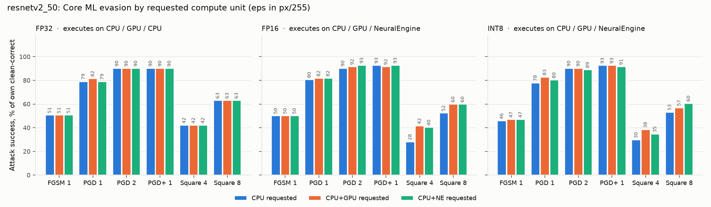
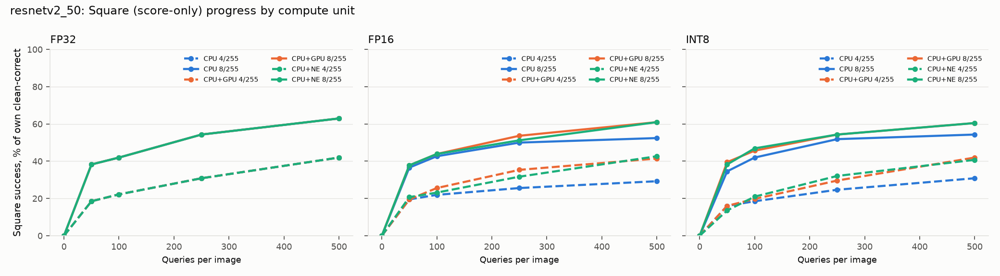

# timm ResNetV2-50 Core ML input-evasion study (CPU, CPU+GPU, CPU+Neural Engine)

Untargeted digital **input evasion** against the archive's ResNetV2-50 Core ML
packages. The packages were tested on all three Apple compute-unit requests:
`CPU_ONLY`, `CPU_AND_GPU` and `CPU_AND_NE`. Only input pixels change. This is a
**new experiment run locally on 10 November 2026** (macOS 26.6.2, Apple Silicon,
coremltools 9.0, torch 2.14.0). It follows the protocol of the
[unified ResNetV2-50 matrix](../evasion_onnx/README.md#unified-timm-base-primary-matrix)
and uses the same 100 images, so results are comparable with the ONNX, TensorRT,
RKNN, QNN and Edge TPU deployments. The method is described in full in the
[MobileNetV2 Core ML report](../../mobilenetv2/evasion_coreml/README.md#2-method).
Only the model-specific details differ, and they are given below. INT4 packages
were excluded: they are experimental exports with large prediction drift.

---

## TL;DR

* **The compute unit does not change white-box results.** PGD reaches 77.8–82.7%
  at 1/255, about 90% at 2/255, 95–98% at 4/255 and 99–100% at 8/255 on all nine
  arms. The 1/255 stronger check (100 steps × 5 starts) raises this to 90–93%.
  Between units of the same precision, results differ by at most 4 images.
* **The score-only Square attack is consistently weakest on `CPU_ONLY` for FP16
  and INT8.** Over three extra seeds, CPU averages 31–33% at 4/255 versus 41–42% on GPU
  and Neural Engine, with non-overlapping seed ranges. At 8/255 the averages are
  52–55% versus 58–59%. GPU and Neural Engine are indistinguishable. Unlike
  MobileNetV2, score granularity does not differ between units here, so the cause
  is **not established**.
* **Weight-only INT8 gives none of the white-box resistance that activation
  quantization gave.** Core ML INT8 (W8A16) reaches 77.8–82.7% PGD at 1/255,
  like float. The earlier W8A8 deployments (ORT, RKNN and NPU INT8) reached
  62–67% on their own denominators.
* **The FP32 CPU arm reproduces the earlier PyTorch/ONNX FP32 rows**: white-box
  conditions agree to within one image, Square to within three.

---

## 1. What was attacked

| Property | Value |
| --- | --- |
| Model | `timm/resnetv2_50.a1h_in1k`, checkpoint SHA-256 `b809e8c09f4a…` |
| Packages | `weights/resnetv2_50/coreml/resnetv2_50_{fp32,fp16,int8}.mlpackage`; hashes in each `results/<arm>/runtime.json` |
| Precisions | FP32; FP16 compute; INT8 per-channel weight-only with FP16 compute (W8A16) |
| Preprocessing | shorter side 232, bilinear → center crop 224 → `[0,1]` → ImageNet mean/std (outside the package) |
| Population | The same 100 Imagenette2-320 `val` images as every earlier ResNetV2-50 study, re-verified by SHA-256 |
| Replica ops | `conv`, `max_pool`, `batch_norm` (17 pre-activation norms), `relu`, `add`, `reduce_mean`, `reshape`, `cast`; classifier is a 1×1 `conv` |

| Precision | `CPU_ONLY` | `CPU_AND_GPU` | `CPU_AND_NE` |
| --- | --- | --- | --- |
| FP32 | CPU (139 ops) | GPU (139) | **CPU (139)**: no FP32 Neural Engine path |
| FP16 | CPU (141) | GPU (141) | Neural Engine (141) |
| INT8 | CPU (141) | GPU (141) | Neural Engine (141) |

The replica gate passed at 100% agreement on all nine arms, and every
exact-forward check was bit-identical. The one-step 8/255 probe flipped 52–55
predictions with the gradient sign, versus 13–15 with a random sign.

## 2. Results

Percentages are `fooled / own clean-correct`. Counts and 95% Wilson intervals are
in [`results/comparisons/matrix.json`](results/comparisons/matrix.json). The
full tables, including the shared n = 81 set, are in
[`matrix.md`](results/comparisons/matrix.md).

### 2.1 Clean

FP32 81/100, FP16 82/100, INT8 81/100, identical on all three units; **81**
images are correct in all nine arms. FP32 GPU logits differ from the CPU by at
most 4.6e-5. FP32 `CPU_AND_NE` is bit-identical to `CPU_ONLY`. FP16 and INT8 on
GPU or Neural Engine differ from CPU by up to 0.42–0.46 logits, with 100% top-1
agreement.

### 2.2 Attack matrix

| Arm | Clean | FGSM 1 | FGSM 8 | PGD 1 | PGD 2 | PGD 4 | PGD 8 | PGD+ 1 | Square 4 | Square 8 | Random 8 |
| --- | ---: | ---: | ---: | ---: | ---: | ---: | ---: | ---: | ---: | ---: | ---: |
| `fp32_cpu_only` | 81 | 50.6 | 51.9 | 79.0 | 90.1 | 97.5 | 100 | 90.1 | 42.0 | 63.0 | 4.9 |
| `fp32_cpu_and_gpu` | 81 | 50.6 | 51.9 | 81.5 | 90.1 | 97.5 | 100 | 90.1 | 42.0 | 63.0 | 4.9 |
| `fp32_cpu_and_ne` | 81 | 50.6 | 51.9 | 79.0 | 90.1 | 97.5 | 100 | 90.1 | 42.0 | 63.0 | 4.9 |
| `fp16_cpu_only` | 82 | 50.0 | 52.4 | 80.5 | 90.2 | 95.1 | 100 | 92.7 | **28.0** | **52.4** | 6.1 |
| `fp16_cpu_and_gpu` | 82 | 50.0 | 53.7 | 81.7 | 91.5 | 97.6 | 100 | 91.5 | 41.5 | 59.8 | 6.1 |
| `fp16_cpu_and_ne` | 82 | 50.0 | 52.4 | 81.7 | 92.7 | 97.6 | 100 | 92.7 | 40.2 | 59.8 | 6.1 |
| `int8_cpu_only` | 81 | 45.7 | 51.9 | 77.8 | 90.1 | 97.5 | 98.8 | 92.6 | **29.6** | **53.1** | 3.7 |
| `int8_cpu_and_gpu` | 81 | 46.9 | 51.9 | 82.7 | 90.1 | 97.5 | 98.8 | 92.6 | 38.3 | 56.8 | 3.7 |
| `int8_cpu_and_ne` | 81 | 46.9 | 51.9 | 80.2 | 88.9 | 97.5 | 100 | 91.4 | 34.6 | 60.5 | 3.7 |

The FP32 CPU reference's candidates transfer to the FP16/INT8 arms at
76.5–79.3% (PGD 1/255) and 100% (PGD 8/255). This is about what each arm's own
adaptive attack achieves, so per-arm adaptation gains little.

### 2.3 Compute-unit differences

**FP32:** all attack outcomes match, except PGD 1/255 on the GPU (66 vs 64
images). That difference comes from 4.6e-5 logit differences changing which
candidate is kept.

**FP16 / INT8, Square with three extra seeds**
([`results/supplementary/square_seeds.json`](results/supplementary/square_seeds.json)),
mean with seed range in brackets:

| Arm | Square 4/255 | Square 8/255 | Unchanged-score probes | Smallest non-zero margin change |
| --- | --- | --- | ---: | ---: |
| `fp16_cpu_only` | 32.5 [29.3–36.6] | 54.9 [51.2–57.3] | 0.8% | 0.00037 |
| `fp16_cpu_and_gpu` | 41.9 [39.0–45.1] | 58.1 [57.3–59.8] | 1.0% | 0.00049 |
| `fp16_cpu_and_ne` | 41.5 [41.5–41.5] | 58.1 [56.1–59.8] | 1.2% | 0.00012 |
| `int8_cpu_only` | 31.3 [30.9–32.1] | 51.9 [50.6–53.1] | 1.2% | 0.00024 |
| `int8_cpu_and_gpu` | 41.1 [37.0–44.4] | 57.6 [55.6–60.5] | 0.8% | 0.00024 |
| `int8_cpu_and_ne` | 41.6 [38.3–44.4] | 59.3 [56.8–64.2] | 0.9% | 0.00024 |

At 4/255 the CPU's seed ranges sit entirely below both other units for FP16 and
INT8. At 8/255 the CPU is lowest on average, but the FP16 ranges touch (57.3).
Unlike MobileNetV2, all three units report scores at similarly fine
granularity and rarely return an unchanged score. Coarse output rounding
therefore does not explain the CPU gap for ResNetV2-50. The difference is
reproducible on this machine, but its mechanism is not established.

**Cross-unit portability** asks: of images fooled on one unit, and clean-correct
on another, what percentage also fool the other unit? For FGSM, PGD and PGD+,
it is 97.7–100%. For Square it is 65–90% at 4/255 and 77–100% at 8/255.
GPU ↔ Neural Engine portability (82–100%) is higher than portability to or from
the CPU.

### 2.4 Comparison with earlier ResNetV2-50 deployments

| Arm (own denominator) | Clean | FGSM 1 | PGD 1 | PGD 2 | PGD+ 1 | Square 4 | Square 8 |
| --- | ---: | ---: | ---: | ---: | ---: | ---: | ---: |
| PyTorch FP32 (earlier) | 81 | 50.6 | 80.2 | 90.1 | 90.1 | 44.4 | 60.5 |
| ONNX FP32 (earlier) | 81 | 50.6 | 80.2 | 90.1 | 91.4 | 45.7 | 60.5 |
| **Core ML FP32 CPU** | 81 | 50.6 | 79.0 | 90.1 | 90.1 | 42.0 | 63.0 |
| **Core ML INT8 (W8A16), all units** | 81 | 45.7–46.9 | 77.8–82.7 | 88.9–90.1 | 91.4–92.6 | 29.6–38.3 | 53.1–60.5 |
| RKNN INT8 (W8A8, earlier) | 78 | 44.9 | 66.7 | 78.2 | 74.4 | 19.2 | 35.9 |
| ORT INT8 QOperator (W8A8, earlier) | 78 | 34.6 | 61.5 | 76.9 | 74.4 | 23.1 | 39.7 |

Core ML INT8 quantizes weights only and keeps FP16 activations. Under attack it
behaves like the float deployments, not like the activation-quantized INT8
deployments. This supports the earlier reports' reading that INT8's measured
resistance comes from **activation** quantization, and that the resistance is
finite-attack friction, not robustness.

## 3. Validation and limitations

`summarize.py` reconciled **9 arms / 199 conditions / 19,900 per-image rows**
with **0 problems**: sample identity, unchanged package hashes, bit-identical
bridged forward, replica gates, L∞ and `[0,1]` bounds, Square budgets and
eligibility, summary-versus-row counts, and consistent clean sets.

Limitations match the MobileNetV2 report: a 100-image pilot, one protocol seed
(plus three supplementary Square seeds), approximate BPDA gradients through an
FP32 replica, and Core ML compute-plan placement for one OS version. These are
not robustness certificates.

Reproduction uses the same source-workspace harness (`AISR/evasion_coreml/`).
Run `./run_all.sh`, then `scripts/summarize.py`,
`scripts/square_seeds.py --model resnetv2_50` and `scripts/figures.py`.
