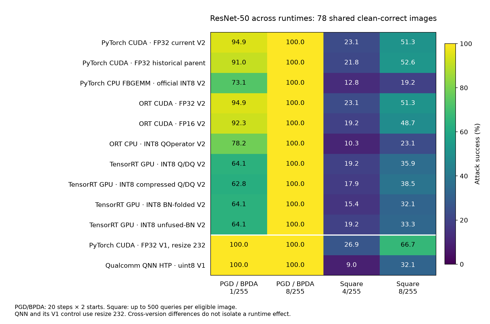
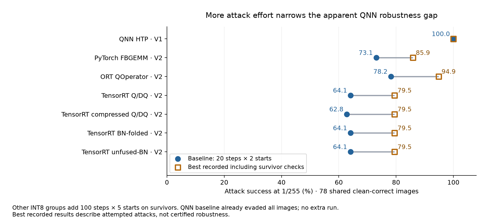

# ONNX ResNet-50 evasion across CUDA, TensorRT, and CPU

> **Base-model status (unified matrix).** The study now uses a single canonical
> base model: `timm/resnetv2_50.a1h_in1k`, which both NPU deployments already
> use. The TorchVision ResNet-50 results retained in this file are the
> **secondary cross-architecture replication** and must not be mixed into a
> runtime/quantization ranking with timm rows: the base-model swap alone moves
> 1/255 PGD evasion by ~16 percentage points, comparable to the entire runtime
> effect. See [BASE_MODEL_UNIFICATION.md](../BASE_MODEL_UNIFICATION.md) and
> [UNIFICATION_STATUS.md](../UNIFICATION_STATUS.md) for the primary matrix,
> provenance and remaining GPU-gated steps.

This suite tests all seven ONNX files found in
`/home/ross/QA/Models/resnet50/quantize/artifacts`. It reuses the earlier
100-image evasion pilot and attacks the actual deployment runtimes. Source
ONNX files, calibration data, and pretrained weights are not modified.

The [QNN-inclusive cross-runtime comparison](#cross-runtime-update-qualcomm-qnn-htp)
adds Qualcomm QNN HTP and its matched FP32 V1 control to the earlier PyTorch,
ORT and TensorRT results. The seven-ONNX experiment below retains its original
scope and results.

The [RKNN Rock 5C comparison](../evasion_rknn/README.md) adds native FP16 and
INT8 deployment measurements and evasion against matched timm ResNetV2-50
PyTorch/ONNX FP32 controls. The review records that source's architecture and
weight identity separately from TorchVision ResNet-50 V2.
The [INT8 comparison](../evasion_rknn/INT8_COMPARISON.md) adds a shared-image
comparison across nine quantized deployments and a same-checkpoint ORT/TensorRT
subset. The RKNN report's latency table now measures all four models on the
Rock 5C, with FP32 execution on CPU.

## Unified timm base (primary matrix)

The primary cross-runtime matrix is built on **one** base model,
`timm/resnetv2_50.a1h_in1k` (canonical ONNX `6416f2e9…`); the TorchVision arms
in this file are the secondary cross-architecture replication. Rationale and
the measured base-model confound are in `../BASE_MODEL_UNIFICATION.md`;
implementation state, artifact hashes and the GPU-gated remainder are in
`../UNIFICATION_STATUS.md`.

| New arm | Artifact (`quantize/artifacts/`) | Runtime |
| --- | --- | --- |
| `timm_rnv2_fp32` | `timm_rnv2_fp32.onnx` (`6416f2e9…`) | ORT CUDA, transfer reference |
| `timm_rnv2_fp16` | `timm_rnv2_fp16.onnx` (`23cc2388…`) | ORT CUDA FP16 |
| `timm_rnv2_int8_ort_qop` | `timm_rnv2_int8_ort_qop.onnx` (`ae524e4d…`) | ORT CPU QOperator |
| `timm_rnv2_int8_ptq_ort` | `timm_rnv2_int8_ptq_ort.onnx` (`99755d64…`) | native TensorRT Q/DQ |
| `timm_rnv2_int8_dq_ort` | `timm_rnv2_int8_dq_ort.onnx` (`fd967b8c…`) | native TensorRT compressed Q/DQ |

```bash
# CPU-only arm (GPU-free host)
python evasion_onnx/scripts/run_model.py --model timm_rnv2_int8_ort_qop --device cpu \
  --reference timm_rnv2_fp32 --reference-dir evasion_rknn/results/run/onnx_fp32
# GPU window: reference, then the three GPU arms, then both reconciliations
python evasion_onnx/scripts/run_model.py --model timm_rnv2_fp32
python evasion_onnx/scripts/run_gpu_variants.py --source timm
python evasion_onnx/scripts/summarize.py --source timm
python evasion_onnx/scripts/compare_timm.py
python evasion_onnx/scripts/make_timm_figure.py
```

`summarize.py` is source-aware (`--source torchvision|timm`); its TorchVision
default reproduces the retained `results/comparisons/onnx.json` unchanged.
`compare_timm.py` never mixes bases and only includes an arm with a complete
`summary.json`. The consolidated analysis of this family is
[`../RESNETV2_50_REPORT.md`](../RESNETV2_50_REPORT.md); its figures are generated
by `scripts/make_v2_report_figures.py` into `../figures/`.

Measured on the shared **71** clean-correct images (evaded / 71; full table with
Wilson intervals in `results/comparisons/timm_matrix.md`, figure
`figures/timm_matrix.png`):

| Deployment | clean | PGD 1/255 | PGD+strong 1/255 | PGD 8/255 | Square 8/255 |
| --- | ---: | ---: | ---: | ---: | ---: |
| PyTorch FP32 · CUDA | 81 | 55 | 63 | 71 | 39 |
| ORT FP32 · CUDA | 81 | 55 | 64 | 71 | 39 |
| ORT FP16 · CUDA | 82 | 54 | 65 | 71 | 40 |
| RKNN FP16 · NPU | 81 | 55 | 64 | 71 | 40 |
| ORT INT8 QOperator · CPU | 78 | 41 | 51 | 69 | 24 |
| RKNN INT8 · NPU | 78 | 45 | 51 | 71 | 21 |
| QNN HTP INT8 · NPU | 79 | 41 | 43 | 71 | 21 |
| TensorRT INT8 Q/DQ | 79 | 42 | 49 | 69 | 26 |
| TensorRT INT8 compressed | 79 | 42 | 50 | 69 | 26 |

The two TensorRT arms carry a recorded replica-agreement exception
(`summary.json.gradient.replica_gate_override`) justified by
`scripts/probe_trt_replica.py`: the ONNX replica disagrees with the TRT engine
on 12/100 clean predictions, but all disagreements are near-ties and a sign step
along the replica gradient flips 11/20 engine predictions versus 0/20 for a
random direction.

## Project layout

| Location | Contents |
| --- | --- |
| `scripts/` | ONNX runtime adapters, graph surrogate, attack runners, validators and report generators. |
| `results/<model>/` | Full-run per-image records, clean logits, manifests, runtime evidence and saved adversarial tensors. |
| `results/comparisons/` | Seven-ONNX, PyTorch/ONNX and QNN-inclusive comparisons. |
| `results/validation/` | Source and calibration provenance verification. |
| `figures/` | ONNX and QNN-inclusive comparison figures. |
| `logs/` | Runtime setup, build, preflight, full-run and validation logs. |
| `engines/` | Retained TensorRT plans and their build metadata. |

Smoke runs and bytecode caches have been removed. Historical run JSON and logs
retain their original recorded paths; the shared move ledger is
`../evasion/results/validation/layout_migration.json`.

## Runtime selection

| Model | Actual runtime | Clean correct / 100 |
| --- | --- | --- |
| `fp32_v2.onnx` | ONNX Runtime 1.24.4, CUDA EP, TF32 disabled | 85 |
| `fp16_v2.onnx` | ONNX Runtime 1.24.4, CUDA EP, FP16 inputs and weights | 85 |
| `int8_ort_qop_v2.onnx` | ONNX Runtime 1.24.4, CPU EP, quantized operators | 88 |
| `int8_ptq_ort.onnx` | Native TensorRT 10.9.0.34, GPU, explicit Q/DQ | 87 |
| `int8_dq_ort.onnx` | Native TensorRT 10.9.0.34, GPU, compressed Q/DQ | 87 |
| `torchptq_v2_bnfused.onnx` | Native TensorRT 10.9.0.34, GPU | 85 |
| `torchptq_v2_residual.onnx` | Native TensorRT 10.9.0.34, GPU | 87 |

ONNX Runtime profiles verify the providers executing the compute kernels;
listing an available provider is not accepted as evidence. All four TensorRT
engine inspectors identify **53 INT8 convolution layers**. Native TensorRT has
no CPU execution fallback in this suite. The ONNX file's storage dtype is kept
separate from the deployed engine's precision.

GPU access is available in this session. The older `quantize/artifacts/env.json`
was captured in a session without GPU access and does not describe this run.

The system TensorRT 11.1 parses the graphs but fails engine construction with
`wtsEngineUtils.cpp::buildWtsEngine` internal assertions, including with
optimization level 0 and JIT-convolution tactics disabled. Those attempts are
recorded in `logs/trt_build_*.log` and `logs/trt11_nojit.log`. An isolated official
TensorRT 10.9 installation succeeds, without changing system TensorRT 11:

```bash
cd /home/ross/QA
uv pip install --python ./venv/bin/python --target ./venv/tensorrt10 --no-deps \
  tensorrt-cu12==10.9.0.34 tensorrt-cu12-libs==10.9.0.34 \
  tensorrt-cu12-bindings==10.9.0.34
```

`runtimes.py` explicitly loads these task-local TensorRT 10 libraries and
bindings. Engine caches record the ONNX hash, TensorRT version, shape profile,
precision configuration, and workspace size. Engines are built for CUDA device
0, batch range 1–10, strongly typed Q/DQ, TF32 disabled, 1 GiB workspace, and
builder optimization level 3. Engine files are specific to this runtime and GPU.

## Source, sample, and preprocessing controls

- Same 100 original images as `../evasion/results/pytorch/samples.json`: ten randomly
  selected validation images per Imagenette class, sample seed `20261030`.
- All **1,000 ImageNet output classes** remain in the classifier.
- Identical shorter-side resize 232, center crop 224, RGB pixels in `[0,1]`, and
  ImageNet normalization for all seven variants.
- Untargeted digital input evasion after resize/crop, with pixel-space L∞
  budgets of **1/255, 2/255, 4/255, and 8/255**, applied before normalization.
- These ONNX variants use the **current** V2 checkpoint `resnet50-11ad3fa6.pth`.
  They are compared to `fp32_v2.onnx`, rather than the historical FP32 parent of
  the separately supplied official PyTorch FBGEMM model.
- `check_provenance.py` checks the source checkpoint hash and quantization
  metadata hashes. FP32 ONNX Runtime versus PyTorch maximum logit difference on
  the pilot is approximately **1.79e-5**, with identical top-1 predictions.
- The 512 calibration images have **zero overlap** with the pilot. Calibration
  manifest and array hashes are retained and checked.

## Attacks and gradient access

All deployment runtimes here are forward-only. None exposes native input
autograd through its inference API. Lack of native gradients is not counted as
robustness. `onnx_surrogate.py` builds differentiable replicas from each actual
ONNX graph, including its own weights, scales, zero points, residual paths,
BatchNorm, pooling, and classifier.

- **FP32:** PGD derivatives from the equivalent differentiable ONNX graph.
- **FP16:** FP32 derivative approximation using the graph's FP16-stored weights;
  the actual runtime retains FP16 inference and is used for all forward scores.
- **INT8:** adaptive **BPDA**, with straight-through rounding and clipping
  derivatives in the graph replica. Clipping is particularly important for
  QOperator graphs, where an unsigned output grid can implement a fused ReLU.
- An autograd bridge returns **bit-identical actual runtime logits** in the
  forward pass and routes the backward derivative through the replica. Every
  final adversarial candidate is evaluated again on the actual runtime.
- Replica clean agreement is measured before attacks. On the full pilot it is
  100% for FP32, FP16, and both ORT-style Q/DQ variants, 98% for QOperator,
  96% for BN-folded torch PTQ, and 97% for the unfused-BN torch PTQ graph.
  Agreement of predictions does not establish accuracy of the approximate
  derivatives; failures of BPDA are not certificates of robustness.

The previous protocol is retained:

1. Uniform bounded **random-noise control** at every epsilon.
2. **FGSM**, one cross-entropy ascent step, step size epsilon.
3. **PGD / BPDA-PGD**, 20 steps, two uniform random starts, step size epsilon/4.
   Keep the best successful candidate per image over all steps and starts;
   project to the pixel L∞ ball and `[0,1]` after each step.
4. At 1/255, an additional **100-step, five-start survivor check**, retaining
   baseline successes. This is reported separately as `pgd_stronger`.
5. Independent score-only **Square attack** at 4/255 and 8/255, up to **500
   queries per initially correct image**, stripe initialization, margin
   objective, and the authors' decreasing square-size schedule. No surrogate or
   transfer warm start. The clean eligibility query and independent final
   verification are outside the search budget. This uses the same local
   reimplementation as the previous experiment, not the upstream package.
6. **Transfer** of the CUDA FP32 reference's FGSM and PGD candidates to every
   other model, scored on each destination runtime without adaptation.

`native_runtime_autograd` is false in each result. The white-box/BPDA results
must not be described as backpropagation through an ORT or TensorRT engine.

## Running the suite in QA's existing uv environment

```bash
cd /home/ross/QA
uv run --no-project --python ./venv/bin/python Models/resnet50/evasion_onnx/scripts/run_model.py --model fp32_v2
uv run --no-project --python ./venv/bin/python Models/resnet50/evasion_onnx/scripts/run_model.py --model int8_ort_qop_v2
uv run --no-project --python ./venv/bin/python Models/resnet50/evasion_onnx/scripts/run_gpu_variants.py
uv run --no-project --python ./venv/bin/python Models/resnet50/evasion_onnx/scripts/check_provenance.py
uv run --no-project --python ./venv/bin/python Models/resnet50/evasion_onnx/scripts/summarize.py
uv run --no-project --python ./venv/bin/python Models/resnet50/evasion_onnx/scripts/make_figure.py
```

The QOperator process can run alongside the GPU suite. The GPU runner waits for
the FP32 reference, then runs the other five GPU variants sequentially. Each
model also supports `--inspect-only` and a short functional `--smoke` run.
The full 100-image preflight, not the ten-image smoke run, determines replica
agreement before a full BPDA test.

## Results and validation

Each model has a directory under `results/` containing:

- `summary.json`: model and engine hashes, actual runtime/provider details,
  gradient method, replica diagnostics, settings, clean accuracy, attack
  success, robust accuracy, query counts, and completion status.
- `samples.json` and `clean.npz`: the full sample manifest, labels, clean target
  logits, and replica logits.
- `per_image.csv`: every evaluated attack/image/epsilon prediction, eligibility,
  perturbation norm, and Square query count.
- `runtime.json`, ORT profile traces, or `tensorrt_layers.json`: evidence of
  actual provider and kernel execution.
- `.pt` examples: full reference candidates for transfer tests, and one
  representative per class for other models. Float tensors retain attacked
  pixels without image-format rounding.

`summarize.py` independently reconciles all **15,300 per-image rows** from the
completed matrix, checks source and image hashes, enforces query and perturbation
bounds, verifies runtime execution, and checks calibration separation. Its
`results/comparisons/onnx.json` includes three distinct populations:

- Each model's **own clean-correct** images for its attack-success rate.
- Images clean-correct for a model **and the FP32 reference**, for paired checks.
- Images clean-correct for **all seven**, for the shared-denominator figure.

Already incorrect images never count as robust. The plotted survival/success
rates concern only the attempted attacks. This is a 100-image, ten-class pilot
with one sample and attack seed, rather than a full ImageNet robustness
benchmark. Backend, quantization scheme, calibration, and graph optimizations
can all vary; these are deployed-configuration comparisons, not an isolated
bit-width experiment.

<!-- BEGIN GENERATED RESULTS -->
## Measured results

The figure compares the **80 images initially correct in all seven models**. The table below instead uses each model's own clean-correct denominator, listed in the runtime table. Values are attack-success percentages; higher means more successful evasion.

| Model | Strong 1/255 | PGD 4/255 | PGD 8/255 | Square 8/255 |
| --- | ---: | ---: | ---: | ---: |
| `fp32_v2` | 97.6% | 98.8% | 100.0% | 54.1% |
| `fp16_v2` | 96.5% | 100.0% | 100.0% | 51.8% |
| `int8_ort_qop_v2` | 95.5% | 100.0% | 100.0% | 29.5% |
| `int8_ptq_ort` | 81.6% | 100.0% | 100.0% | 40.2% |
| `int8_dq_ort` | 81.6% | 100.0% | 100.0% | 43.7% |
| `torchptq_v2_bnfused` | 81.2% | 97.6% | 100.0% | 36.5% |
| `torchptq_v2_residual` | 81.6% | 100.0% | 100.0% | 39.1% |

Strong 1/255 includes the baseline attack and the additional 100-step, five-start survivor check. Other PGD/BPDA points use 20 steps and two starts. Square has a 500-query search limit.

Transfer of the FP32 reference's 8/255 PGD candidates:

| Destination | Transfer evasion |
| --- | ---: |
| `fp16_v2` | 100.0% |
| `int8_ort_qop_v2` | 98.9% |
| `int8_ptq_ort` | 100.0% |
| `int8_dq_ort` | 100.0% |
| `torchptq_v2_bnfused` | 100.0% |
| `torchptq_v2_residual` | 100.0% |

At 8/255, PGD/BPDA evaded every initially correct image in **7 of 7** variants. Residual survival at smaller budgets concerns these attempted attacks; approximate derivatives and finite query budgets do not establish worst-case robustness.

Independent validation reconciled **15,300 rows**. All model and sample hashes remained unchanged, all recorded perturbation and query bounds held, and all selected runtime providers were verified. Attack durations include preprocessing, replica gradients, transfers, and inference; they are not a controlled inference-latency benchmark.
<!-- END GENERATED RESULTS -->


<!-- BEGIN QNN COMPARISON -->
## Cross-runtime update: Qualcomm QNN HTP

Latest QNN result file saved **2 November 2026, 18:11 HKT**. The completed run adds Qualcomm QNN (`libQnnHtp.so`) on the QCS6490 Hexagon V68, using the deployed AIMET graph with uint8 inputs and outputs.

### What the QNN group changes

- **QNN shows no observed PGD/BPDA survival at the tested budgets:** all 89 initially correct images were evaded at 1/255, 2/255, 4/255 and 8/255, using 20 steps and two starts. Its matched FP32 V1 control had the same outcome.
- **Limited-query Square is less successful on QNN:** 10/89 (11.2%) at 4/255 and 34/89 (38.2%) at 8/255, versus 31/89 (34.8%) and 63/89 (70.8%) for FP32 V1. The paired gaps are 23.6 and 32.6 percentage points. These are resistance to this 500-query attack, not certified robustness.
- **The earlier cross-runtime findings remain:** every configuration is fully evaded by PGD/BPDA at 8/255. QNN adds another example where lower Square success does not imply protection against an adaptive gradient attack.

### Comparison on the same images

All 12 configurations are clean-correct on the same **78 images** from the original 100-image pilot. Adding QNN and its V1 control leaves the previous ten-configuration denominator of 78 unchanged. The seven-ONNX figure above retains its original 80-image population.

Every attack percentage below uses those 78 images; “Clean / 100” uses the whole pilot. Higher attack success means more successful evasion. “Strong 1/255” adds the 100-step, five-start survivor check; a dash means no additional survivor run was recorded.

| Configuration and runtime | Clean / 100 | PGD/BPDA 1/255 | Strong 1/255 | Square 4/255 | Square 8/255 |
| --- | ---: | ---: | ---: | ---: | ---: |
| PyTorch CUDA · FP32 current V2 | 85 | 94.9% | — | 23.1% | 51.3% |
| PyTorch CUDA · FP32 historical parent | 93 | 91.0% | 98.7% | 21.8% | 52.6% |
| PyTorch CPU FBGEMM · official INT8 V2 | 91 | 73.1% | 85.9% | 12.8% | 19.2% |
| ORT CUDA · FP32 V2 | 85 | 94.9% | 97.4% | 23.1% | 51.3% |
| ORT CUDA · FP16 V2 | 85 | 92.3% | 96.2% | 19.2% | 48.7% |
| ORT CPU · INT8 QOperator V2 | 88 | 78.2% | 94.9% | 10.3% | 23.1% |
| TensorRT GPU · INT8 Q/DQ V2 | 87 | 64.1% | 79.5% | 19.2% | 35.9% |
| TensorRT GPU · INT8 compressed Q/DQ V2 | 87 | 62.8% | 79.5% | 17.9% | 38.5% |
| TensorRT GPU · INT8 BN-folded V2 | 85 | 64.1% | 79.5% | 15.4% | 32.1% |
| TensorRT GPU · INT8 unfused-BN V2 | 87 | 64.1% | 79.5% | 19.2% | 33.3% |
| PyTorch CUDA · FP32 V1, resize 232 | 89 | 100.0% | — | 26.9% | 66.7% |
| Qualcomm QNN HTP · uint8 V1 | 89 | 100.0% | — | 9.0% | 32.1% |



On this shared subset, QNN has 100% PGD/BPDA success at 1/255 and 32.1% Square success at 8/255. The V1 control has 100% and 66.7%, respectively. QNN therefore does not reproduce the small-budget BPDA resistance observed in the V2 INT8 groups. Its Square result equals BN-folded TensorRT INT8 on this subset, while PyTorch FBGEMM and ORT QOperator have lower Square success (19.2% and 23.1%). This is a comparison of measured configurations, not a backend ranking.

**Checkpoint and input scope.** QNN is V1 based. Its reference here is the matched V1 run on identical resize-232 crops, with 89/100 clean accuracy for both targets; the earlier V1 resize-256 run had 83/100. All seven ONNX groups use current V2 weights, and official PyTorch INT8 uses the historical V2 parent. Quantization, calibration, graph transformations and gradient approximations also differ. Clean parity supports the V1 reference; it does not establish tensor-by-tensor equality of the deployed weights.

### What the Square plateau establishes

At 4/255, QNN Square had 10 evasions after 100 queries and still 10 at 500; FP32 V1 increased from 21 to 31. At 8/255, QNN increased from 31 to 34 while FP32 V1 increased from 41 to 63. The QNN output grid has spacing 0.167785 in logit units. Coarse feedback is a plausible contributor to the plateau, but the saved traces count successful evasions rather than unchanged proposal scores. They do not establish how often score ties occurred or isolate output quantization as the cause.

The existing level-change diagnostic concerns independently optimized QNN candidates. It is not a transfer test of the float Square candidates, so it cannot rule out input absorption of those float candidates. Both directions of **PGD** transfer were measured separately and evaded all 89 eligible images at every tested epsilon.

### Completion and evidence

The QNN run contains all 28 planned model/attack/epsilon conditions and 2,800 per-image rows. Reconciliation passes, with no recorded perturbation-bound or query-budget violations, and device clean predictions agree with the independent Stage A run. BPDA uses actual device forward scores and FP32 V1 surrogate gradients; QNN exposes no native autograd in this harness. A stronger survivor run was unnecessary for QNN because baseline PGD already left no survivors.

The original manifest hashes match the current files, and the QNN seed reconstructs the same sample order. QNN did not save an independent image-hash manifest at attack time. This remains a 100-image, ten-class, one-seed pilot.

- [QNN methods, matched V1 results and deployment checks](../evasion/README.md#qualcomm-qnn-on-the-qcs6490-npu)
- [Reconciled cross-runtime counts, per-image membership and input hashes](results/comparisons/qnn.json)
- [QNN original summary and query traces](../evasion/results/qnn/summary.json)
- [QNN independent reconciliation](../evasion/results/qnn/reconciliation.json)

Rebuild this update from the saved results, without rerunning attacks:

```bash
cd /home/ross/QA
./venv/bin/python Models/resnet50/evasion/scripts/check_npu_results.py
./venv/bin/python Models/resnet50/evasion_onnx/scripts/compare_qnn.py
```
<!-- END QNN COMPARISON -->

<!-- BEGIN QNN DIAGNOSIS -->
## Why QNN is easier to evade at 1/255

**QNN preserves vulnerable directions from its V1 reference. Different internal quantization and attack optimization are plausible explanations for the remaining gap, but their contributions have not been isolated.** The gap concerns small-budget gradient attacks: all INT8 groups are fully evaded at 8/255, while QNN remains substantially harder for Square than its float control.

### 1. V1 adversarial directions survive QNN deployment

At 1/255, the V1 control and QNN are both evaded on all 78 shared eligible images. More directly, **FP32 V1 PGD candidates transfer to QNN on all 89 of its eligible images**, without device adaptation, at every tested budget. Device PGD examples also transfer back with 100% success. Thus QNN retains nearby adversarial examples that the float reference already exposes; input rounding and deployment have not removed those directions.

V1 lineage alone is not a complete explanation. On the same 78 images, FP32 current V2 PGD evades 74 and the historical parent evades 71, versus 78 for V1. Yet INT8 baseline evasion falls to 61 for ORT QOperator, 49–50 for TensorRT and 57 for FBGEMM. For example, the 17-image QNN–ORT gap can be written as four images of FP32 baseline difference plus 13 images of differing within-pair attack outcomes. This is descriptive arithmetic, not a causal allocation between training and quantization.

### 2. Input rounding can contribute, but cannot explain the ORT gap

The actual saved quantizers give the following input spacings, in pre-normalization pixel/255 units. Epsilon is the same pixel-space bound in all groups.

| Deployment | Input spacing R / G / B | Input encoding |
| --- | --- | --- |
| QNN HTP · V1 | 1.0896 / 1.0658 / 1.0705 | uint8, zero point 114 |
| PyTorch FBGEMM · V2 | 2.1845 / 2.1368 / 2.1463 | uint8, zero point 57 |
| ORT QOperator · V2 | 1.0896 / 1.0658 / 1.0705 | uint8, zero point 114 |
| TensorRT Q/DQ · V2 | 1.2139 / 1.1874 / 1.1927 | int8, zero point 0 |
| TensorRT compressed Q/DQ · V2 | 1.2139 / 1.1874 / 1.1927 | int8, zero point 0 |
| TensorRT BN-folded · V2 | 1.2139 / 1.1874 / 1.1927 | int8, zero point 0 |
| TensorRT unfused-BN · V2 | 1.2139 / 1.1874 / 1.1927 | int8, zero point 0 |

**QNN and ORT QOperator have the same nominal input encoding:** uint8, scale 0.01865844801068306 and zero point 114 (QNN offset −114). Therefore different input-grid resolution alone cannot explain their 100% versus 78.2% baseline BPDA success at 1/255.

FBGEMM has an approximately twice-coarser input grid, so its smaller number of accessible input levels is a plausible contributor to its small-budget resistance. TensorRT input steps are only about 11% larger than QNN, despite a much larger baseline BPDA gap. Internal quantizers and classifier geometry must also be considered. Neither spacing defines a safe radius: pixels near a bin boundary can cross it under a sub-step perturbation, and uint8 versus int8 is not itself a robustness distinction.

### 3. Some apparent protection depends on attack effort

Using the same 78-image denominator, stronger survivor attacks increase ORT QOperator success from 78.2% to 94.9%, FBGEMM from 73.1% to 85.9%, and TensorRT from 62.8–64.1% to 79.5%. Consequently, the QNN–ORT gap shrinks from 21.8 to **5.1 percentage points**. The corresponding FBGEMM gap shrinks from 26.9 to 14.1 points, and TensorRT gaps shrink from 35.9–37.2 to 20.5 points.



The surviving INT8 examples may reflect a combination of changed boundaries and optimization difficulty. Approximate BPDA gradients, a fixed epsilon/4 step size and cross-entropy loss can interact differently with each graph. QNN uses a smooth FP32 V1 surrogate; other INT8 attacks use replicas with their own dequantized weights and activation rounding. This changes attack effectiveness as well as the target being measured. Clean replica agreement is 100% for QNN versus V1, 98% for ORT QOperator and 96–100% for TensorRT replicas; those figures do not measure gradient accuracy near adversarial boundaries. The TensorRT replicas with 100% clean agreement still retain the small-budget gap, so clean agreement cannot explain it by itself.

Published work shows that misleading gradients can inflate apparent robustness and that improving attack gradients can substantially change quantized-network results. This motivates testing those explanations here; it does not prove that every remaining survivor is gradient masking. [BPDA and obfuscated gradients](https://arxiv.org/abs/1802.00420); [quantized-network attack study](https://arxiv.org/abs/2003.13511).

### 4. The internal quantization recipe is still unresolved

The local V2 variants differ in calibration, per-tensor/per-channel choices, residual quantizers, BatchNorm folding and high-precision operations. Four TensorRT inspectors verify INT8 convolutions, but their ONNX graphs finish with a floating-point Gemm. QNN uint8 input/output metadata does not provide a layer-by-layer inventory of internal precision. The inspected deployment package supplies a compiled context and minimal model card, without the original calibration manifest or per-layer AIMET encodings. Calibration or internal activation resolution could explain part of the difference, but neither has been isolated.

AIMET defines activation and parameter encodings separately, including scales, offsets and encoding types; a shared “8-bit” label does not establish equivalent quantization throughout the network. [AIMET encoding specification](https://qualcomm.github.io/aimet-pages/releases/2.35.0/techniques/encoding_spec.html).

### 5. Square’s plateau does not predict PGD resistance

QNN logits have spacing 0.167785, and Square success plateaus early. This is compatible with coarse feedback limiting score-based search. BPDA uses a differentiable V1 surrogate and checks candidates on the real device; moreover, float PGD transfer already evades every eligible input. Thus a coarse output grid can coexist with very successful gradient attacks. The plateau does not establish a measured tie frequency or a causal output-quantization explanation.

### Experiments that would distinguish the remaining explanations

1. Hold the FP32 checkpoint and resize-232 inputs fixed while producing QNN, ORT and TensorRT variants with recorded calibration and matched input encodings. This separates checkpoint differences from the deployment recipe.
2. Transfer the same strong candidates across each matched float/quantized pair and compare several BPDA surrogates, step sizes, and margin or temperature-scaled losses. Score every candidate on the actual target and retain the attack union. This tests whether the remaining 1/255 survivors reflect optimizer limitations.
3. Obtain QNN per-layer encodings and run input-only, weight-only and full-quantization ablations on the same weights. These would locate any change in boundary distance; the current compiled binary alone cannot do that.

These are proposed follow-ups. The analysis above uses retained attacks and artifact inspection; no new device attack has been run. [Quantizer values, attack counts, replica checks and source hashes](results/diagnostics/qnn_robustness.json); [inspected QNN package metadata and inventory](../evasion/results/validation/qnn_deployment_package.json).

Rebuild this diagnostic from the retained evidence:

```bash
cd /home/ross/QA
PYTHONDONTWRITEBYTECODE=1 ./venv/bin/python Models/resnet50/evasion_onnx/scripts/analyze_qnn_robustness.py
```
<!-- END QNN DIAGNOSIS -->

## Primary references

- [ORT TensorRT provider requirements](https://onnxruntime.ai/docs/execution-providers/TensorRT-ExecutionProvider.html)
- [ORT quantized model formats](https://onnxruntime.ai/docs/performance/model-optimizations/quantization.html)
- [TensorRT Python inference API](https://docs.nvidia.com/deeplearning/tensorrt/11.4.0/inference-library/python-api-docs.html)
- [BPDA and gradient masking](https://arxiv.org/abs/1802.00420)
- [Square Attack](https://arxiv.org/abs/1912.00049)
