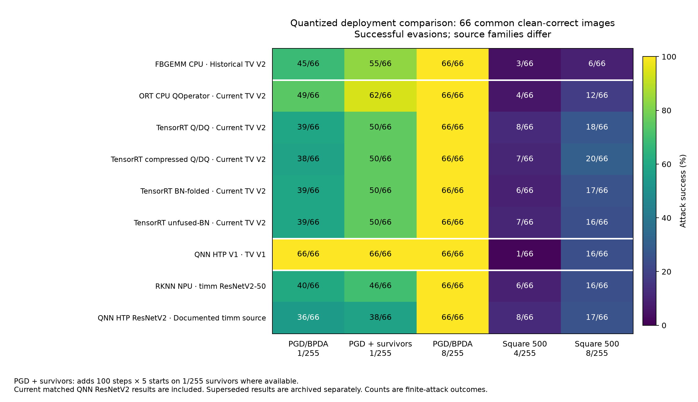

# INT8 / 8-bit runtime robustness comparison

> **Base-model status (unified matrix).** This file is a **historical
> cross-family comparison**: it ranks TorchVision-family and timm-family
> deployments against each other, which the base-model confound does not
> support. The primary, single-base matrix is now
> `timm/resnetv2_50.a1h_in1k`; the TorchVision rows are retained as a
> secondary replication. See [BASE_MODEL_UNIFICATION.md](../BASE_MODEL_UNIFICATION.md)
> and [UNIFICATION_STATUS.md](../UNIFICATION_STATUS.md).

All valid gradient-attack groups are fully evaded at **8/255**. Resistance differs
at 1/255 and under 500-query Square search. Those differences describe these
recorded deployments; architecture, checkpoint, calibration, graph conversion
and BPDA approximation prevent a single causal ranking of runtime robustness.

The closest controlled subset shows an attack-dependent ordering: on the same
80 current-TorchVision-V2 images, standard 1/255 PGD/BPDA evades 63/80 for ORT
and 51–52/80 for TensorRT. With the stronger survivor checks this becomes 76/80
versus 64/80. At 8/255, 500-query Square instead evades 20/80 for ORT and
27–32/80 for TensorRT. A lower gradient-attack success rate therefore does not
imply a lower score-only attack success rate under these budgets.

**Correction, 4 November 2026.** The QNN ResNetV2 deployment was previously
attacked with TorchVision ResNet-50 gradients and appeared far harder to evade
than its peers (6/66 at 1/255). That surrogate had the wrong architecture and
the wrong weights. Re-attacked with the graph's own documented FP32 source it
evades **36/66** at 1/255, in line with RKNN (40/66) and the TensorRT family
(38–39/66). Only the matched rerun appears in the primary tables and chart.
The superseded run remains in the comparison JSON for historical inspection.
Its score-only results reproduce exactly.

## Same-image comparison

The nine current quantized deployments and their four FP32 source references are all
initially correct on the same **66/100 images**. Every count below uses those
identical indices and original labels. Higher evasion means a more successful
attack. QNN uses UINT8 activation interfaces; signed versus unsigned storage
alone is not a robustness distinction.
TV denotes TorchVision ResNet-50 weight versions; timm ResNetV2-50 is a separate
architecture and source checkpoint. The historical QNN ResNetV2 run with
TorchVision gradients is archived as `qnn_timm_superseded` in the JSON and
omitted from these primary tables and chart.

Historical QNN image alignment is reconstructed from its saved seed/settings
and control predictions; no independent attack-time image-hash manifest exists.
A fresh reconstruction reproduced all 100 retained QNN V1 control predictions
from the verified original image files. This corroborates alignment without
replacing the missing attack-time hashes.

| Deployment | Source family | Clean /100 | PGD 1/255 | PGD + survivors 1/255 | PGD 8/255 | Square 4/255 | Square 8/255 |
| --- | --- | ---: | ---: | ---: | ---: | ---: | ---: |
| FBGEMM CPU | Historical TV V2 | 91 | 45/66 | 55/66 | 66/66 | 3/66 | 6/66 |
| ORT CPU QOperator | Current TV V2 | 88 | 49/66 | 62/66 | 66/66 | 4/66 | 12/66 |
| TensorRT Q/DQ | Current TV V2 | 87 | 39/66 | 50/66 | 66/66 | 8/66 | 18/66 |
| TensorRT compressed Q/DQ | Current TV V2 | 87 | 38/66 | 50/66 | 66/66 | 7/66 | 20/66 |
| TensorRT BN-folded | Current TV V2 | 85 | 39/66 | 50/66 | 66/66 | 6/66 | 17/66 |
| TensorRT unfused-BN | Current TV V2 | 87 | 39/66 | 50/66 | 66/66 | 7/66 | 16/66 |
| QNN HTP V1 | TV V1 | 89 | 66/66 | 66/66 | 66/66 | 1/66 | 16/66 |
| RKNN NPU | timm ResNetV2-50 | 78 | 40/66 | 46/66 | 66/66 | 6/66 | 16/66 |
| QNN HTP ResNetV2 | Documented timm source | 79 | 36/66 | 38/66 | 66/66 | 8/66 | 17/66 |

The [matched QNN rerun](../evasion/README.md#matched-comparison-documented-resnetv2-source-versus-the-deployed-graph)
records 49/79 evasions at 1/255 and 79/79 at 8/255 on its full eligible population.
Its score-only Square counts are 18/79 at 4/255 and 29/79 at 8/255.

## Closest comparison: same current TorchVision V2 source

These five exports derive from the same `resnet50-11ad3fa6` FP32 checkpoint and
share **80** clean-correct images with its FP32 reference. This removes the
architecture/checkpoint difference from this subset. Quantization grids,
calibration and conversion details, and gradient replicas still differ.

| Current TV V2 deployment | PGD 1/255 | PGD + survivors 1/255 | PGD 8/255 | Square 8/255 |
| --- | ---: | ---: | ---: | ---: |
| ORT CPU QOperator | 63/80 | 76/80 | 80/80 | 20/80 |
| TensorRT Q/DQ | 52/80 | 64/80 | 80/80 | 30/80 |
| TensorRT compressed Q/DQ | 51/80 | 64/80 | 80/80 | 32/80 |
| TensorRT BN-folded | 52/80 | 64/80 | 80/80 | 27/80 |
| TensorRT unfused-BN | 52/80 | 64/80 | 80/80 | 28/80 |

## Each deployment against its own FP32 source

Each row uses the intersection of that target's and its own reference's clean
sets. These denominators vary and must not be compared as one shared population.
The FP32 source attack results were recorded on CUDA; the corrected board CPU
latency benchmark is a separate measurement.

| Deployment | Pair eligible | FP32 PGD 1/255 | Quantized PGD 1/255 | FP32 Square 8/255 | Quantized Square 8/255 |
| --- | ---: | ---: | ---: | ---: | ---: |
| FBGEMM CPU | 91 | 84/91 | 70/91 | 54/91 | 24/91 |
| ORT CPU QOperator | 82 | 78/82 | 65/82 | 44/82 | 21/82 |
| TensorRT Q/DQ | 85 | 81/85 | 57/85 | 46/85 | 33/85 |
| TensorRT compressed Q/DQ | 85 | 81/85 | 56/85 | 46/85 | 36/85 |
| TensorRT BN-folded | 83 | 79/83 | 55/83 | 44/83 | 29/83 |
| TensorRT unfused-BN | 85 | 81/85 | 57/85 | 46/85 | 32/85 |
| QNN HTP V1 | 89 | 89/89 | 89/89 | 63/89 | 34/89 |
| RKNN NPU | 73 | 57/73 | 47/73 | 41/73 | 23/73 |
| QNN HTP ResNetV2 | 75 | 59/75 | 45/75 | 43/75 | 25/75 |

The historical FBGEMM parent is `resnet50-f46c3f97`, the current TorchVision V2
source is `resnet50-11ad3fa6`, QNN V1 uses `resnet50-19c8e357` with resize 232,
and both timm ResNetV2-50 deployments share the documented QAIRT source ONNX
`6416f2e9`. A smaller attack-success gap within a pair is descriptive; it does
not isolate a causal backend effect.

## Full eligible populations

| Deployment | PGD 1/255 | PGD + survivors 1/255 | PGD 8/255 | Square 4/255 | Square 8/255 |
| --- | ---: | ---: | ---: | ---: | ---: |
| FBGEMM CPU | 70/91 | 80/91 | 91/91 | 17/91 | 24/91 |
| ORT CPU QOperator | 71/88 | 84/88 | 88/88 | 17/88 | 26/88 |
| TensorRT Q/DQ | 59/87 | 71/87 | 87/87 | 22/87 | 35/87 |
| TensorRT compressed Q/DQ | 58/87 | 71/87 | 87/87 | 21/87 | 38/87 |
| TensorRT BN-folded | 57/85 | 69/85 | 85/85 | 18/85 | 31/85 |
| TensorRT unfused-BN | 59/87 | 71/87 | 87/87 | 23/87 | 34/87 |
| QNN HTP V1 | 89/89 | 89/89 | 89/89 | 10/89 | 34/89 |
| RKNN NPU | 52/78 | 58/78 | 78/78 | 15/78 | 28/78 |
| QNN HTP ResNetV2 | 49/79 | 51/79 | 79/79 | 18/79 | 29/79 |

## Protocol and interpretation

- Same stratified 100-image Imagenette validation pilot, seed 20261030, resize
  232 and crop 224; all 1,000 ImageNet classes are retained.
- Untargeted digital continuous-pixel attacks before ImageNet normalization.
  PGD/BPDA: 20 steps, two starts, epsilon/4 steps. The survivor column adds 100 steps and
  five starts on survivors where recorded; QNN V1 already has no baseline survivors.
- Square: independent initialization, no gradient or transfer warm start,
  at most 500 search queries per initially correct image at 4/255 and 8/255.
- Real deployment logits score quantized attacks. BPDA approximations differ;
  surviving an attempted attack does not establish or certify robustness.
- The common-clean population is deliberately conditioned on all configurations
  and their references being initially correct. It differs from earlier 78- or
  73-image reports and is not an independent ImageNet-wide sample.
- Historical QNN image alignment uses saved settings, labels and control
  predictions; an independent per-image file-hash manifest was not saved then.

The [comparison JSON](results/comparisons/int8_runtime.json) retains all index
sets, full-population and paired counts, per-family comparisons, excluded
attempted outcomes and SHA-256 hashes of the original CSVs and metadata.
`scripts/compare_int8.py` recomputes the results from those saved records.
No new attacks are implied by this comparison. The corrected latency benchmark
is in [the same-board report](README.md#performance).
