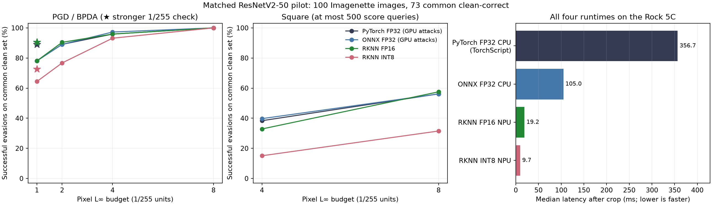

# RKNN ResNetV2-50 comparison and evasion

> **Base-model status (unified matrix).** The study now uses a single canonical
> base model: `timm/resnetv2_50.a1h_in1k`, which both NPU deployments already
> use. The TorchVision ResNet-50 results retained in this file are the
> **secondary cross-architecture replication** and must not be mixed into a
> runtime/quantization ranking with timm rows: the base-model swap alone moves
> 1/255 PGD evasion by ~16 percentage points, comparable to the entire runtime
> effect. See [BASE_MODEL_UNIFICATION.md](../BASE_MODEL_UNIFICATION.md) and
> [UNIFICATION_STATUS.md](../UNIFICATION_STATUS.md) for the primary matrix,
> provenance and remaining GPU-gated steps.

Measured on 4 November 2026 (HKT). The two deployed models are on the RADXA
Rock 5C at `192.168.1.30`, RK3588. The unquantized RKNN artifact exposes **FP16**
native input/output; the quantized artifact exposes **INT8**, dequantized to
FP32 for scoring. A NumPy FP32 output is not evidence of FP32 NPU arithmetic.
These are native interface queries and storage/build evidence; this review does
not assert the arithmetic dtype of every internal operator.

On the UINT8 RGB interface used by the supplied Lite2 test, median Python-runtime
latency is **19.19 ms for FP16** and **9.73 ms for INT8**
(1.97× faster on this board). Clean scores are 81/100 for FP32/FP16
and 78/100 for INT8. **All four recorded attack configurations were fully evaded by PGD/BPDA at 8/255.** Smaller-budget and finite-query survival
should be read alongside the derivative and query-budget limitations below.

The baseline is **timm ResNetV2-50**, not TorchVision ResNet-50 V2. All **251 ONNX
initializer tensors match the cached original PyTorch checkpoint exactly**.
The source ONNX is also byte-identical to the existing ResNetV2 source used in
the QNN source review. All models receive identical RGB crops and ImageNet
normalization; RKNN applies the baked mean/std to raw RGB values in [0,255].

| Model | Storage | Native input / output | Clean correct | FP32 top-1 agreement | Logit MAE |
| --- | ---: | --- | ---: | ---: | ---: |
| PyTorch FP32 | 97.67 MiB | FP32 / FP32 | 81/100 | 100/100 | 3.53926e-06 |
| ONNX FP32 | 97.69 MiB | FP32 / FP32 | 81/100 | 100/100 | 3.45074e-06 |
| RKNN FP16 | 50.07 MiB | FP16 / FP16 | 81/100 | 100/100 | 0.00388957 |
| RKNN INT8 | 25.49 MiB | INT8 / INT8 | 78/100 | 86/100 | 0.467821 |

INT8 changes both the predictions and clean accuracy on this pilot. FP16 retains
all FP32 top-1 predictions. This is a stratified 100-image Imagenette validation
pilot over ten classes with all 1,000 ImageNet logits, not full ImageNet accuracy.
The INT8 calibration list contains 256 ImageNet-mini training
images, with zero evaluation overlap by path or content hash.

## Performance

| Runtime / hardware | Median | p95 | Serial images/s |
| --- | ---: | ---: | ---: |
| PyTorch FP32 TorchScript / Rock 5C CPU | 356.655 ms | 520.316 ms | 2.5 |
| ONNX FP32 / Rock 5C CPU | 104.988 ms | 105.762 ms | 9.5 |
| RKNN FP16 / Rock 5C NPU | 19.190 ms | 19.524 ms | 51.6 |
| RKNN INT8 / Rock 5C NPU | 9.732 ms | 9.896 ms | 104.2 |

**Every row now runs on the same Rock 5C.** FP32 models execute on its CPU;
RKNN models execute on its NPU. The earlier desktop-GPU timing comparison has
been removed from the primary table and figure; its raw measurements remain
archived for provenance.

Batch size one, two sweeps of 100 timed calls each, 20 warmups per model per
sweep, with the second sweep reversing model order. All cases start from the
same pre-cropped UINT8 RGB array in board memory and end with 1,000 FP32 logits.
CPU conversion, layout change and ImageNet normalization are included for the
FP32 baselines; RKNN's baked preprocessing and synchronous Lite2 call are
included. Image decode, resize/crop, file I/O and network transport are excluded
for every row. There is no concurrent model workload.

The process and its CPU workers are pinned to the four Cortex-A76 cores 4–7;
PyTorch and ONNX Runtime use four intra-op and one inter-op thread. RKNN uses
default NPU core selection through the same Lite2 API as the supplied test.
PyTorch 2.2.0 executes an unquantized TorchScript export of the original
timm FP32 model, avoiding missing timm/TorchVision dependencies on the board.
The exported graph is bit-identical to eager PyTorch on the first ten local
validation images. Both board FP32 runtimes match all 100 reference predictions;
their maximum logit differences are below 1e-3. ONNX Runtime 1.26.0
is explicitly CPU-only, independently verified by its executed-provider trace.
This is a measured TorchScript CPU baseline, not an eager-Python latency claim.
PyTorch CPU timings varied between sweeps; the combined median and p95 are
reported above, and the raw per-sweep samples remain available for inspection.

[Raw same-board timings, environment and parity](results/board_cpu/same_board.json)
include all 200 samples per row, clock/temperature readings and source hashes.
The recorded adversarial results below retain their original GPU FP32 scoring
and actual RKNN scoring; this correction reruns latency and clean parity, not
the FP32 attacks on CPU.

## Cross-runtime INT8 comparison

The [INT8 runtime comparison](INT8_COMPARISON.md) reconciles nine current quantized
deployments across FBGEMM, ONNX Runtime, TensorRT, QNN and RKNN on identical
eligible images. It also provides a same-checkpoint five-deployment comparison
and includes the corrected, matched-surrogate QNN ResNetV2 rerun. Only the
superseded mismatched-surrogate run is excluded from gradient ranking.

## Evasion results

Counts below are successful untargeted evasions / initially correct images.
Higher means greater vulnerability to the attempted attack. Model-specific
denominators differ, so the paired table is the controlled comparison.

| Attack | Pixel L∞ | PyTorch FP32 | ONNX FP32 | RKNN FP16 | RKNN INT8 |
| --- | ---: | ---: | ---: | ---: | ---: |
| FGSM / BPDA-FGSM | 1/255 | 41/81 | 41/81 | 41/81 | 35/78 |
| PGD / BPDA-PGD, 20 × 2 | 1/255 | 65/81 | 65/81 | 65/81 | 52/78 |
| Above + 100 × 5 on survivors | 1/255 | 73/81 | 74/81 | 74/81 | 58/78 |
| PGD / BPDA-PGD, 20 × 2 | 2/255 | 73/81 | 73/81 | 74/81 | 61/78 |
| PGD / BPDA-PGD, 20 × 2 | 4/255 | 78/81 | 79/81 | 78/81 | 73/78 |
| PGD / BPDA-PGD, 20 × 2 | 8/255 | 81/81 | 81/81 | 81/81 | 78/78 |
| Square, 500 queries | 4/255 | 36/81 | 37/81 | 32/81 | 15/78 |
| Square, 500 queries | 8/255 | 49/81 | 49/81 | 50/81 | 28/78 |

All four models were clean-correct on the same **73 images**. Successful evasions on that common subset:

| Attack | Pixel L∞ | PyTorch FP32 | ONNX FP32 | RKNN FP16 | RKNN INT8 |
| --- | ---: | ---: | ---: | ---: | ---: |
| FGSM / BPDA-FGSM | 1/255 | 33/73 | 33/73 | 33/73 | 30/73 |
| PGD / BPDA-PGD, 20 × 2 | 1/255 | 57/73 | 57/73 | 57/73 | 47/73 |
| Above + 100 × 5 on survivors | 1/255 | 65/73 | 66/73 | 66/73 | 53/73 |
| PGD / BPDA-PGD, 20 × 2 | 2/255 | 65/73 | 65/73 | 66/73 | 56/73 |
| PGD / BPDA-PGD, 20 × 2 | 4/255 | 70/73 | 71/73 | 70/73 | 68/73 |
| PGD / BPDA-PGD, 20 × 2 | 8/255 | 73/73 | 73/73 | 73/73 | 73/73 |
| Square, 500 queries | 4/255 | 28/73 | 29/73 | 24/73 | 11/73 |
| Square, 500 queries | 8/255 | 41/73 | 41/73 | 42/73 | 23/73 |



The attack budgets are 1, 2, 4 and 8/255 in cropped [0,1] pixel space before
normalization. Attacks use the runtime's continuous FP32 raw-RGB interface;
the adversarial tensor is passed to the runtime without uint8 rounding.
FGSM takes one epsilon step. PGD uses 20 steps, epsilon/4 step
size, two random starts, projection and per-image success retention. At 1/255,
survivors receive an additional 100-step, five-start check. Square uses the
previous local implementation, independent stripe initialization, no transfer
warm start and at most 500 search queries per eligible image, at 4 and 8/255.
Clean eligibility and final verification queries are outside the search budget.
Random-noise controls and matched PyTorch FGSM/PGD transfer candidates are also
retained. `union` in the validation JSON includes every attempted candidate at
the budget. These are empirical attack outcomes, not certified robustness.

RKNN BPDA forwards use **real device logits at every step**. Backward derivatives
come from the matched FP32 source, without pretending that integer operators
support native autograd. This approximates the derivative of the deployment;
finite-budget survival does not establish robustness. ORT likewise uses actual
ORT forwards and the matching differentiable PyTorch derivative.

Runs began on the RTX 2000 Ada. At the user's request, unfinished work resumed
on the RTX Pro 4000 Blackwell at `192.168.1.32`. Completed candidates were
preserved. Per-attack execution metadata and execution segments record the
hardware and PyTorch versions; device scoring for the gradient attacks used an
SSH relay through the original host, with no private-key copying. Latency was measured
separately on the named hardware with attacks paused or complete. The board
attack scorer uses three independent contexts, one per NPU core, to process
different images in parallel. Both single-worker and three-worker outputs
matched Lite2 bit-for-bit on the integer and attacked-float transport tests.
The latency table uses a single synchronous context with default core selection.
Small evasion-count differences may also reflect numerical differences between
the recorded CUDA/PyTorch environments and finite random attack searches.
Attack elapsed times include measurement pauses and contention from concurrent
device searches; they are not used for the inference-latency comparisons.

The final INT8 8/255 Square pass ran on the board to remove repeated network
transfers. It executes the original `margin` and `square` function bodies from
`run_evasion.py`, extracted without editing, with the same seed and 500-query
budget. A ten-image, five-query check produced bit-identical perturbations,
predictions and query counts to the host-driven path; see
[the parity evidence](results/board_square/parity.json). Its metadata records
the board's PyTorch/NumPy versions. All final candidates were independently
replayed through the ordinary runtime transport during validation.

The QNN ResNetV2 architecture mismatch is resolved in the matched rerun using
`resnetv2_fp32` from its documented source. Standard BPDA-PGD evades 49/79 at
1/255 and 79/79 at 8/255; the stronger 1/255 check reaches 51/79. The older
TorchVision-surrogate run remains superseded. See
[the matched QNN analysis](../evasion/README.md#matched-comparison-documented-resnetv2-source-versus-the-deployed-graph).

## Validation and evidence

- [Native interfaces, clean logits, provenance and timing](results/review/review.json).
- [Independent Lite2/C transport parity](results/validation/transport.json):
  integer RGB and continuous attacked float RGB, ten images spanning all ten
  classes, two repeats, bit-exact outputs for both artifacts.
- [Independent candidate reconciliation](results/validation/validation.json):
  all CSV rows, saved predictions, finite values, pixel bounds, L∞ bounds,
  query budgets, clean eligibility and paired counts. Both RKNN models were
  rescored on the board in a separate process. Source, checkpoint, deployed
  artifact and runtime library hashes remained unchanged.
- `results/run/<model>/summary.json`, `per_image.csv`, `samples.json`, `clean.npz`
  and all `*.pt` candidate tensors preserve the raw experiment, including
  1,000-class logits, sample indices, labels, query counts and full float inputs.
- `logs/` contains local and resumed server progress; no historical evasion
  experiment was overwritten.

## Reproduce

From `/home/ross/QA`, use the existing `venv/bin/python`. The scorer source is
`scripts/rknn_scorer.c`, compiled against the official vendored RKNN header and
the same `librknnrt.so` used by the supplied Lite2 test. Models stay unchanged.

```bash
venv/bin/python Models/resnet50/evasion_rknn/scripts/probe.py
venv/bin/python Models/resnet50/evasion_rknn/scripts/run_suite.py --model pytorch_fp32
venv/bin/python Models/resnet50/evasion_rknn/scripts/run_suite.py --model onnx_fp32
venv/bin/python Models/resnet50/evasion_rknn/scripts/run_suite.py --model rknn_fp16
venv/bin/python Models/resnet50/evasion_rknn/scripts/run_suite.py --model rknn_int8
venv/bin/python Models/resnet50/evasion_rknn/scripts/validate_transport.py
venv/bin/python Models/resnet50/evasion_rknn/scripts/review.py
venv/bin/python Models/resnet50/evasion_rknn/scripts/benchmark_uint8.py
venv/bin/python Models/resnet50/evasion_rknn/scripts/compare_int8.py
venv/bin/python Models/resnet50/evasion_rknn/scripts/validate.py --rescore-board
venv/bin/python Models/resnet50/evasion_rknn/scripts/summarize.py
```

The runner resumes only completed, matching-configuration attack records. For a
fresh independent run, archive the existing `results/run` directory first.
Source hashes and the original sample manifest are checked.

`scripts/square_on_board.py` provides the faster score-only path. Its input is
the frozen `results/board_square/input.pt` crop tensor and labels, together with
the original `../evasion/scripts/run_evasion.py` source and the compiled scorer.
The retained `results/run/rknn_int8/external/square_eps8.pt` contains its complete
500-query result and provenance. `run_suite.py` verifies the model, source,
crop, label, seed and budget metadata before accepting that external result,
then independently scores the final tensor on the real device.

`scripts/benchmark_same_board.py` runs on the Rock 5C in `~/NPU/resnet/qa_evasion`
using `~/rknn-venv/bin/python`. Its inputs are the checked TorchScript export,
the original `resnetv2_50.onnx`, `inputs.npz` and `deployment.json` from
`results/board_cpu/`. Copy `same_board.json`, its provider trace and clean-logit
arrays back to `results/board_cpu/` before regenerating this report.
